<p align="center">
  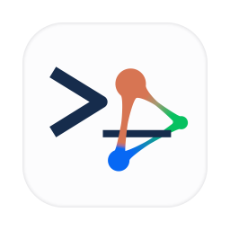
</p>

<h1 align="center">Matou (码头)</h1>

<p align="center">
  <strong>A native multi-agent desktop workbench for AI coding</strong><br>
  Built in Rust + GPUI + <code>libghostty-vt</code> for macOS and Windows. Run Claude Code, Codex, Antigravity and DSH side by side —<br>
  with a unified HUD across every agent, multi-provider &amp; account hot-swap, built-in agent dispatch, zero-MCP context optimization, fork DAG, kanban and Git worktrees.
</p>

<p align="center">
  <a href="https://github.com/icesword0760/matou/actions/workflows/ci.yml"></a>
  <a href="LICENSE"></a>
  
  
</p>

<p align="center">
  <a href="#multi-provider-routing-account-switching--live-model-hot-swap">Providers &amp; Accounts</a> ·
  <a href="#built-in-zero-config-multi-agent-dispatch">Agent Dispatch</a> ·
  <a href="#zero-mcp-context--kv-cache-optimizer">Context Optimizer</a> ·
  <a href="#multi-session-workbench--cross-card-collaboration">Workbench &amp; DAG</a> ·
  <a href="#download">Download</a> ·
  <a href="#build-from-source">Build</a> ·
  <a href="README.zh-CN.md">简体中文</a>
</p>

<br>

Matou is a native desktop workbench for AI coding on macOS and Windows with zero Node.js runtime dependency. It brings **Claude Code, Codex, Antigravity, DSH**, and regular shell sessions into a single recoverable workspace hierarchy — **Workspace → Task → Canvas → Session Card** — so you can run many agents in parallel, switch accounts and providers in place, dispatch subtasks to the right specialist agent, and always see what every session is doing, how much context it has used, and where it branched from.

> **Status**: Native release in active development. Published downloads are on [Releases](https://github.com/icesword0760/matou/releases/latest).
>
> **Video walkthrough**: [YouTube (English)](https://youtu.be/1OYvkryUNFo) · [Bilibili (Chinese, 5 min)](https://www.bilibili.com/video/BV1uBbL6eEGa)

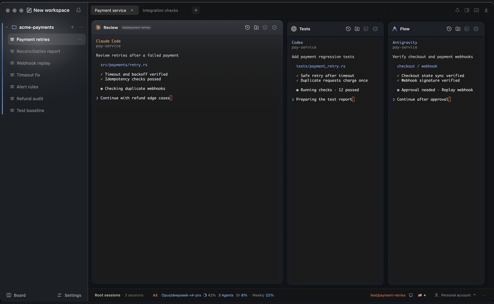

> A full native workflow in one pass: Claude Code, Codex, and Antigravity cards run side by side with distinct agent icons; a background task raises an unread badge and opens through the tiered notification center; the DAG view maps parent/child branches; and the workspace board tracks task status via drag-and-drop. All screenshots and GIFs were captured in an isolated demo environment.

---

## Pure Native Stack (Rust + GPUI + libghostty-vt)

Matou has fully moved off Electron to a single native stack:

- **GPU-accelerated UI & terminal**: Rust + GPUI for crisp native rendering paired with `libghostty-vt` for fast terminal emulation under heavy multi-card output.
- **Zero Node.js runtime**: The session host, platform PTYs, `mt` control plane, agent hooks, and built-in `mt-foreman` dispatch engine all ship inside `matou-native-runtime`.
- **macOS & Windows native**: Supports Apple Silicon / Intel macOS and x64 / ARM64 Windows, including native titlebars, CJK IME composition, OS notifications, and external file drag-and-drop.

---

## Multi-Provider Routing, Account Switching & Live Model Hot-Swap

Real daily coding rarely stays on one subscription or one model. Matou manages both account quotas and model supply in one place so you do not have to juggle shell environment variables or restart active terminals.

### 1. Multi-provider supply, per-role model assignment & live hot-swap

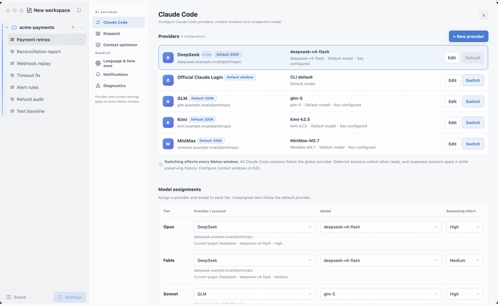

Open **Settings → Providers** to wire up all your model sources:

- **Flexible supply options**: Supports **Official Anthropic OAuth**, **DeepSeek**, **Zhipu GLM**, **Kimi**, **MiniMax**, custom compatible endpoints, and routing **subscription accounts directly into Claude Code** via the bundled model router.
- **Per-role model & effort assignment**: Assign target models and reasoning effort independently for `Opus`, `Sonnet`, `Haiku` (and `Fable`) — keep flagship reasoning on hard problems and fast models on routine work, with live model discovery before saving.
- **Live hot-swap without restarting sessions**: Update a role's model mapping and save; **the very next message uses the new model immediately without restarting running sessions**, keeping your full conversation and terminal state intact.
- **Safe global switching**: Switching providers reports exact per-session status; rejected keys or timeouts keep your form intact for immediate retry, and editing a provider without changing its endpoint preserves the stored key.

API keys stay strictly on your machine and are sent only to the configured endpoint. Built-in presets are derived from [cc-switch](https://github.com/farion1231/cc-switch) (MIT).

### 2. Switch Claude subscription accounts from the footer

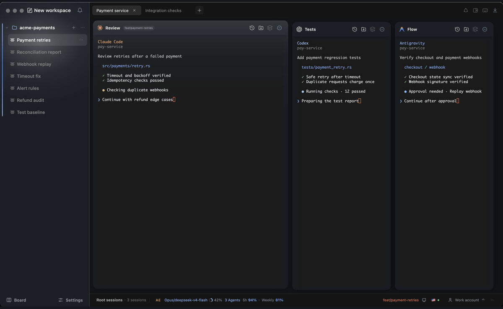

Keep work and personal subscriptions — or multiple quota pools — side by side in the bottom-right **Claude Accounts** button:

- **Clean isolated sign-in**: Adding an account uses official `claude auth login` in an isolated browser window so existing browser logins never collide.
- **Live quota visibility**: Each account shows 5-hour and weekly usage with refresh timestamps, keeping the last valid reading during transient network blips. The footer always displays the active account name.
- **Smooth switching & optional immediate restart**: Switch the default account in one click. Running sessions pick it up safely, or click **Restart now** to restart active Claude sessions and resume each conversation in place without touching plain shells.

Account storage, switching, and usage lookups are powered by [claude-swap](https://github.com/realiti4/claude-swap) (MIT) and stay compatible with the `cswap` CLI.

---

## Built-in Zero-Config Multi-Agent Dispatch

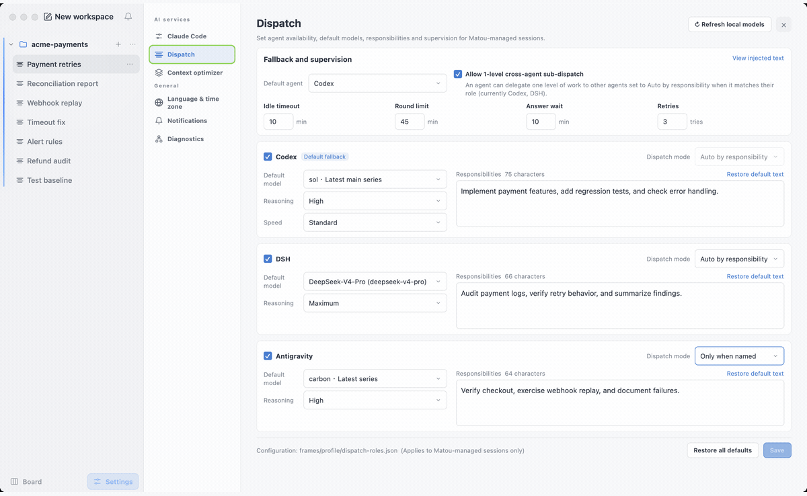

Different coding agents shine at different jobs — let Claude Code plan and verify while delegating heavy coding or refactors to Codex, UI work to DSH, or targeted tasks to Antigravity.

Matou builds native dispatch (`mt-foreman`) directly into the runtime with zero external Node scripts required:

- **Unified Settings → Dispatch panel**: Configure **Codex**, **DSH**, and **Antigravity** on a single screen — activation mode (default worker / auto by specialty / on-demand), default model, reasoning effort, specialty notes, and cross-agent delegation rules.
- **Cross-agent sub-delegation with no artificial concurrency cap**: Optionally allow an executing agent to delegate sub-tasks matching another enabled specialist's niche, and run as many parallel delegated workers as your workflow needs.
- **Full live visibility**: Every running delegated task appears as a live card in the footer **Agents** popover showing the agent, task name, model, and effort level — with interactive Q&A, resume-from-checkpoint, and completion notifications.

> Want the same supervisor workflow outside Matou in any plain terminal? See the standalone [agent-foreman](https://github.com/icesword0760/agent-foreman) skill.

---

## Zero-MCP Context & KV-Cache Optimizer

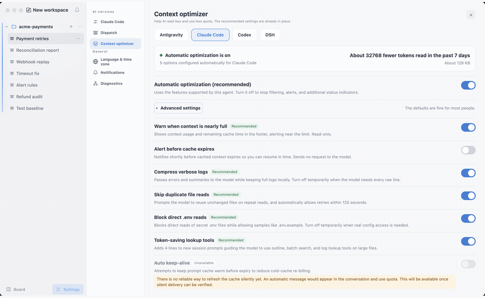

Long coding sessions lose speed and budget when huge command outputs flood the context window or KV-cache expires. Matou includes a **zero-MCP native context & cache optimizer** (no MCP servers to install; supported for **Claude Code** and **Antigravity**):

- **Oversized log compression & dedup guards**: Compresses bulky test/build output while keeping raw logs locally searchable, warns on repeated reads of unchanged files, and blocks direct `.env` secret reads (while allowing `.env.example`).
- **Context & cache-expiry alerts**: Displays live context usage and cache countdown in the footer, alerting before prompt cache expires or context fills up.
- **One-click handoff summary & fresh session**: When context crosses the threshold, jump straight into a new session with a **complete, untruncated handoff summary** or copy it in one click.
- **Live session details popover**: Inspect tool calls, hooks, MCP servers, and todos directly from the footer without scrolling back through terminal history.

---

## Multi-Session Workbench & Cross-Card Collaboration

### 1. Four-level workspace with mixed agents side by side

Organize work by **Workspace → Task → Canvas → Session Card**, mixing **Claude Code, Codex, Antigravity, DSH**, and plain shells on the same canvas:

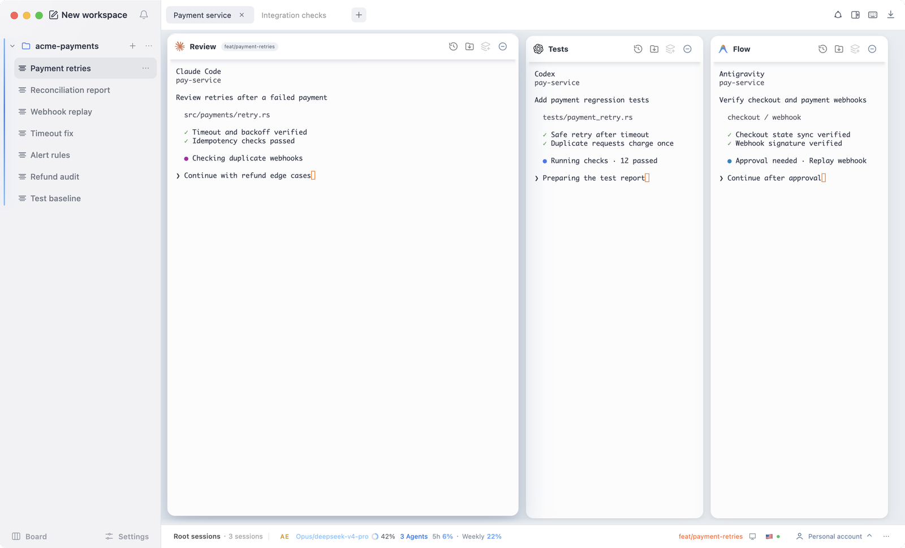

- **Instant agent recognition**: Every card header shows its agent icon; the focused card expands automatically while sibling cards stay visible on either side.
- **Flexible splits & detached windows**: Use tabs plus horizontal/vertical splits, or detach any card into its own window and re-dock it anytime — both windows share the same live runtime session.

### 2. Natural-language cross-card control (`mt`)

Skip manual tab-hopping and copy-pasting. Ask your active agent directly:

> "Check the card on the right — did the regression suite pass?"
>
> "Read the parent session's latest output and compare Option A vs Option B."
>
> "Fork three child cards from here to test performance, compatibility, and rollback separately."

Every managed session receives the built-in `mt` control plane to inspect sibling/parent/child cards, read live screen or history, send inputs, and manage workspaces, tasks, canvases, and forks.

<details>
<summary>Built-in mt control commands</summary>

Supports `mt identify`, `mt list`, `mt read`, `mt history`, `mt commands`, `mt send`, `mt key`, `mt create`, `mt fork`, `mt remove`, `mt close`, `mt focus`, `mt switch`, and `mt-foreman`. Targets accept `self`, `left`, `right`, `parent`, `child:N`, `sibling:N`, or an explicit session ID.

</details>

### 3. Fork DAG & Git Worktree isolation

Press `Option + Tab` to open the DAG view and see how every session relates:

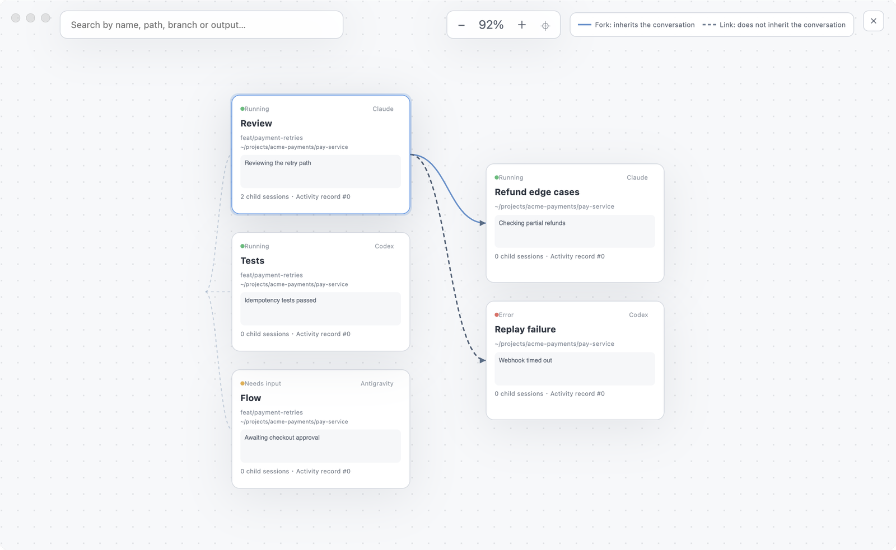

- **Two clear edge types**: Solid lines mark **Forks** (inheriting conversation context); dashed lines mark **relations** (linked in the same workflow without inheriting chat history).
- **Parallel Git Worktrees**: Fork alternative implementations into isolated Git worktrees, compare them safely, and merge or discard when done.
- **Search, zoom & jump**: Filter by title, path, branch, or recent output, then click any node to jump straight back to that card.

### 4. Unified HUD across every agent, four-tier notifications & OS-level alerts

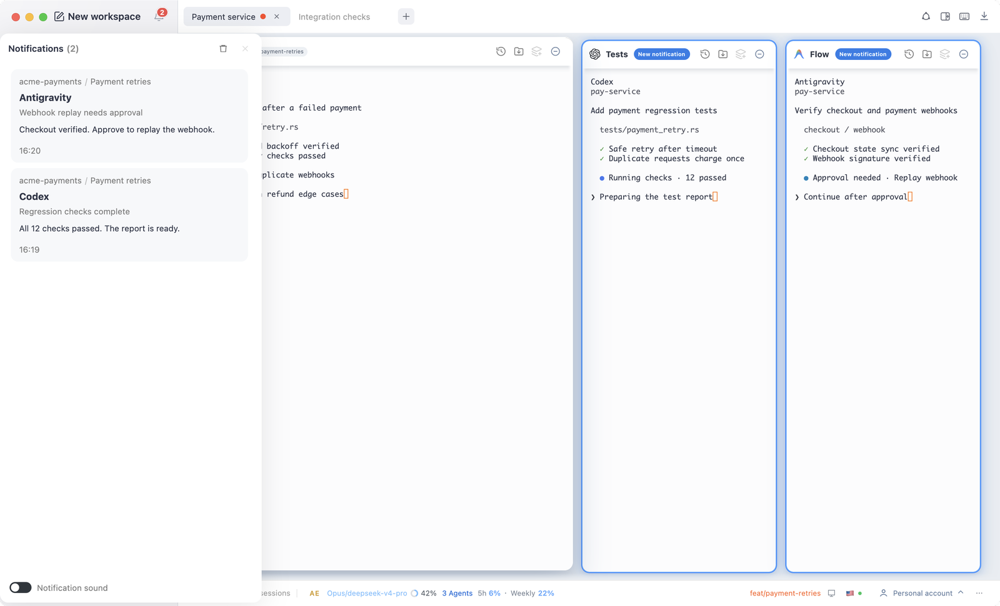

- **One consistent HUD for every agent**: Whether the focused card is **Claude Code, Codex, Antigravity, or DSH**, the footer uses the same unified layout and shows each agent's live metrics — active model (including mapped target model) and reasoning effort, one-click permission mode switching, context usage & alerts, 5h / weekly quotas (for Claude Code, Codex, and Antigravity), MCP / hooks / tools / todos / agents details, directory & Git branch actions, and quick `CLAUDE.md` / instructions editing. Switching agents never forces you to re-learn where status lives.
- **Four-tier in-app notifications**: When a background agent finishes, waits for confirmation, needs input, or hits an error, unread and status indicators bubble up across all four levels — **Session Card → Canvas Tab → Task → Workspace** — so you can trace attention from anywhere in the app while the card you are already watching stays quiet. The notification center lists summaries, source paths, and sound controls, jumping straight to the source card on click.
- **Native OS-level notifications**: Even when Matou is minimized or behind other apps, important agent events deliver native **macOS Notification Center** and **Windows Toast** alerts (configurable under **Settings → Notifications**). Clicking an OS notification brings Matou forward and focuses the exact session card that fired it.
- **Network egress status**: Live footer indicator checks network egress posture without blocking terminal responsiveness.

### 5. Workspace kanban board

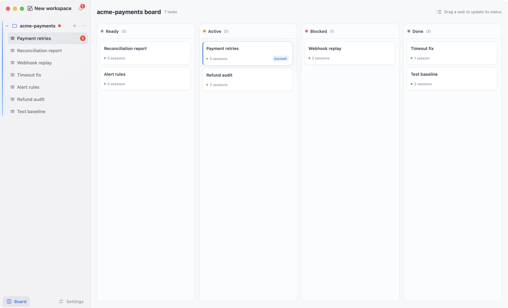

Track tasks across **Ready, Running, Blocked, and Done** with compact cards showing title and session count, updated via drag-and-drop.

### 6. Automatic session recovery, full-content search & one-click session loading

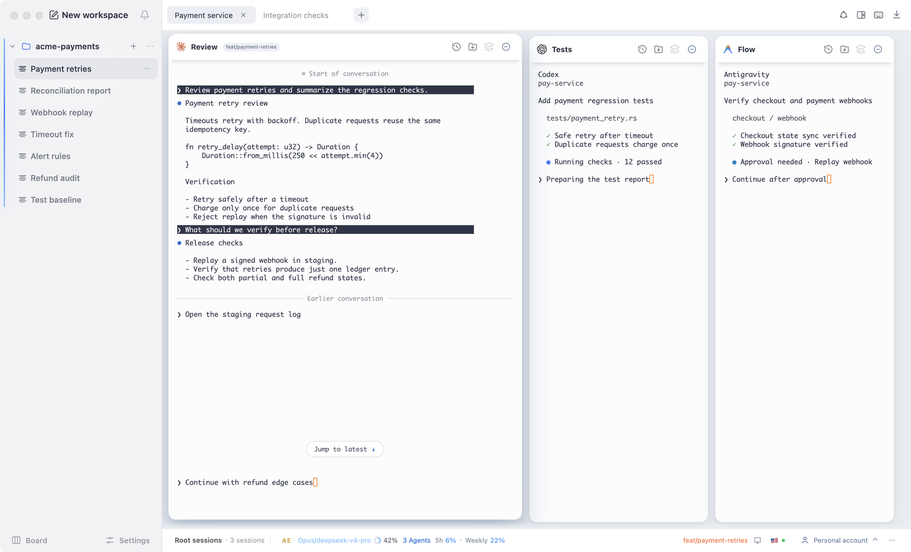

- **Automatic session recovery**: Persists workspaces, tasks, tabs, splits, working directories, Git worktrees, segmented terminal journals, and every agent's session binding. After a restart or unexpected exit, Matou automatically restores your full working state instead of making you rebuild terminals by hand.
- **Session content search**: Press `Cmd + F` (`Ctrl + F` on Windows) inside any card to search across live output and long terminal history with match navigation; search by title, path, branch, or conversation content in the DAG view and project session browser to find where any decision happened.
- **One-click session loading & seamless Markdown history**: Skip copying session IDs or typing `--resume` flags — browse existing local Claude Code, Codex, Antigravity, and DSH conversations grouped by project and load any of them straight into a card in one click. Inside a card, scroll up seamlessly into full **Markdown-rendered** conversation history above the live terminal.
- **External file drag-and-drop**: Drag files from Finder or Windows Explorer directly into a card to insert quoted paths and focus the terminal immediately.

---

## Download

1. Download the latest release for your platform from [Releases](https://github.com/icesword0760/matou/releases/latest) (macOS Apple Silicon: `Matou-<version>-mac-arm64.dmg`; published targets are listed on the Releases page).
2. On macOS, open the DMG and drag **码头** into **Applications**. If macOS blocks the first launch, allow it under **System Settings → Privacy & Security → Open Anyway**.
3. Install and sign in to whichever agent CLIs you plan to use (Claude Code, Codex, Antigravity, DSH). In-app update notifications alert you when newer builds are available.

---

## Build from source

Requires stable Rust & Cargo, Python 3.12+, Zig `0.17.0`, Git, and `curl`. macOS requires Xcode Command Line Tools; Windows requires Visual Studio C++ build tools and the Windows SDK. Tooling and packaging scripts use Node.js 22.16+ and pnpm 10.17.1 (zero npm dependencies); Python account sidecar tests and builds use `uv`.

Prepare the pinned GPUI and `libghostty-vt` libraries, fetch locked crates, and build (Apple Silicon example):

```bash
python3 apps/native/scripts/prepare-gpui.py
python3 apps/native/terminal/scripts/build-libs.py --target aarch64-apple-darwin
cargo fetch --manifest-path apps/native/Cargo.toml --locked
pnpm build:native
```

Use `--target x86_64-apple-darwin` on Intel Macs, or `python` with `x86_64-pc-windows-msvc` / `aarch64-pc-windows-msvc` on Windows. See the [native workspace guide](apps/native/README.md) for platform details.

### Common commands

| Command | Purpose |
| --- | --- |
| `pnpm test` | Run identifier checks, tooling tests, Python sidecar tests, and Rust workspace tests on macOS |
| `pnpm test:native` | Run Rust workspace tests on macOS or Windows (build debug runtime first) |
| `pnpm accounts:build` | Build the local Claude accounts sidecar |
| `pnpm router:build` | Build the patched Go model router sidecar |
| `pnpm package:mac` | Package signed macOS DMG and ZIP releases |
| `pnpm package:win --model-router <dir>` | Build Windows x64 / ARM64 installer or portable ZIP |
| `pnpm install:mac --source <abs-path.app>` | Safely update `/Applications/码头.app` after quitting Matou |

See the [release guide](docs/release/cloud-updates.md) for signing and update feed configuration.

---

## Project layout & privacy

```text
apps/native/
├── desktop/               GPUI native desktop UI and terminal rendering
├── runtime/               Session host, platform PTYs, multi-agent hooks, context optimizer & mt / mt-foreman
├── core/                  Domain model, SQLite metadata and segmented journal
├── terminal/              libghostty-vt Rust bindings and patches
└── packaging/             Icons, signing entitlements and Finder quick action

tooling/claude-accounts/   Python Claude accounts sidecar
tooling/model-router/      Go model router build & verification scripts
tooling/packaging/         Native macOS & Windows packagers
docs/                      Product specs, architecture and release guides
```

- **Local-first data**: Workspace metadata lives in local SQLite, terminal output in segmented journals, and account credentials / provider API keys remain strictly on disk. Matou only makes explicit utility requests (update checks, account usage refreshes, manual model discovery, and egress checks); conversation traffic always flows from your agent CLIs directly to your chosen providers.
- **Archive**: The legacy Electron codebase is preserved at Git tag `archive/electron-0.2-final`.

---

## FAQ

**Which platforms are supported?**
Source builds target macOS (Apple Silicon & Intel) and Windows (x64 & ARM64). Check [Releases](https://github.com/icesword0760/matou/releases/latest) for currently published prebuilt installers.

**How is Matou different from other AI terminal managers?**
Instead of just wrapping tabs or worktrees in a sidebar, Matou combines **multi-agent side-by-side sessions, multi-provider & multi-account live hot-swap, built-in zero-config dispatch, a zero-MCP context & KV-cache optimizer, three synchronized views (cards / DAG / kanban), and `mt` cross-card control** in a single native app.

**Does it support both English and Chinese?**
Yes. The UI follows your OS language automatically and supports manual switching in settings / menu. See [#4](https://github.com/icesword0760/matou/issues/4).

---

## Feedback

- Open an [issue](https://github.com/icesword0760/matou/issues) for bugs or feature ideas.
- For recovery, fork, notification, or multi-window reports, include reproduction steps, OS version, and shareable demo data.
- Chinese-speaking users can also join QQ group **454249629** (QR code in the [Chinese README](README.zh-CN.md#反馈与交流)).

## License

Released under the [GNU General Public License v3.0](LICENSE). You are free to use, modify, and redistribute it; derivative works must be released under the same license.

---

If Matou saves you time juggling multiple AI coding agents, a ⭐ is appreciated.
