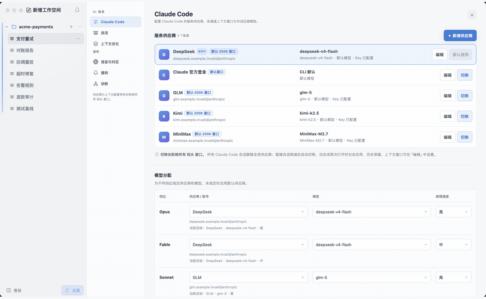
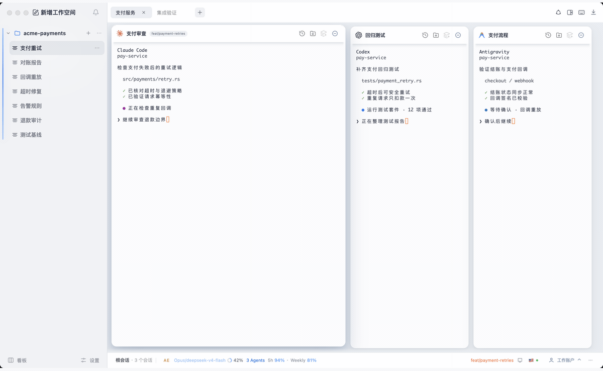
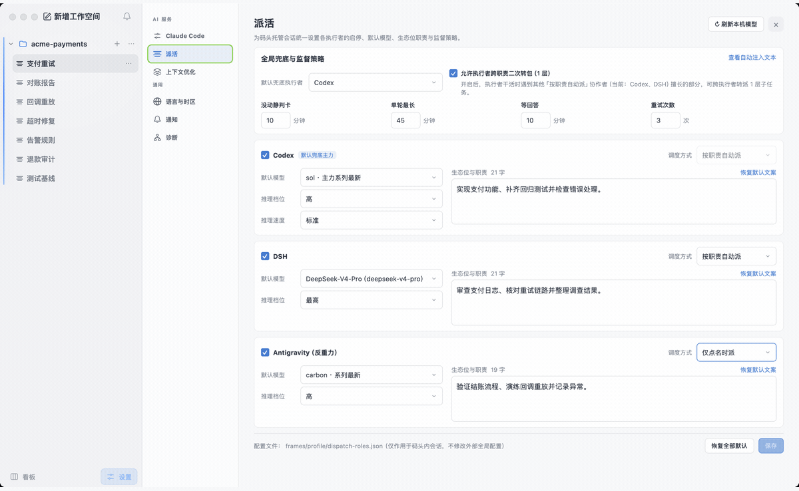
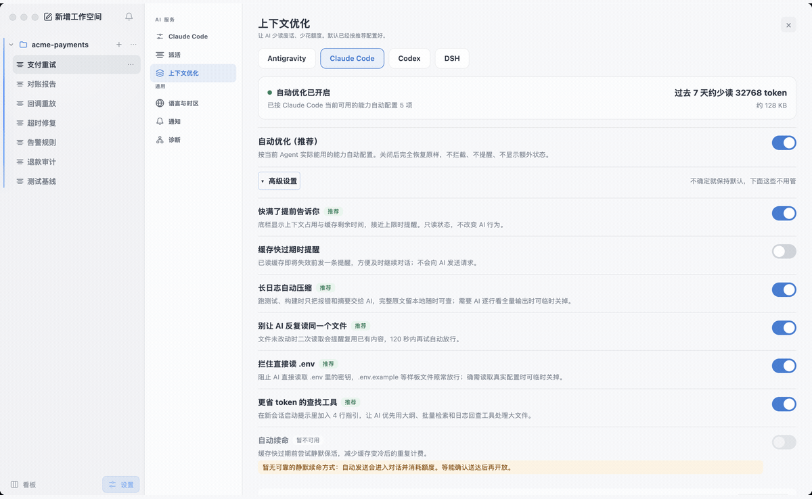
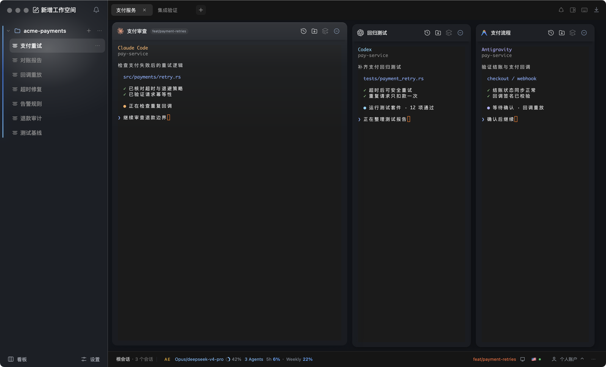
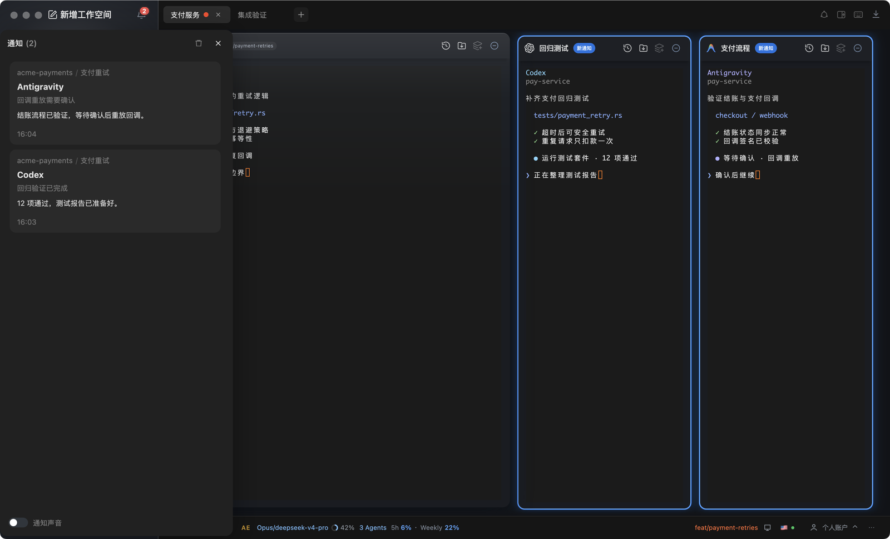
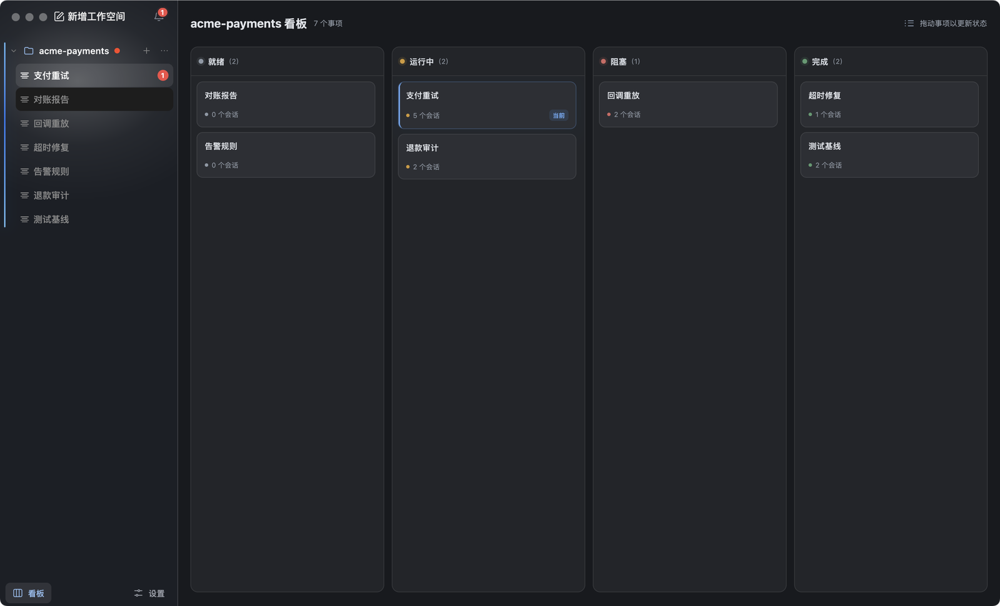
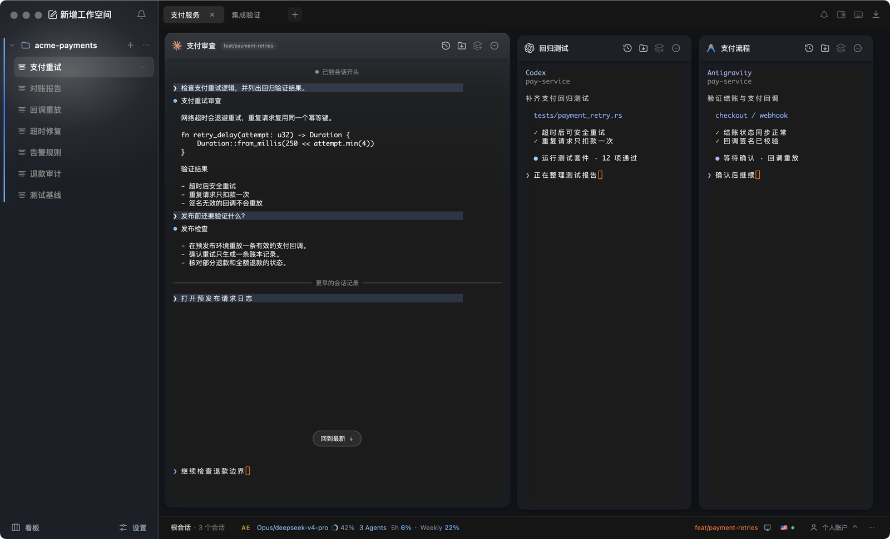

<p align="center">
  
</p>

<h1 align="center">码头 Matou</h1>

<p align="center">
  <strong>面向 AI 编程的多 Agent 原生桌面工作台</strong><br>
  用 Rust + GPUI + <code>libghostty-vt</code> 原生打造，在同一工作台并行管理 Claude Code、Codex、Antigravity 与 DSH：<br>
  全 Agent 统一 HUD、多供应商与多账号热切换、内置多 Agent 派活、零 MCP 上下文优化、DAG、看板与 Git Worktree。
</p>

<p align="center">
  <a href="https://github.com/icesword0760/matou/actions/workflows/ci.yml"></a>
  <a href="LICENSE"></a>
  
  
</p>

<p align="center">
  <a href="#多供应商供应多账号切换与模型热切换">多供应商与账户</a> ·
  <a href="#内置零配置多-agent-派活">内置派活</a> ·
  <a href="#零-mcp-上下文与-kv-cache-优化">上下文优化</a> ·
  <a href="#多会话工作台与跨卡片协作">工作台与 DAG</a> ·
  <a href="#下载安装">下载安装</a> ·
  <a href="#从源码构建">从源码构建</a> ·
  <a href="README.md">English</a>
</p>

<br>

码头（Matou）是一款纯原生的 AI 编程桌面工作台（支持 macOS 与 Windows，零 Node.js 运行时依赖）。它把 **Claude Code、Codex、Antigravity、DSH** 以及普通终端会话，统一收进「工作空间 → 事项 → 画布 → 会话卡片」的可恢复工作现场：你可以同时推进多个 Agent，在底栏一键切换账号与供应商，让主会话把活派给最合适的协作者，又随时看清每个会话在做什么、花了多少上下文、从哪里分出来。

> **项目状态**：原生版持续迭代中，公开安装包见 [Releases](https://github.com/icesword0760/matou/releases/latest)。
>
> **演示视频**：[B 站 5 分钟演示](https://www.bilibili.com/video/BV1uBbL6eEGa) · [YouTube 英文版](https://youtu.be/1OYvkryUNFo)


> 上图演示原生工作台的一段完整工作流：Claude Code、Codex、Antigravity 三张卡片并行推进（左上角带各自 Agent 标识），后台任务亮起未读角标后经分级通知中心一键直达现场，再切到 DAG 会话图看清分支关系，最后在工作空间看板拖动事项状态。文中截图与动图均在隔离演示环境录制。

---

## 为什么是纯原生（Rust + GPUI + libghostty-vt）

码头已全面从旧版 Electron 架构迁移至纯原生桌面栈：

- **GPU 加速原生渲染**：基于 Rust + GPUI 构建界面，结合 `libghostty-vt` 处理终端状态，多张高吞吐终端卡片同时刷屏依然流畅跟手。
- **开箱即用，零 Node.js 依赖**：终端运行时、`mt` 跨会话控制面、Agent Hook 与内置派活全部编译进原生 `matou-native-runtime`，新机器装好即可使用。
- **跨平台体验一致**：面向 macOS（Apple Silicon / Intel）与 Windows（x64 / ARM64）原生构建，分别适配原生标题栏、输入法（含搜狗拼音等中文 IME）、系统通知与文件拖放。

---

## 多供应商供应、多账号切换与模型热切换

实际日常开发中，很少只靠一个账号、一家厂商或一个固定模型跑到底。码头把「账号额度」和「模型供应」统一收进应用内置的路由与配置体系，不再反复手动改环境变量或重开终端。

### 1. 多供应商统一托管 & 按档位自由混搭 & 热切换



打开 **设置 → 服务供应商**，把手上可用的模型资源一次性配好：

- **丰富的供应方式**：支持 **Anthropic 官方 OAuth 登录**、**DeepSeek**、**智谱 GLM**、**Kimi**、**MiniMax**、自定义兼容 API 端点，以及通过内置路由将**订阅账号直接供应给 Claude Code** 使用。
- **按角色档位精细分配**：为 `Opus`、`Sonnet`、`Haiku`（以及 `Fable`）各自指定目标模型和推理等级，重活走旗舰模型、检索和辅助任务走轻量或高性价比模型；支持「获取模型」实时拉取可用模型列表。
- **模型分配热切换，即时生效**：在当前供应商下修改角色模型映射并保存后，**下一条消息直接切到新模型，不需要重启正在运行的会话**，上下文和现场完全保留。
- **全局切换与精确状态反馈**：切换供应商时会清晰反馈各会话的切换状态；密钥校验失败或请求超时时保留已填表单方便重试，编辑时不改地址无需重填密钥。

API Key 仅保存在本机配置中，只发往你配置的目标服务。部分供应商预设参考自 [cc-switch](https://github.com/farion1231/cc-switch)（MIT）。

### 2. 多 Claude 订阅账户底栏一键切换



工作号与个人号并行，或者一个订阅的 5 小时 / 每周额度见底时，直接点底栏最右侧的 **Claude 账户**：

- **干净登录不串号**：添加账户走官方 `claude auth login` 流程，默认在独立浏览器环境完成授权，不和已有登录态互相覆盖。
- **实时用量面板**：每个账户展示 5 小时与每周用量及刷新时间；网络波动时保留上次有效数值，不会误归零。底栏右侧常驻当前账户名，正在消耗谁的额度一目了然。
- **平滑切换与立即重启**：一键切换默认账户；正在跑任务的会话可等待安全时机切过去，也可以点「立即重启」让所有运行中的 Claude 会话重启并自动接回原对话，普通 Shell 不受影响。

账户凭据保存与切换能力由 [claude-swap](https://github.com/realiti4/claude-swap)（MIT）驱动，与本机 `cswap` 命令共享同一份存储。

---

## 内置零配置多 Agent 派活



不同 Agent 各有所长——比如用 Claude Code 做总控规划和验收，把编码、调研或大批量改动派给 Codex，前端界面和视觉落地派给 DSH，或者点名让 Antigravity 接手复杂任务。

码头直接把派活能力原生内置进运行时（`mt-foreman`），无需额外安装外部脚本或 Node.js：

- **单面板统一配置（设置 → 派活）**：在一页里为 **Codex**、**DSH**、**Antigravity** 分别设定启用方式（默认主力 / 按职责自动派 / 仅点名时派）、默认模型、推理档位与职责描述，修改后即时对新任务生效。
- **支持跨执行者二次转包**：可选开启「允许执行者按职责跨协作者转派子任务」（例如主控派给 Codex 后，Codex 遇到前端 UI 部分自动转派给 DSH），且不设人为的并发子任务数量上限。
- **全流程可观测、可交互**：派出的每个子任务都会作为独立卡片出现在底栏 **Agents** 浮层中，写明执行者、任务名、模型与推理档位；支持实时日志、阻塞提问/回答、断点续跑与任务完成通知。

> 如果你也想在码头之外的普通终端里使用同类派活工作流，可以了解独立的开源技能 [agent-foreman](https://github.com/icesword0760/agent-foreman)。

---

## 零 MCP 上下文与 KV-Cache 优化



长会话跑久了，大段命令输出会迅速吃光上下文窗口，缓存失效还会拉高延迟和 token 消耗。码头在原生运行时中内置了**零 MCP 的上下文与缓存优化引擎**（无需安装配置任何 MCP Server，当前支持 **Claude Code** 与 **Antigravity**）：

- **长日志自动压缩与防重复读**：自动压缩冗长的测试/构建输出（完整原文留存本地随时回查），拦住未改动文件的重复读取，并阻止 AI 直接读取 `.env` 密钥文件（`.env.example` 照常放行）。
- **缓存与上下文预警**：在底栏显示上下文占用与缓存剩余时间，缓存快过期或上下文逼近上限时提前提醒。
- **一键带摘要开新会话 / 复制摘要**：上下文快满时在卡片顶栏和底栏一键弹出「带摘要开新会话」与「复制摘要」，生成完整不截断的交接摘要，直接带进新会话无缝接力。
- **底栏明细浮层**：随时展开查看当前会话的工具调用、Hooks、MCP 与待办进度，不必翻找终端历史。

---

## 多会话工作台与跨卡片协作

### 1. 四级结构与多 Agent 同台并行

码头用 **工作空间 Workspace → 事项 Task → 画布 Canvas → 会话卡片 Session** 组织所有 AI 编程现场，同一画布内可自由混排 **Claude Code、Codex、Antigravity、DSH** 与普通 Shell：



- **一眼识别 Agent**：每张卡片标题左侧带专属 Agent 标识，焦点卡片自动展开，其余卡片收窄排在两侧方便扫视全局。
- **灵活布局**：画布支持多页签、水平/垂直分屏；任意会话卡片可脱出为独立窗口并随时归还原画布，主窗与独立窗共享同一底层运行时会话。

### 2. 用自然语言跨卡片读屏、发指令和编排结构

当结论或报错在另一张卡片里时，不必来回切窗复制粘贴，直接对当前 Agent 说：

> “看看右边那张卡片的测试跑到哪了，给我结论。”
>
> “读取父会话最近的输出，对比方案 A 和方案 B 的风险。”
>
> “根据这三个方案创建三个子卡片，分别验证性能、兼容性和回滚路径。”

码头为所有托管会话内置了 `mt` 控制面，Agent 可以直接识别自身位置、列出关联卡片、读取实时屏幕或历史输出、发送输入，甚至创建/Fork/聚焦/切换工作空间与卡片。

<details>
<summary>内置 mt 控制命令一览</summary>

支持 `mt identify`、`mt list`、`mt read`、`mt history`、`mt commands`、`mt send`、`mt key`、`mt create`、`mt fork`、`mt remove`、`mt close`、`mt focus`、`mt switch` 以及 `mt-foreman`。目标支持 `self`、`left`、`right`、`parent`、`child:N`、`sibling:N` 或指定会话 ID。

</details>

### 3. DAG 会话关系图 + Fork & Git Worktree

按 `Option + Tab`（Windows 下对应快捷键）呼出独立 DAG 会话图，把“谁从谁分出来、每条路线跑到哪了”摊平在一张图里：


- **区分关系类型**：实线表示 **Fork**（继承父会话对话上下文）；虚线表示普通关联（建立任务关系但不继承对话）。
- **搭配 Git Worktree 并行试错**：从稳定会话 Fork 出方案 A、方案 B 并绑定各自 Worktree，代码目录与 Git 分支完全隔离，验证后再合并或清理。
- **搜索、缩放与一键回现场**：按标题、目录、分支或输出搜索，点击任意节点即刻聚焦对应会话卡片；已停止节点仍保留在图中方便追溯决策链。

### 4. 全 Agent 统一底栏 HUD、四层通知与系统级通知



- **所有 Agent 共用同一套统一 HUD**：无论当前聚焦的是 **Claude Code、Codex、Antigravity 还是 DSH**，底栏 HUD 都用统一的布局和交互把关键信息收在同一行，并按各 Agent 实际能力展示对应指标——当前模型（含映射后的真实模型标识）与推理档位、权限模式一键切换、上下文窗口占用与告警、5h / Weekly 账户用量（Claude Code / Codex / Antigravity）、MCP / Hooks / 工具 / 待办 / Agents 明细、工作目录与 Git 分支操作，以及 `CLAUDE.md` / 指令文件快速编辑入口。切到哪个 Agent 都不用重新适应界面。
- **四层逐级通知，只在需要你时打断**：后台 Agent 完成任务、等待确认、请求帮助或报错时，未读与状态信号沿 **会话卡片 → 画布页签 → 事项 → 工作空间** 四层逐级上浮，无论你正停在哪个项目都能顺着角标一眼找到源头；当前正盯着的卡片保持安静，不乱刷打扰。通知中心汇总事件摘要、来源路径与声音开关，点一下即刻跳回对应卡片。
- **系统级原生通知**：切去浏览器、编辑器或把码头最小化在后台时，重要事件同步推送到 **macOS 通知中心 / Windows 原生 Toast 通知**；在「设置 → 通知」可随时开关，点击系统弹窗直接把窗口拉到前台并精准落到产生通知的那张会话卡片。
- **网络出口检测**：底栏实时展示当前网络出口状态与地区判断，异常时第一时间提醒。

### 5. 工作空间任务看板



把当前工作空间下的事项按 **就绪、运行中、阻塞、完成** 四列呈现，卡片精简展示标题与会话数量，拖拽即可流转状态。

### 6. 会话自动恢复、内容搜索与一键直接载入历史会话



- **会话自动恢复**：持久化保存工作空间、事项、页签、分屏、工作目录、Git Worktree、分段终端日志与每个 Agent 的会话身份。无论是主动重启、关闭重开还是异常退出，再次打开后自动恢复整个工作现场，不必手动逐个找回会话。
- **会话内容搜索**：在终端卡片内按 `Cmd + F`（Windows 为 `Ctrl + F`）即可对当前会话的实时输出与长历史做关键词搜索和高亮跳转；在 DAG 会话图与历史会话列表中同样支持按标题、目录、分支或对话内容检索，几秒钟定位具体结论出自哪张卡片。
- **一键直接载入历史会话**：不必手动查会话 ID 或敲 `--resume` 命令——按项目目录浏览本机既有的 Claude Code / Codex / Antigravity / DSH 历史对话，点一下即可直接载入进卡片接着聊；卡片内还支持直接上滑查看完整 **Markdown 渲染** 的历史对话，与实时终端无缝衔接。
- **外部文件拖放**：从 Finder 或 Windows 资源管理器直接把文件拖进卡片，自动插入转义路径并聚焦终端，顺手即可把文件喂给 Agent。

---

## 下载安装

1. 前往 [Releases](https://github.com/icesword0760/matou/releases/latest) 下载对应平台的最新安装包（macOS 为 `Matou-<版本>-mac-arm64.dmg`；公开包范围以 Releases 页面为准）。
2. macOS 打开 DMG 将「码头」拖入「应用程序」；如首次启动被系统安全提示拦截，可在「系统设置 → 隐私与安全性」中点击「仍要打开」。
3. 按需提前在本机安装并登录你要使用的 Agent CLI（如 Claude Code、Codex、Antigravity、DSH）。后续有新版本时应用内会提示更新。

---

## 从源码构建

需要稳定版 Rust 与 Cargo、Python 3.12+、Zig `0.17.0`、Git 与 `curl`；macOS 需安装 Xcode Command Line Tools，Windows 需安装 Visual Studio C++ 构建工具与 Windows SDK。打包和校验脚本使用 Node.js 22.16+ 与 pnpm 10.17.1（零 npm 依赖），测试或构建 Python 账户组件需要 `uv`。

先准备固定版本的 GPUI 与 `libghostty-vt`，再拉取锁定依赖并编译（以下以 Apple Silicon 为例）：

```bash
python3 apps/native/scripts/prepare-gpui.py
python3 apps/native/terminal/scripts/build-libs.py --target aarch64-apple-darwin
cargo fetch --manifest-path apps/native/Cargo.toml --locked
pnpm build:native
```

Intel Mac 使用 `--target x86_64-apple-darwin`；Windows 使用 `python`，按工具链选择 `x86_64-pc-windows-msvc` 或 `aarch64-pc-windows-msvc`。更多平台构建与本地运行细节见 [原生工作区说明](apps/native/README.md)。

### 常用命令

| 命令 | 用途 |
| --- | --- |
| `pnpm test` | 在 macOS 上运行命名门禁、工具单测、Python 账户单测与 Rust 全量测试 |
| `pnpm test:native` | 在 macOS 或 Windows 上运行 Rust 工作区测试（先编调试版 runtime） |
| `pnpm accounts:build` | 构建本地 Claude 账户管理 sidecar |
| `pnpm router:build` | 构建本地补丁版模型路由 sidecar |
| `pnpm package:mac` | 打包带签名的 macOS DMG 与 ZIP |
| `pnpm package:win --model-router <目录>` | 构建 Windows x64 / ARM64 安装包或便携 ZIP |
| `pnpm install:mac --source <绝对路径.app>` | 退出码头后，用签名 `.app` 安全更新本机 `/Applications/码头.app` |

发版签名与更新源配置详见 [发版手册](docs/release/cloud-updates.md)。

---

## 项目结构与架构

```text
apps/native/
├── desktop/               GPUI 原生界面与终端渲染
├── runtime/               会话宿主、跨平台 PTY、多 Agent 集成、上下文优化与 mt / mt-foreman
├── core/                  领域模型、SQLite 元数据与分段日志
├── terminal/              libghostty-vt Rust 绑定与构建补丁
└── packaging/             双端图标、签名权限与 Finder 快捷操作

tooling/claude-accounts/   Python Claude 账户 sidecar
tooling/model-router/      Go 模型路由构建与校验脚本
tooling/packaging/         macOS 与 Windows 原生打包器
docs/                      产品规格、架构与发版指南
```

- **数据留存本地**：工作区元数据存在本机 SQLite，终端输出存在分段日志，账户凭据和供应商 API Key 仅保存在本机。码头自身只发必要请求（更新检查、账户用量刷新、手动点「获取模型」以及出口检测），对话流量始终由对应 Agent CLI 直接发往你指定的服务商。
- **历史归档**：旧版 Electron 源码完整保存在 Git 标签 `archive/electron-0.2-final`。

---

## 常见问题

**支持哪些平台？**
源码支持 macOS（Apple Silicon / Intel）与 Windows（x64 / ARM64）。公开预编译安装包以 [Releases](https://github.com/icesword0760/matou/releases/latest) 页面为准。

**和其他 AI 终端 / 会话管理工具有什么区别？**
多数工具只是给终端加个侧边栏或 Worktree 列表。码头把**多 Agent 同台 + 多供应商/多账号热切换 + 内置派活 + 零 MCP 上下文缓存优化 + 卡片/DAG/看板三视图 + `mt` 跨会话操控**整合在一个纯原生应用里，让多个智能体真正按任务结构协作。

**支持中文和英文界面吗？**
支持。默认跟随系统语言自动切换中文或英文，也可以在菜单 / 设置中手动指定。详见 [#4](https://github.com/icesword0760/matou/issues/4)。

---

## 反馈与交流

- 遇到问题或有功能建议，欢迎提 [Issue](https://github.com/icesword0760/matou/issues)。
- 反馈恢复、分支、通知或多窗口问题时，请附上复现步骤、系统版本和可公开的演示数据。
- 中文用户也可以加入 QQ 体验反馈群 **454249629**，或扫码加入：


## 开源协议

基于 [GNU General Public License v3.0](LICENSE) 开源。你可以自由使用、修改和分发；衍生作品需以相同协议开源。

---

如果码头帮你在同时驾驭多个 AI 编程智能体时省下了一点精力，欢迎点个 ⭐。
