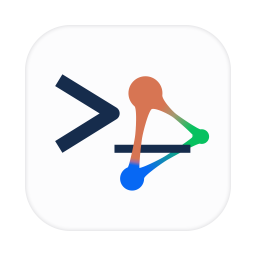
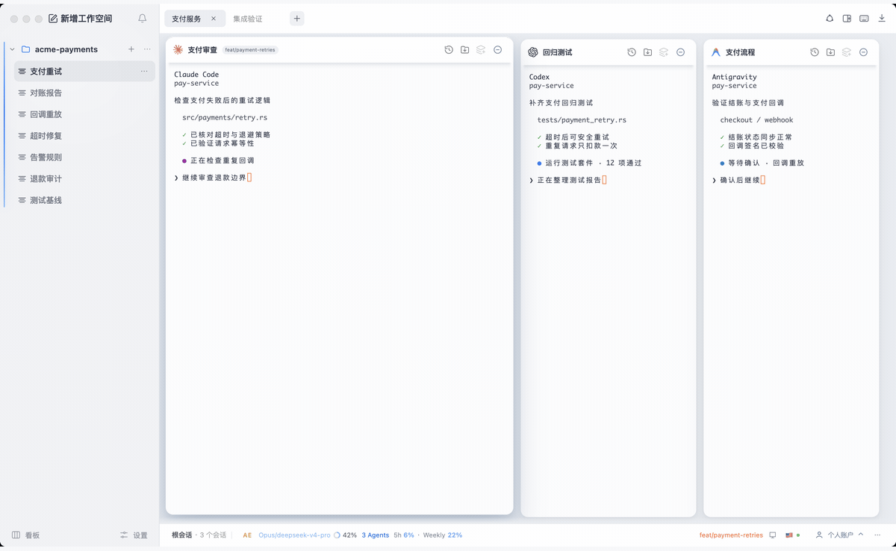
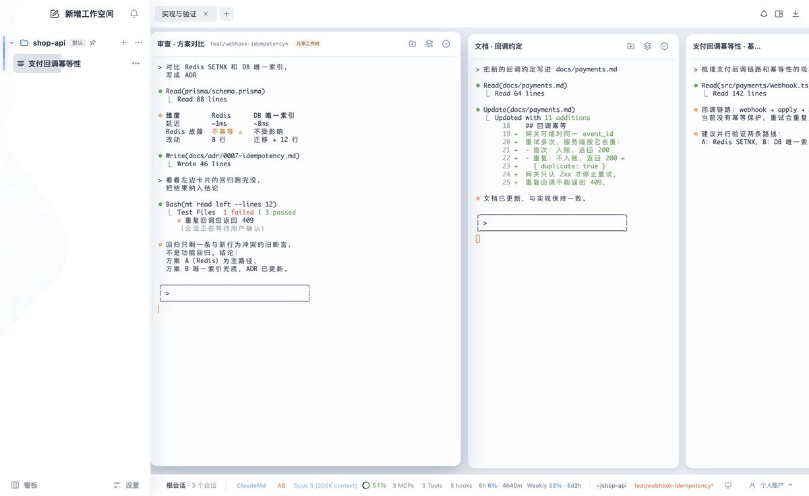
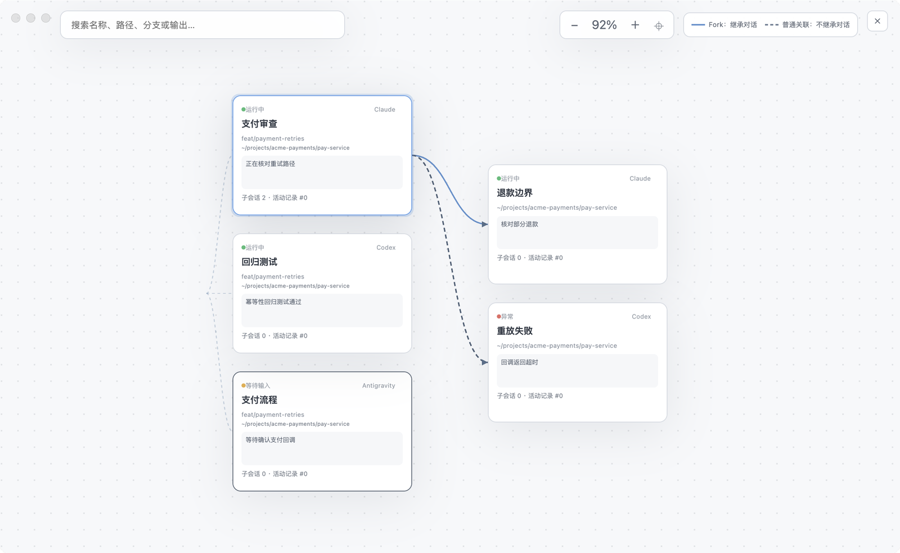

<p align="center">
  
</p>

<h1 align="center">码头 Matou</h1>

<p align="center">
  <strong>Claude Code 多智能体桌面工作台</strong><br>
  并行管理多个 Claude Code 会话，支持跨会话协作、DAG、分级通知、Agent HUD、Git Worktree，以及账户和模型供应商切换。
</p>

<p align="center">
  <a href="https://github.com/icesword0760/matou/actions/workflows/ci.yml"></a>
  <a href="LICENSE"></a>
  
  
</p>

<p align="center">
  <a href="#新功能在底栏切换-claude-账户不用退出登录">本次更新</a> ·
  <a href="#下载安装">下载安装</a> ·
  <a href="#从混乱的终端到可管理的-ai-工作流">核心场景</a> ·
  <a href="#用-dag-看懂会话从哪里来下一步去哪里">DAG 使用方法</a> ·
  <a href="#架构与质量">架构文档</a> ·
  <a href="README.md">English</a>
</p>

<br>

码头（Matou）是一款面向 AI 编程的桌面工作台：把 Claude Code 会话、任务、分支和上下文放进同一个可恢复的工作现场。你可以同时推进多个编码智能体，又随时知道每个会话在做什么、需要什么、从哪里分出来。

> **项目状态**：早期预览版。已公开的 macOS 安装包见 [Releases](https://github.com/icesword0760/matou/releases/latest)。
>
> **演示视频**：[B 站 5 分钟演示](https://www.bilibili.com/video/BV1uBbL6eEGa) · [YouTube 英文版](https://youtu.be/1OYvkryUNFo)
>
> **0.2.11 新功能**：在底栏直接切换 Claude 账户，不用退出登录；DeepSeek、GLM、Kimi、MiniMax 点几下就能接进来。[看看怎么用](#新功能在底栏切换-claude-账户不用退出登录)。



> 上图的一段工作流：你在「实现」卡片里写代码，后台的回归跑完了、需要你拍板，卡片角标当场亮起；打开通知中心点进去，画布滑到回归卡片；切到「方案探索」呼出 DAG，一眼看到方案 A 在跑、方案 B 卡住、回归失败；点方案 B 节点直接落到那张卡片；最后呼出看板把事项拖到「阻塞」。本文截图均来自隔离演示环境，项目、终端输出和通知都是为演示构造的。

---

## 新功能：在底栏切换 Claude 账户，不用退出登录


> 工作账户的 5 小时额度已经用了 94%。打开 Claude 账户切到个人账户，底部 HUD 立刻换成新账户的用量；点「立即重启」，三个正在运行的 Claude 会话重启后各自接回原来的对话。录屏中的账户和用量都是演示数据。

工作号和个人号，或者第一个订阅的周额度用完了想换第二个。打开底栏最右侧的 **Claude 账户**，几个账户都放在码头里管：

- 添加账户走官方的 `claude auth login`，在一个全新的 Chrome、Edge 或 Brave 隐私窗口里登录，不会沿用浏览器里已经登着的账号。登录页给出授权码、没有自动跳回时，把授权码粘回码头即可。
- 每个账户显示 5 小时和每周用量，以及这组数字的获取时间。面板开着时每隔几分钟在后台刷新一次；网络出错时保留上一次的数值，不会显示成 0%。
- 点「切换」，把这个账户设为本机 Claude Code 的默认登录。码头里还有任务在跑时，会等任务结束再切。本机其他终端里的 Claude Code 也会跟着用新账户，第一次切换时码头会说明这一点。
- 运行中的会话一般在 30 秒左右用上新账户。想立刻生效就点「立即重启」：确认一次后，码头里所有运行中的 Claude 会话会重启并接回各自的对话。进行中的任务会被打断，普通 Shell 不受影响。
- 登录过期时，在该账户的卡片上重新登录。账户名称保留；新登录要由你点一下才会应用，期间不会重启任何会话。

底部 HUD 的 5h / Weekly 用量始终属于当前默认账户，账户名就显示在底栏右端的账户按钮上，用的是谁的额度不会搞混。

账户的保存、切换和用量读取由 [claude-swap](https://github.com/realiti4/claude-swap)（MIT）完成。码头里保存的账户，和它的 `cswap` 命令行看到的是同一份。

### 另一个新功能：接入服务供应商，不用改环境变量



> 选 DeepSeek，粘贴密钥，地址、默认模型和 opus / sonnet / haiku 映射都已经填好。点「添加并使用」后，正在运行的 Claude Code 会话切到新供应商，HUD 显示新模型。录屏里的密钥是占位符。

打开 **设置 → 服务供应商 → 新增供应商**，先选服务再填表：官方 Claude 登录、DeepSeek、智谱 GLM、Kimi、MiniMax，或者自定义地址。

- 预设会填好 API 地址、默认模型，以及 opus / sonnet / haiku 三个档位的模型映射，通常只需要粘贴密钥。「获取密钥」会打开对应厂商的控制台。
- 「获取模型」在保存之前就能查出这个密钥可用的模型，可以搜索，也可以手填模型名。
- 「仅保存」只加入列表，「添加并使用」同时设为默认；已保存的供应商点「切换」即可。
- 切换是全局的。运行中的 Claude Code 会话会重启到新供应商，并接着原来的对话继续；还在启动或恢复中的会话保留原配置，并单独列出原因，不会被一句「已切换」带过。
- 密钥被拒或请求超时，填好的内容都还在，可以直接重试。编辑时只要不改地址，原密钥不用重填。

API Key 只保存在本机，只发给你配置的服务。预设的地址和模型取自 [cc-switch](https://github.com/farion1231/cc-switch)（MIT）。

---

## 你需要管理的不是终端，而是正在推进的工作

同时开两个 AI 编程会话很轻松，开到十个以后，真正消耗注意力的通常不是代码：

- 这个窗口属于哪个项目、哪个需求、哪个分支？
- 哪个 Claude Code 已完成，哪个在等确认，哪个已经出错？
- 另一个会话刚得出的结论，是否又要复制粘贴一遍？
- 想验证第二种方案，如何保留原会话上下文，又不污染正在工作的目录？
- App 重启后，页签、分屏、目录、输出和 Agent 身份还能否回到原位？
- 一个账户的周额度用完了，或者想让日常杂活换个便宜的模型，难道要退出登录、改环境变量、再把终端挨个重开？

码头把这些问题收进一个工作模型：**工作空间 → 事项 → 画布 → 会话卡片**。你看到的是目标、关系、状态和下一步，而不是一排难以辨认的终端窗口。

## 从混乱的终端到可管理的 AI 工作流

### 1. 用四级结构管理项目、任务和 Agent

| 层级 | 适合放什么 | 你会在什么时候用到 |
|---|---|---|
| **工作空间 Workspace** | 一个代码仓库、产品或客户环境 | 同时维护多个项目时，隔离目录、任务和通知 |
| **事项 Task** | 一项能交付的工作，例如“发布 Matou 0.1” | 按就绪、运行中、阻塞、完成推进工作，而不是寻找窗口 |
| **画布 Canvas** | 一个事项里的阶段或场景 | 把方案探索、实现、回归放到不同页签，减少视觉噪音 |
| **会话卡片 Session** | 一个独立的 Claude Code Agent | 并行编码、审查、测试或调研；每张卡片保留自己的输入、输出和状态 |

事项支持新建、重命名、排序与看板流转；画布支持页签、水平分屏和垂直分屏；会话卡片可以独立运行、聚焦、脱出窗口或回到原画布。

### 2. 直接用自然语言获取其他卡片的信息

当结果在另一张卡片里时，你不必逐个切换、滚动、复制。可以直接对当前 Claude Code 说：

> “看看右边那张卡片的测试跑到哪了，给我结论。”

> “读取父会话最近的输出，对比方案 A 和方案 B 的风险。”

> “让左边的会话继续运行回归，完成后把结果发回来。”

Matou 会向它托管的每个 Agent 提供会话定位与控制能力，使它能够识别自己、列出关联卡片、读取实时屏幕或历史输出、查看可执行命令，并向父卡片、子卡片、左右相邻卡片或指定会话发送输入。这样，跨会话协作仍然发生在你的任务结构里。


> 左侧在实现 Redis 幂等键（运行中），中间的回归测试在等你确认一条断言，右侧的审查会话直接用 `mt read left` 读取了回归结果，再给出结论。焦点卡片自动展开，其余卡片收窄排在旁边。

<details>
<summary>当前版本支持的控制命令</summary>

Matou 托管的会话内可使用 `mt identify`、`mt list`、`mt read`、`mt history`、`mt commands`、`mt send`、`mt key`、`mt create`、`mt fork`、`mt remove`、`mt close`、`mt focus` 和 `mt switch`。目标可按 `self`、`left`、`right`、`parent`、`child:N`、`sibling:N` 或会话引用指定。

</details>

### 3. 用 DAG 看懂会话从哪里来、下一步去哪里

普通标签页只能告诉你“有哪些会话”，DAG 会话图还能告诉你“它们是什么关系”。当一个问题被拆成多条验证路线时，按 `Option + Tab` 打开独立 DAG：

1. **从当前节点看上下游**：快速定位父会话、当前会话和子会话。
2. **区分两种关系**：实线 Fork 表示继承对话上下文；虚线普通关联表示建立关系但不继承对话。
3. **不打开终端也能判断进展**：节点直接显示 Agent 类型、运行状态、目录、分支、最近输出与子会话数量。
4. **搜索与大图导航**：按名称、路径、分支或输出搜索，配合缩放、平移和自动聚合浏览大规模会话图。
5. **一键回到现场**：点击节点即可关闭 DAG 并聚焦对应会话；已停止节点仍保留在关系图中，方便回看决策链。



> 基线会话 Fork 出方案 A、方案 B 两条路线（实线，继承对话），一个跑回归的 Shell 通过普通关联挂在同一父节点下（虚线）。不打开任何终端就能看到：A 还在跑，B 在等决定，回归以退出码 1 失败。

### 4. AI 通知：只在需要你时打断你

后台 Agent 完成任务、等待输入、请求帮助或发生错误时，Matou 会把信号送到对应会话卡片，并沿画布、事项和工作空间逐级提示。当前正在查看的卡片保持安静；点击通知即可回到产生事件的现场。

通知中心提供事件摘要、来源路径和声音开关，适合同时跑实现、测试、审查等多个 Claude Code 会话时使用。

### 5. AI HUD：不用再问“你现在做到哪了”

底部 HUD 把影响下一步判断的信息放在一个视线范围内：

- 当前模型、权限模式、上下文窗口与已用比例
- 当前默认账户的 5h / Weekly 用量与重置时间、当前目录、Git 分支与脏状态
- MCP、工具和 Agent 数量；悬停后可把鼠标移入明细框滚动查看，不会再被右侧长文本挤掉
- 当前项目存在 `CLAUDE.md` 时，最左侧显示 `ClaudeMd` 入口，可直接编辑并保存
- 待办进度、需要输入、错误状态与 MCP 异常；普通“任务中”和 `Local` 不再占用空间


> 通知中心按「工作空间 / 事项」标注来源，出错、等待输入、任务完成分级显示，另一个工作空间的完成事件也会进来；右侧两张卡片带「新通知」角标；底部 HUD 显示当前会话的模型、上下文用量、周用量、工具与 Agent 明细、待办进度和分支状态。

### 6. Fork + Git Worktree：放心比较多种实现

从已有会话创建 Fork，可以保留父会话，让新会话继承对话后独立继续。需要代码隔离时，为分支绑定 Git Worktree：

- 父会话继续守住稳定实现；
- 子会话分别验证方案 A、方案 B；
- 每条路线拥有清楚的会话关系、目录和 Git 状态；
- 验证完成后，再决定合并、保留或停止。

这适合架构选型、疑难缺陷、多方案 UI、并行代码审查和高风险重构。

### 7. 用看板判断下一步，而不是靠记忆

工作空间看板把事项分为**就绪、运行中、阻塞、完成**。拖动卡片即可更新状态；每张事项卡同时显示会话数量，让你先处理真正需要关注的工作。


### 8. 重启恢复与多窗口：工作现场跟着任务走

Matou 持久化事项、页签、分屏、目录、焦点、终端输出和托管 Agent 的身份。窗口隐藏、应用重启或异常退出后，按不同会话类型恢复现场。会话还可以脱出为独立窗口，再归还原画布；主窗口和独立窗口共享同一 Runtime 会话。

## 配套技能：派活监工

如果你会让 Claude Code 把活交给 Codex，可以试试 [派活监工（Agent Foreman）](https://github.com/icesword0760/agent-foreman/blob/main/README.zh-CN.md)。它是一个独立的 Claude Code 技能：Claude 写交代书、把任务派给 Codex CLI、实时盯进度、回答 Codex 的提问，最后看实物验收。在码头里，每个运行中的任务都会显示为底栏「Agents」里的一张卡片，写明 agent、任务名、模型和推理档位，任务结束后自动消失。

它在任何终端里都能用，不依赖码头。安装方法见[它的仓库](https://github.com/icesword0760/agent-foreman/blob/main/README.zh-CN.md#安装)。

## 路线图

**自然语言创建层级结构。** 除了读取和控制其他卡片，托管的 Agent 还可以直接创建结构：`mt create workspace|task|canvas|session`、`mt fork child|sibling|children`，以及 `mt remove preview|commit` 带预览确认的移除。你可以对当前会话说：

> “根据这三个方案创建三个子卡片，分别验证性能、兼容性和回滚路径。”

## 适合谁

- 同时运行多个 Claude Code 会话的独立开发者
- 希望把 AI coding agent 从“聊天窗口”变成可管理工作流的团队
- 需要 DAG visualization 回溯方案分支、上下文来源和决策路径的复杂项目
- 经常使用 Git Worktree 并行开发、测试、审查和修复的工程师
- 关注会话恢复、通知分级和上下文用量的重度 AI 编程用户
- 手上有多个 Claude 订阅，或者想把一部分工作交给 DeepSeek、GLM、Kimi、MiniMax 的用户

## 下载安装

1. 下载适用于 Apple Silicon 的 `Matou-<版本>-mac-arm64.dmg`。[Releases](https://github.com/icesword0760/matou/releases/latest)
2. 打开 DMG，把「码头」拖进「应用程序」。
3. 如果确认文件来源无误，但 macOS 首次启动时拦截了应用，可以到「系统设置 → 隐私与安全性」选择「仍要打开」。

使用前请确认本机已安装并登录 Claude Code CLI。公开安装包以 Releases 页面为准，源码也可以在 Windows 上构建。

## 从源码构建

需要稳定版 Rust 和 Cargo、Python 3.12 以上、Zig 0.17.0、Git 和 curl。macOS 使用 Xcode Command Line Tools，Windows 使用 Visual Studio C++ 构建工具和 Windows SDK。开发脚本使用 Node.js 22.16 以上和 pnpm 10.17.1。测试或构建账户组件时还需要 uv。

先准备固定版本的 GPUI 和终端库，再下载锁定的 Rust 依赖。以下命令使用 Apple Silicon 目标。

```bash
python3 apps/native/scripts/prepare-gpui.py
python3 apps/native/terminal/scripts/build-libs.py --target aarch64-apple-darwin
cargo fetch --manifest-path apps/native/Cargo.toml --locked
pnpm build:native
```

Intel Mac 使用 `x86_64-apple-darwin`。Windows 用 `python`，按 Rust 工具链选择 `x86_64-pc-windows-msvc` 或 `aarch64-pc-windows-msvc`。Windows 的 DLL 路径和 macOS 的隔离启动方式见原生工作区说明。[原生工作区](apps/native/README.md)

## 常用命令

| 命令 | 用途 |
| --- | --- |
| `pnpm test` | 在 macOS 上运行命名检查、工具测试、Python 账户组件测试和 Rust 工作区测试 |
| `pnpm test:native` | 准备依赖后在 macOS 或 Windows 上运行 Rust 工作区测试 |
| `pnpm package:mac` | 使用准备好的随包组件生成签名的 macOS DMG 和 ZIP |
| `pnpm package:win --model-router <目录>` | 使用对应架构的路由和账户组件构建 Windows 安装包 |
| `pnpm install:mac --source <绝对路径.app>` | 退出码头后，用签名的应用包更新本机安装 |

跑 Rust 全量测试前先编译调试版 runtime。两端打包所需的组件和签名见原生工作区说明及发版手册。[原生工作区](apps/native/README.md) · [发版手册](docs/release/cloud-updates.md)

## 项目结构

```text
apps/native/
├── desktop/               GPUI 桌面和终端绘制
├── runtime/               会话管理、平台 PTY、Agent 集成和 mt 命令
├── core/                  领域逻辑、SQLite 和分段日志
└── terminal/              libghostty-vt 的 Rust 绑定

tooling/claude-accounts/   Python 账户组件
tooling/model-router/      Go 模型路由构建与准备
tooling/packaging/         macOS 和 Windows 原生打包
docs/                     产品规格、验收记录和发版指南
```

## 架构与质量

Rust 桌面使用 GPUI 渲染窗口，使用 `libghostty-vt` 维护终端状态。原生运行时管理 PTY 进程和会话。SQLite 保存工作区元数据，分段日志保存终端输出和恢复检查点。Python 组件处理本地 Claude 账户操作，Go 组件为已配置的供应商转发模型请求。

旧版 Electron 源码保存在本地 Git 标签 `archive/electron-0.2-final`。

## 常见问题

**源码支持哪些平台？** macOS 和 Windows。公开安装包见 Releases，构建目标见原生工作区说明。

**和其他 Claude Code 会话管理工具有什么区别？** 多数工具给你的是一个会话或 worktree 列表，用来切换。码头把三个视图放在同一批会话上：横向滑动、可以同时对话的卡片，看它们如何互相 fork 出来的 DAG，以及每件事进行到哪一步的看板。会话之间还能在 Claude Code 里用 `mt` 命令互相读屏和派活，交接不经过你的剪贴板。

**数据会离开我的电脑吗？** 码头自己发出的请求只有几类：检查更新；保存了 Claude 账户时，通过 claude-swap 向 Anthropic 读取这些账户的用量；在供应商设置里点「获取模型」时，向你正在配置的服务查询模型列表。会话元数据和终端输出都保存在本机应用数据目录。Claude Code 与 Anthropic（或你切换到的供应商）之间的通信，和在普通终端里完全一样。账户凭据由 claude-swap 保存在本机；供应商的 API Key 保存在码头的本地配置里，只发给对应的服务。

**有英文界面吗？** 有。界面会跟随系统语言自动切换中文或英文，也可以在托盘菜单里手动指定：Language → Follow system / 中文 / English。运行时消息（如会话与终端文案）在重启后生效。详见 [#4](https://github.com/icesword0760/matou/issues/4)。

## 反馈与交流

- 在 [Issues](https://github.com/icesword0760/matou/issues) 提交问题或建议。
- 涉及恢复、分支、通知或多窗口问题时，请附上复现步骤、系统版本和可公开的演示数据。
- 加入 QQ 体验反馈群 **454249629**，或扫码：


## 许可证

本项目以 [GNU General Public License v3.0](LICENSE) 发布。你可以自由使用、修改和分发，但基于本项目的衍生作品必须以相同协议开源。

---

如果 Matou 让你少花一点时间寻找终端、确认上下文，欢迎点一个 ⭐。
