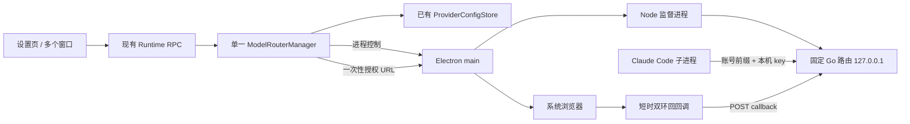

# 订阅账号接入 Claude Code：第一关技术方案与隔离验证

> 记录说明：第 1～15 节是各关当时的方案与证据，保留历史状态。**当前启动菜单、窗口与失败文案以第 16 节第四关返工为准**：窗口始终取 Opus/Sonnet/Haiku 三档最小值，替代早期“Haiku 仅主模型时纳入”的裁决；旧 Haiku 热更新缺口已通过该保守策略关闭。Default 价格标签按回答 #10 保留为已知客户端小问题。第一关的“仅新增本文”不描述后续实现工作区。

日期：2026-11-13（UTC+8）。工作分支：`feat/subscription-accounts`。本关只新增本文；产品代码、版本、依赖及 PRD 均未修改，无提交、无发布。真实 ChatGPT / Google 账号未登录，未操作正在运行的 Matou。

## 1. 结论与放行边界

**建议继续采用固定版 CLIProxyAPI + Matou 自己的账号、启动与生命周期管理层。** 官方 arm64 二进制已真实无头运行，管理 API 可用，Messages ↔ Responses 基础转换及工具历史回放已通过本机假上游验证。两个合成 OAuth 凭据同时存在时，独立账号前缀能隔离后端，失败不转投另一类账号。

本关的证据支持继续实现，不等于“订阅账号已能在 Matou 使用”。真实 OAuth 换码、套餐/额度响应、真实模型回复、实际工具执行、`/model` 可见菜单、Matou 会话恢复和正式安装包仍待后续验收。

本轮按规定提出并获得的确认如下；它们补充原技术决定，不改动原 PRD 文件：

| 确认 | 已采用的处理 |
| --- | --- |
| 监督回答 #1：临时写入范围 | 验证材料仅写指定 scratchpad 的 `model-router-spike/`；仓库只写本文；监督日志按约定写 |
| #2：上游回调监听不符合环回限制 | 不加 `is_webui`；runtime 用 Node 内置 HTTP 短时接回调，校验 state 后 POST 路由的 `/oauth/callback`；监听 `127.0.0.1` 与 `::1`，IPv6 不可用才降为 IPv4；端口被占用按 PRD 提示；回调页中英文反馈 |
| #3：模型识别、窗口与输出上限 | 两类账号各自独立前缀；真实 Claude 上游换算已知 5.5 客户端 id；对话保守窗口取 Opus/Sonnet 最小值，Haiku 作为主模型时纳入；输出上限按当前主模型、以 128000 封顶，未知不写；较大窗口档位提前压缩可接受，逐模型元数据优化不阻断首期 |
| #4：用户 settings 会重新注入旧密钥 | 订阅会话复用 Matou 已有临时 `--settings`，追加两个空值覆盖：`env.ANTHROPIC_API_KEY`、`env.CLAUDE_CODE_OAUTH_TOKEN`；地址、路由 key、模型仍由进程 env 注入。临时 settings 同时写保守 `autoCompactWindow`；官方/API Key 会话不追加这些覆盖 |

`/model` 在进程内切到更小 Haiku 窗口时，临时压缩阈值能否热更新，按回答 #4 记为后续验收缺口，不擅自增加用户可见的重启。

## 2. 固定基线与证据索引

### 2.1 上游与本机基线

| 项目 | 固定版本 / 提交 / 证据 |
| --- | --- |
| 路由 | [v8.0.69 官方发布](https://github.com/router-for-me/CLIProxyAPI/releases/tag/v8.0.69)，提交 `f7ae8feeb3710319f524730849fbe32fde1751e4`；二进制自报 `8.0.69 / f7ae8fee / 2026-11-12T18:27:10Z` |
| 关键行为参照 | [CC Switch v4.0.31](https://github.com/farion1231/cc-switch/releases/tag/v4.0.31)，tag 对象 `5ad4f9701aeb1e82f327445420451f6c889260e3`，解引用提交 `3c76d3bda670297dd8c27d7d9be9b18a4c9143f5` |
| 打包器 | `pnpm-lock.yaml` 锁定 electron-builder / app-builder-lib `26.15.3`；上游 tag 为 `electron-builder@26.15.3`，提交 `37802b5d11ee05b51e168eb6abdc12ab4db1f5d1` |
| 验证机器 | macOS arm64，Node `v22.16.0`，Python `3.12.7`；本机 Claude Code 包版本 `2.1.323` |

官方下载包已分别对发布页 `checksums.txt` 校验，未自行编译替代：

```text
CLIProxyAPI_8.0.69_darwin_aarch64.tar.gz
44070a946dd8932829a52e5d15fe8f01c3748afbbdacc17b10f5a42ce7dba263
CLIProxyAPI_8.0.69_darwin_amd64.tar.gz
dc9b9e782cf1266eedb9c7102ade1f263027af2cf509c8175e156b74bda994d6
```

`file` 分别确认 Mach-O arm64 / x86_64。**amd64 只下载、校验、检查架构，未在 Intel Mac 原生运行。** arm64 的 `otool -L` 只有 macOS 系统库/框架，无需用户安装 Go。下载包包含二进制、LICENSE、README 和配置样例。LICENSE 为 MIT；`codesign -dvv` 显示上游 arm64 仅为 linker ad-hoc 签名，无 TeamIdentifier，必须纳入 Matou 正式签名。

### 2.2 临时证据目录

下文 `SPIKE` 均指以下唯一目录；不在产品仓库中：

```text
/private/tmp/claude-501/-Users-icesword-Documents-AIProjects-matou/d0a3e1fc-4e38-4083-b429-0553135c26cf/scratchpad/model-router-spike
```

| 证据 | 文件，相对 SPIKE |
| --- | --- |
| 开工 Git 状态 | `main-before.txt`、`worktree-before.txt` |
| 下载与准备脚本 | `prepare.py`、`checksums.txt`、两个官方 tar.gz、`binary/`、`binary-amd64/` |
| 固定源码 | `router-source/CLIProxyAPI-8.0.69/`、`reference-source/cc-switch-4.0.31/` |
| E1 无头启动、CPU、空凭据、OAuth、代查 | `verify.py`；`run-20261113-101259/results.json` 及各 `cold-*/router.log`；`verification-console-final.log`（初轮 `run-20261113-094835/` 另保留） |
| E2 双账号隔离 | `routing-probe.py`；`routing-20261113-101259/results.json`、`router.log`（首次成功 `routing-20261113-095424/` 另保留） |
| E3 客户端模型请求 | `client-probe.py`；`client-20261113-094938/results.json` |
| E4 显式输出上限 | `client-output-probe.py`；`client-20261113-095026/results.json` |
| E5 模型发现不足以修正窗口 | `client-discovery-probe.py`；`client-20261113-095121/results.json` |
| E6 生命周期 | `guardian.mjs`、`lifecycle-probe.py`；由 `latest-lifecycle.txt` 指向的目录内 `results.json` |
| E7 双环回回调 | `callback-probe.mjs`；由 `latest-callbacks.txt` 指向的目录内 `results.json` |
| E8 转换、进度文字、工具历史 | `protocol-probe.py`；由 `latest-protocol.txt` 指向的目录内 `results.json` 与 `captured-requests.json` |
| E9 用户配置密钥冲突 | `client-conflict-probe.py`；由 `latest-client-conflicts.txt` 指向的目录内 `results.json` |
| 汇总检查 | `check-evidence.py`、`checks.json`；日志抽样检查 `log-secrecy-check.json` |

每次复跑写新的时间目录，`latest-*.txt` 指向最新结果。E2 曾因假 Antigravity 账号没有模型探测响应而失败，旧目录 `routing-20261113-095255/` 保留；之后为其增加纯本机模型列表响应，未改路由二进制，得到上述成功结果。这同时说明不能把静态模型目录当成已验证的账号权限。

### 2.3 复跑步骤

仅复跑隔离探针，不打开浏览器、不提交真实 code、不读取用户已有账号文件。Python 探针需要 Python 3.12+；Node 探针用 Node 22；`lsof`、`ps` 为 macOS 自带工具。这是开发验收要求，最终用户不需要这些工具。

```bash
cd /private/tmp/claude-501/-Users-icesword-Documents-AIProjects-matou/d0a3e1fc-4e38-4083-b429-0553135c26cf/scratchpad/model-router-spike
python3 prepare.py
python3 verify.py
python3 routing-probe.py
python3 lifecycle-probe.py
node callback-probe.mjs
python3 protocol-probe.py
python3 client-probe.py
python3 client-output-probe.py
python3 client-discovery-probe.py
python3 client-conflict-probe.py
python3 check-evidence.py
```

前三类路由探针使用官方 **arm64** 包，因此以上命令按当前 arm64 验证机编写；Intel 上须将脚本的二进制路径改为 `binary-amd64/cli-proxy-api` 并重新记录性能，不沿用本次数值。客户端探针调用本机已有 `claude`，只连本机假 Messages 服务；通过 `CLAUDE_CONFIG_DIR` 隔离配置，禁用工具、MCP、会话持久化、非必要网络。探针生成的 `.claude.json` 均在各自隔离配置目录里。它们输出的模型费用字段为假响应引起的客户端估算，**不是实际消耗**。

脚本在 `finally` 回收自己的路由和本机服务器；回调探针遇到已有登录端口被占用会报告跳过，不会结束别人的程序。复跑后应检查没有跳过项，而不只看退出码。汇总检查还比较主仓 Git 状态；若用户在主仓另有工作，该项可能因外部变化失败，不能自动回滚。

## 3. 问题一：无头运行、性能、管理 API 与代查

### 3.1 实跑配置与结果

E1 在临时目录生成配置、空凭据目录和随机管理/客户端 key，`umask 077`；用以下参数启动，无 TUI、无系统浏览器：

```text
cli-proxy-api -config <临时绝对路径/config.yaml> -local-model -no-browser
```

配置使用 v8 嵌套字段。探针的配置文件为 JSON 形式的合法 YAML，官方二进制可以加载；启动时会将明文管理密钥哈希并写回文件。产品生成普通 YAML 或相同 JSON/YAML 均可，不必引入 YAML npm 依赖。以下是建议产品配置片段；E1的精确实跑输入见verify.py及生成的config，未包含后补的credits显式关闭项，前缀强制由E2另行实测。

```yaml
config-version: 8
server:
  host: "127.0.0.1"
  port: <Matou 选取的本机端口>
  shutdown-timeout: 1
  discovery:
    enabled: false
management:
  allow-remote: false
  secret-key: <随机管理密钥>
  disable-control-panel: true
  disable-auto-update-panel: true
access:
  api-keys: [<随机客户端 key>]
oauth:
  auth-dir: <Matou 数据目录/model-router/credentials>
  providers:
    antigravity:
      antigravity-credits: false
client:
  claude:
    show-codex-commentary: true
multimedia:
  disable-image-generation: "passthrough"
observability:
  logs:
    debug: false
    logging-to-file: false
    request-log: false
    error-logs-max-files: 10
  usage:
    usage-statistics-enabled: false
  pprof:
    enable: false
plugins:
  enabled: false
routing:
  force-model-prefix: true
  cooldown:
    disable-cooling: false
    save-cooldown-status: false
    transient-error-cooldown-seconds: -1
  retry:
    request-retry: 0
    max-retry-credentials: 1
    max-retry-interval: 0
```

E1 的空账号测量未开启 `force-model-prefix`，E2 另行验证此项；该区别不影响空账号启动样本。产品不配置账号池、跨账号候选或同别名多上游。旧 `quota-exceeded.switch-project/switch-preview-model` 仅为兼容字段，没有新的 v8 对应路径，不能误写在 routing 下；本方案不依赖这些旧开关。隔离依赖前缀、单个已采用凭据与有界重试。建议另显式关闭 Antigravity credits 追加消耗开关，额度用尽沿用PRD提示；这是配置建议，未用真实额度验证。

| 项目 | E1 实测 | 判断 |
| --- | --- | --- |
| spawn 到 `/healthz` 200，3 次 | `517.94 / 330.90 / 649.83 ms`，含启动哈希配置与本机 HTTP 探测 | 无头启动可行；初轮另测为154～248ms；两批负载未受控，不是统计承诺或 Matou 切换总耗时 |
| 30.534 秒空闲，5 次 ps | `%CPU` 均 `0.0`；CPU 时间保持 `0:01.41`；RSS `49056 → 40848 KB` | 该短样本未观察到持续 CPU；CPU 时间精度约 0.01 秒，不代表绝对零消耗或长期统计 |
| 监听 | `TCP 127.0.0.1:60596 (LISTEN)` | 无全网监听；生成登录 URL 后仍只有此监听 |
| 正常 SIGTERM | `14.24 ms` 后退出，exit 0 | 无请求时快速退出；未测真实长流 drain |
| 路由端口冲突 | 进程退出，`listen tcp 127.0.0.1:<port>: bind: address already in use` | 必须以本子进程存活与认证就绪联合验收，不能只探测任意已有 HTTP 服务 |
| 权限 | 配置、假凭据、锁文件、KV、日志均 `0600` | 产品目录另设 `0700`；启动/续期/覆盖后继续检查权限 |

`-local-model` 让模型目录使用随二进制内置的数据，避免把模型目录网络刷新放在启动关键路径。[固定配置样例](https://github.com/router-for-me/CLIProxyAPI/blob/f7ae8feeb3710319f524730849fbe32fde1751e4/config.example.yaml) 和 `cmd/server/main.go` 为复核入口。

边界：固定版仍会后台获取 Grok CLI 的版本元数据（源码 `sdk/cliproxy/service_lifecycle.go:startProviderVersionUpdaters`、`internal/runtime/executor/helps/xai_version.go`，启动一次、每 3 小时一次）。这不是更新路由二进制或下载控制台；不能声称路由“完全无后台联网”。本期不启用该供应商，也不改官方二进制。若后续要求禁止一切后台元数据联网，须另行裁决，当前开关不能证明满足。

### 3.2 API 的真实返回形态

[固定 v8 文档](https://github.com/router-for-me/CLIProxyAPI/blob/f7ae8feeb3710319f524730849fbe32fde1751e4/docs/management-api-v8.md) 与 E1 对照：

| 请求 | HTTP / body 摘录 | Matou 处理 |
| --- | --- | --- |
| `/v8/management/credentials` 不带管理 key | 401 | 管理客户端与模型客户端 key 分离 |
| `/v1/models` 不带客户端 key | 401 | 不以无认证探测判断推理服务已就绪 |
| `/credentials`，空目录 | 200，`files: []`（另有 observed_at） | 没有账号不是进程启动失败 |
| `/v1/models`，空目录 | 200，`data: []` | 切换前还要确认选中账号/模型存在 |
| `/v1/messages`，无凭据 | 400，Anthropic `type:error`、`error.type:invalid_request_error`、`unknown provider for model ...` | 不能假设无凭据一定是 401/503 |
| `/oauth/auth-url?provider=codex\|antigravity` | 200，`status:ok,url,state` | 不加 is_webui；仅 main 打开浏览器 |
| 待完成 `/oauth/status?state=` | HTTP 200，`status:wait` | 继续等待，不是成功 |
| `DELETE /oauth/session?state=` | HTTP 200，`cancelled:true,status:ok` | 关闭本地回调监听并释放登录 lease |
| 取消后 / 未知 state 的 status | HTTP 200，`status:error,error:"unknown or expired state"` | 必须检查 body.status |
| 未知 state 的 POST `/oauth/callback` | 404，`status:error` | 不能把收到浏览器回调当作登录完成 |
| 禁用的 `/management.html` | 404 | 无需网页控制台，未下载控制台资产 |
| `/requests/api-call`，TOKEN 占位但无凭据 | 400，`auth credential not found for auth_index` | 不做“没有凭据则匿名请求”的回落 |

### 3.3 套餐、额度、模型列表：Matou 不取上游令牌

**接口能力可用；真实服务方响应尚未验证。** E1 向两种合成凭据分别发送如下管理请求，目标为纯本机假上游。假上游只返回“凭据是否匹配”，不回显令牌；两次均匹配各自账号。由路由替换 `$TOKEN$`，Matou 只持有 `auth_index`。

```json
{
  "auth_index": "<来自 credentials 的索引>",
  "method": "GET",
  "url": "https://chatgpt.com/backend-api/wham/usage",
  "header": { "Authorization": "Bearer $TOKEN$", "Accept": "application/json", "User-Agent": "codex-cli", "ChatGPT-Account-Id": "<账号摘要中的 id>" }
}
```

API 返回外层 HTTP 200，body 为 `{status_code,header,body}`。E1 特别验证了上游 403 仍包在 HTTP 200 内；错误判定必须看内层 `status_code`，再解析字符串 body。源码：`internal/api/handlers/management/api_tools.go:APICall/resolveTokenForAuth`。

| 数据 | 建议实际请求与解析 | 证据 / 限制 |
| --- | --- | --- |
| ChatGPT 套餐/额度 | `GET https://chatgpt.com/backend-api/wham/usage`；借鉴 plan_type 标签、按 `limit_window_seconds` 识别 5 小时与每周，解析 `used_percent/reset_at`，不按主/次窗口顺序硬猜 | CC `subscription.rs:query_codex_usage/codex_plan_label/window_seconds_to_tier_name`；E1 证明注入和响应包装，未证明服务方接受真实账号 |
| ChatGPT 可用模型 | 通过同一 api-call 调 `GET https://chatgpt.com/backend-api/codex/models?client_version=0.159.0`，带 `originator:codex_cli_rs`、`version:0.159.0` 与账号 id（来自固定参照的常量，不自动跟随本机Codex更新）；解析 data/models/items/数组/map | CC `codex_oauth_models.rs:build_models_request/parse_models`；候选和路由可路由模型取交集；E1 中假 Plus 凭据已经能得到静态模型目录，故 `/credentials/models` 本身不证明真实权限 |
| Antigravity 套餐/项目/资格 | `POST https://daily-cloudcode-pa.googleapis.com/v1internal:loadCodeAssist`，body `{"metadata":{"ideType":"ANTIGRAVITY"}}` | CC `agy_account/quota.rs:load_code_assist/parse_plan/parse_ineligible_reason`；保留 Pro / Ultra 5x、20x 区分 |
| Antigravity 额度 | 之后同域 `:retrieveUserQuotaSummary`，带 loadCodeAssist 得到的 project；解析 groups/buckets 的 remainingFraction、resetTime 并分组 | CC `quota.rs:fetch_tiers/parse`、`subscription_agy.rs:collect_tiers`；不能误用 `fetchAvailableModels` 代替其额度分组解析 |
| Antigravity 模型 | `/credentials/models?name=` 对应账号动态注册结果，底层 `fetchAvailableModels`；必要时通过 api-call 读实际模型列表并与路由注册结果交集 | E2 在模拟探测失败时列表为空，补本机模型响应后才发布；源码 `sdk/cliproxy/service_models.go`、`antigravity_models*.go` |

普通 `/credentials` 中名为 `id_token` 的 Codex 字段是**解析后的非秘密摘要对象**，含 chatgpt_account_id/plan_type 等，不是原始 JWT；源码 `auth_files.go:extractCodexIDTokenClaims`。runtime 只白名单提取所需摘要，禁止调用 `/credentials/download`，不复制 refresh/access token 到 Matou 供应商 JSON，也不把整个管理响应交给渲染层。

Antigravity 额度请求的 User-Agent/请求体须对照固定路由与 CC 的兼容版本一起验证，不依赖用户安装 Antigravity App。CC 的配额实现使用 `cc-switch/<版本> (antigravity/cli/<版本>)`，读不到本机客户端时回落 `1.4.6`；Matou 应报告自己的产品名并随包固定经验证的兼容版本，不能把路由推理使用的 Hub UA 无验证地套到额度接口，也不调用外部 agy 命令。若服务方返回“无许可”，必须区分版本/请求形态不兼容与账号资格，不能仅凭一次额度 403 判定封号。`api-call` 对 Antigravity 可在路由内部刷新 token；Codex 分支直接使用当前 token，必要时由 Matou 请求 `/credentials/refresh` 后仅重试一次，不下载 token。

额度只在设置页每次打开时读取一轮；多窗口相同轮次可合并在途请求，BroadcastChannel 刷新供应商快照不能再次触发额度网络请求。额度失败隐藏摘要，切换不等待它。登录后为展示套餐/模型的读取属于登录流程，不启动额度定时器。上述均为 HTTP/本机处理，不新增运行时 LLM 请求、推理延迟或模型调用费用；不启用默认关闭的 `verify:true` 登录后推理探针。

## 4. 问题二：登录回调、账号隔离和替换

### 4.1 回调流程

E1 从**实际 auth-url 响应**解出：

```text
codex       -> http://localhost:1455/auth/callback
antigravity -> http://localhost:51121/oauth-callback
```

普通 Codex 流程在此固定版使用 localhost。原线索中的 `127.0.0.1:1455` 对应另一条 SIWC 绑定示例，不能混用。Matou 本期不启用 SIWC 二次绑定。

固定源码 `internal/api/handlers/management/auth_files_oauth_callback.go:startCallbackForwarder` 将 is_webui 的监听写死为 `0.0.0.0:<port>`，`server.host` 管不到它。因此按已确认回答 #2，流程为：

1. runtime 申请登录 lease，启动路由；先占住该供应商回调端口的双环回监听，失败就返回 PRD 的端口占用提示，不打开浏览器。
2. 取 v8 auth-url 和 state（无 is_webui）；绑定本次 attempt、provider、state、截止时间。main 验证 URL 只为预期 OpenAI/Google 授权域及本次请求后，调用 Electron `shell.openExternal`。
3. 回调只接受预期路径、方法、state 与本次 provider；拒绝重复、未知、已取消或过期回调。code/error 只 POST 给 `/v8/management/oauth/callback`，不进日志、不回显到页面。
4. runtime 以单一轮询器读 `/oauth/status`；只有 body.status 为 ok 且凭据已保存/加载后才进入模型设置。收到 code 不是成功；状态 wait/error 不能靠 HTTP 200 当作成功。
5. 成功返回「登录完成，可以回到 Matou 了 / Sign-in complete. You can return to Matou.」；失败写明经过脱敏的原因。成功、失败、取消或 Matou 自定 5 分钟超时均关闭两个监听、取消路由会话并释放 lease；成功则保留模型设置所需 lease。

E7 已在两个固定端口分别监听 `127.0.0.1`、`::1`，模拟 `access_denied` 回调交回真实管理 API：错误 state 400 且上游 POST 次数 0，正确 state 仅转交一次、最终 status:error，重复请求 409；自占端口被识别为 EADDRINUSE。本机 IPv6 可用，**IPv6 不可用的降级、真实浏览器成功回调尚未实测**。

### 4.2 不串号的模型路由

每个订阅类别一份稳定前缀：`matou-chatgpt` / `matou-antigravity`，通过 `/credentials/fields` 写 credential 的 prefix（实现时由 manager 串行设置）；`routing.force-model-prefix: true`。源头支持见 `auth_files_fields.go` 的 prefix → `auth.Prefix` 同步，以及 `sdk/cliproxy/auth/conductor_models.go:rewriteModelForAuth`。

`oauth.model-alias` 分频道配置，客户端发 `<前缀>/<客户端模型别名>`；原始模型与别名都必须带前缀。不同类型不共享无前缀别名，不写通配回落。固定版配置样例明确提示：跨频道同名别名的合并路由可能有歧义。

E2 故意给两类凭据同一个 `claude-opus-5-5` 别名，再加各自前缀：

| 请求 | 实际选择与结果 |
| --- | --- |
| `matou-chatgpt/claude-opus-5-5` | 只走 Codex 假代理，目标 `chatgpt.com:443`；假代理拒绝后返回 500 |
| `matou-antigravity/claude-opus-5-5` | 只走 Antigravity 假代理；转成上游模型 `claude-opus-5-5-high`；假上游返回 502 |
| 无前缀 `claude-opus-5-5` | 400 unknown provider；没有访问任一假代理 |
| Codex 失败后的再次请求 | 503 auth_unavailable；没有转去 Antigravity |
| 禁用 Antigravity 后请求其前缀 | 400 unknown provider；没有转去 Codex |

这里证明的是**固定二进制的选路和失败隔离**，不是账号服务可用性；两个假代理不会向服务方转发。E2 初始凭据 JSON 的 prefix 已实跑，管理 API 热改 prefix 的时序及同类替换事务还要实现后验证。

### 4.3 同类只保留一张卡、一个已采用账号

由现有供应商存储按 `(claude-code, subscriptionProvider)` 唯一 upsert，重复添加沿用原 providerId 与模型映射，不追加卡片。OAuth 的凭据落盘仍归路由，不重写 token 文件。

不同账号登录成功后可能先产生第二份凭据文件；它是**未采用的登录草稿**，不赋可路由前缀，并尽快 disabled，不进入卡片候选。force-model-prefix 防止草稿意外参与请求。用户保存时，在单一操作队列内：停用旧凭据 → 为草稿设置模型别名/前缀 → 启用并确认模型注册 → 原子写回该卡的 credentialRef → 删除旧凭据。提交前失败恢复旧凭据启用状态、保持卡片及全局选择；删除旧文件失败时保持其 disabled，启动时按已提交引用清理，不让它参与选路。

同邮箱重新授权可能由路由直接续写同一凭据，不能将“必须新增一个文件”作为成功条件。用 OAuth 完成状态中的 auth_id 与 metadata 判断；这类重新登录取消模型编辑时不新增卡片，已完成的同账号续期无需回滚旧 token。

v8 的 targeted `name/auth_index` 恢复会拒绝换成别的账号，故“再次添加以替换账号”的入口不能盲用 targeted 恢复。成功但未保存时取消弹窗，删除新草稿；应用崩溃重开后，以存储中已提交 credentialRef 对账，清理未采用且不在有效登录 attempt 中的草稿。切换与同类替换串行，使用中的删除仍拒绝；删除卡片时也删除其路由凭据。这不包含撤销服务方所有设备授权。

## 5. 问题三：客户端模型、显示、分类器与上下文

### 5.1 采用账号前缀 + OAuth 别名，不把角色名直接当上游 id

保存的是用户选择的真实上游 id 与其显示名、窗口、输出上限；启动时生成账号隔离的三档客户端 id，并用 `oauth.model-alias` 映射回真实上游。

- GPT / Gemini：用中性、按角色区分的别名，例如 `matou-chatgpt/matou-opus`，不借一个已知 Claude id 冒充其模型能力。
- Antigravity 内的真实 Claude：借鉴 CC 的已知客户端 family / 5.5 换算，再附账号前缀。相同上游映射到多个档位时，允许同一个 name 对应多个别名；必须定点验证三档显示与参数没有互相覆盖。
- 三档 `_MODEL_NAME` 写真实显示名，`_MODEL_DESCRIPTION` 写「供应商名 · 上游 id · 上游窗口」；不从 GPT 示例硬编码窗口。
- CLI 默认主模型用角色 alias（如 sonnet）或对应客户端 id，持久化上游配置和逻辑角色，不把随机路由端口存进会话身份。

CC `claude.rs:route_roles/proxy_model_fields` 的回落顺序照搬其行为：Haiku 自己 → SMALL_FAST → 默认；Opus/Sonnet 自己 → 默认 → SMALL_FAST。新卡保存时会将三档补全为候选内的模型，旧 API Key 卡不重解释。默认候选排序只使用“账号实际返回且路由可用”的模型；PRD 指定的旗舰/均衡/轻量或 Claude/Gemini 若不存在，就取有效列表首个，不杜撰可用权限。

### 5.2 实测揭示的窗口/输出限制

E3–E5 的 `400000` 是**人为探针参数**，不是 GPT 实际窗口承诺；E3 独立于路由，假上游返回固定文本。

| 客户端 id / 设置 | 发出的请求 / 客户端 modelUsage | 结论 |
| --- | --- | --- |
| `claude-opus-5-5`，MAX_CONTEXT=400000 | 首请求 max_tokens 128000；contextWindow 1000000 | 已知 id 忽略该全局窗口覆盖 |
| `matou-chatgpt/claude-opus-5-5` | 同上，仍识别 canonicalModel 为 Claude 5.5 | 前缀不破坏此版本的 5.5 输出识别，但不能用来表示 GPT 的较小窗口 |
| 直接 `gpt-6.1-sol` | contextWindow 400000；默认 max_tokens 32000 | 直接上游 id 有默认输出缩小风险 |
| 中性别名 + MAX_OUTPUT=128000 | 首请求 max_tokens 128000，后续主请求 64000；contextWindow 400000；modelUsage.maxOutputTokens 仍显示 32000 | 显式变量能提高实际请求上限，不能据此声称所有客户端内部元数据已精确修正 |
| 开启网关模型发现，假 `/v1/models` 返回窗口/输出元数据 | 确实调用模型发现，但已知 id 仍为 1M，中性别名内部 maxOutputTokens 仍为 32K | 单加发现开关尚未解决问题，且会暴露合并模型列表；本期不默认启用 |

实际发出的 token 请求上限与 modelUsage 的内部字段要分别验收；未用 32K+ 真实长输出证明最终不截断。窗口值必须来自账号模型响应和固定路由定义的核对；该版内置 Codex Plus 目录已有 272000 与 500000 等值，不是所有 GPT 都是 PRD 示例的 400K。

[Claude Code 官方模型配置文档](https://code.claude.com/docs/en/model-config) 是环境变量与临时模型设置的辅助基线；本次选择以 E3–E5 实际请求为依据。后续明确最低已验证 CLI 版本，不能把 2.1.323 的结果推广到任意旧客户端。

### 5.3 启动环境和用户配置冲突

复核后，线索中的 runtime-server 约3178行目前是 `#usesDefaultClaudeLogin` 的默认账号判断，不负责清理启动env；真正的最终合并点在 `PtySession.create`。对照 CC `src-tauri/src/live/project/claude.rs`，最终 spawn 边界先清除外部继承的供应商认证、三档映射/显示、SUBAGENT、窗口和云协议选择器，再注入当前供应商；只改子进程环境，不改 Matou 父环境。

```text
ANTHROPIC_BASE_URL=http://127.0.0.1:<port>
ANTHROPIC_AUTH_TOKEN=<Matou 本机客户端 key>
ANTHROPIC_DEFAULT_{OPUS,SONNET,HAIKU}_MODEL=<账号前缀/客户端 id>
ANTHROPIC_DEFAULT_{OPUS,SONNET,HAIKU}_MODEL_NAME=<真实名称>
ANTHROPIC_DEFAULT_{OPUS,SONNET,HAIKU}_MODEL_DESCRIPTION=<供应商 · 上游 id · 窗口>
CLAUDE_CODE_MAX_CONTEXT_TOKENS=<本会话保守窗口>
CLAUDE_CODE_MAX_OUTPUT_TOKENS=<当前主模型已知上限，最多128000；未知不写>
CLAUDE_CODE_AUTO_MODE_SERVER=0
```

E9 在**隔离的假用户 settings** 中存入假 API Key/OAuth token：仅清进程 env，Claude 仍把旧 x-api-key 与路由 Bearer 一起发送；临时 `--settings` 的两个空值覆盖后，旧 x-api-key 未再发送。因此回答 #4 批准复用现有每会话 hook settings 文件追加空值，不触碰用户 `~/.claude/settings.json`。不把真实路由 key 再复制到该临时文件。

`CLAUDE_CODE_MAX_CONTEXT_TOKENS` 不能压低已知 Claude id 的原生窗口，所以临时 settings 另写同一个保守 `autoCompactWindow`。较大档位提前压缩是已确认取舍；参数应检查客户端支持的范围，不能悄悄把小窗口抬到 100K 下限以上。**跨 `/model` 选择更小 Haiku 后的热更新仍待验证**，详见第 11 节。

需同时清理的继承项包括 `ANTHROPIC_API_KEY`、`CLAUDE_CODE_OAUTH_TOKEN`、`ANTHROPIC_MODEL`、`ANTHROPIC_SMALL_FAST_MODEL`、`CLAUDE_CODE_SUBAGENT_MODEL` 与其 force 覆盖、旧输出/压缩变量、`CLAUDE_CODE_USE_BEDROCK/VERTEX/FOUNDRY` 等。用户 settings 中其他协议选择器也要纳入冲突矩阵验证；本次只实际证明了两个旧认证字段的空值覆盖。切回官方/API Key 时重新从其自身启动选择构建，移除订阅专用临时覆盖，防止污染官方登录。

### 5.4 分类器、Haiku、子代理和已知版本

- 后台小请求使用账号前缀内的 Haiku 映射；自动权限分类器不借 Anthropic 官方后端，按已定规则 `AUTO_MODE_SERVER=0`。需分别验证标题/分类、compact、Plan/普通工具回合，不能只用一轮问答证明所有内部调用。
- 子代理默认继承主模型；显式 opus/sonnet/haiku 仍走本账号三档。继承的外部 SUBAGENT 强制变量清掉，避免绕路；用户明确指定的、不在该账号候选中的原始模型请求应给出明确错误，不能通配到另一账号。
- 5.5 换算严格参照 `point_release_client_id/client_model_for_subagent`：`claude-opus-5.5`、`anthropic/claude-opus-5.5`、`claude-opus-5-5-日期` 归对应 `claude-opus-5-5`；5.55 不应误命中；Sonnet 同理，按上游真实窗口处理 `[1M]`。
- 当前 CLI 还有 Fable 内部/菜单分支。Matou 本期仍只有三档设置；参照 CC 的未配 Fable → Opus 回落作为兼容验证项，不能让其无前缀请求误入其他账号。不得未经确认新增第四档设置。
- 未知模型 id：切换前验证映射均可注册；运行中不认识的 id 明确报错。中性 id 的实际输出上限用上述显式变量处理，不能用 `"Custom model"` 或看起来像 Claude 的名字掩盖能力不符。

## 6. 问题四：开发资源、安装包、签名与公证

沿用现有 `tooling/prepare-package-resources.mjs` → electron-builder `extraResources` 链路。当前工具脚本先删除全部 `package-resources`，因此路由复制步骤必须在该删除之后执行，不能提前准备到会被清空的位置。无需用户安装路由或 Go。

建议新增 `tooling/model-router/prepare.mjs` 和固定版本清单：构建机下载官方目标架构包及 checksums，校验 SHA256 后解包、检查 Mach-O 架构、保留原始 LICENSE，再复制为 `package-resources/model-router/model-router`。开发缓存放**本 worktree 内被忽略的精确目录**（例如 `.cache/model-router/8.0.69/darwin-arm64/`）；开发命令显式准备，绝不在用户运行应用时下载更新。安装包只含目标架构，不做 universal 合并。

| 场景 | 资源位置与来源 |
| --- | --- |
| 开发 | worktree 内固定版本缓存；由 main 解析绝对路径传给 runtime，缺失时明确报错，不临时从 PATH 找用户工具 |
| 打包 | `Contents/Resources/model-router/model-router`、`LICENSE`、版本/来源/校验清单 |
| 数据 | 现有 runtime dataRoot 下 `model-router/`，包含 config、credentials、随机本机 secrets；不把凭据放 Resources |

`apps/desktop/package.json` 增加对应 `extraResources`；electron-builder **26** 的 `mac.binaries` 显式包含 `Contents/Resources/model-router/model-router`，使嵌套 Go 程序和 App 使用同一 Developer ID、时间戳与 hardened runtime，再公证整个 App。不要误用最新版 v27 的 `mac.sign.binaries` 结构。[v26 文档](https://www.electron.build/v26/docs/mac/#binaries) 及固定源码 `packages/app-builder-lib/src/mac/MacTargetHelper.ts:buildSignOptions` 已复核：`config.binaries` 被传给签名器；主包 `macPackager.ts` 在签名后调用 `notarizeIfProvided`。

未来验收命令应分别读回：

```bash
file '<产物.app>/Contents/Resources/model-router/model-router'
codesign --verify --strict --verbose=2 '<产物.app>/Contents/Resources/model-router/model-router'
codesign -dvv '<产物.app>/Contents/Resources/model-router/model-router'
codesign --verify --deep --strict --verbose=2 '<产物.app>'
xcrun stapler validate '<产物.app>'
spctl -a -vv -t execute '<产物.app>'
```

签名完成后的文件与原 tar 内文件的 SHA256 会因重签发生变化，发布校验针对下载包，不能拿原始二进制摘要校验重签后的程序。按现有发布手册分别在 arm64 / Intel 构建机验证原生 PTY 与路由；签名成功不能代替公证。本关**未构建 App、未使用发布证书、未上传 Apple 公证、未修改安装中的应用**。

## 7. 问题五：存储、runtime 层级、浏览器与生命周期

### 7.1 最小兼容存储

扩展现有 `provider-config.json`，保持 version 1 与原卡 id、选中 id、API Key、endpoint、modelMapping 原值；缺少 kind 的行仍按现有供应商解释。新增订阅行 `kind:subscription`、`subscription.provider:codex|antigravity`、路由凭据引用、邮箱/套餐摘要和已选模型的必要元数据。旧数据不做删库、批量重写或破坏性迁移；只有显式保存才用现有临时文件 + rename + chmod 600 写入。

渲染层输入使用区分类型的 contract：API Key 行延续原字段；订阅行提交登录 attempt 引用、名称与三档真实模型 id，不允许自行指定管理 URL、auth-dir、任意 credential 路径或上游 token。runtime 将 opaque attempt 换成已确认凭据。快照只含邮箱、套餐、状态、额度摘要和模型显示数据，不含管理密钥、客户端 key、JWT、上游请求 header。

Antigravity 首次风险确认放同一现有配置文件的可选策略字段，删除账号后仍保留首次确认；原文逐字采用 PRD。每次打开设置得到的新额度只放内存，不引入用量数据库、历史统计或常驻 quota 定时器。

当前 `ProviderConfigStore.normalizeState` 对 version 非 1 会回默认，因此不能随手升版本号。存储应保留旧字段/未知的无关字段；旧版数据完整读写、损坏 JSON 保持原有报错策略都需测试。本方案只要求当前版本向前读旧数据，不承诺旧 Matou 能安全编辑新增订阅行。

### 7.2 单一 runtime owner



在 `apps/runtime/src/index.ts` 初始化一个 manager，与现有 ProviderConfigStore、sessions 同生命周期；注入所有 RuntimeServer / RuntimeRpcRouter，不能每个窗口各建路由。runtime 是路由需求与状态的业务 owner；main 负责物理启动监督进程并持有 stdin 租约，解析资源路径、执行受约束的 openExternal 与退出清理，不持有上游账号 token；renderer 不持管理 key。这样 main 被强杀而 runtime 未及时退出时，也会由 main 写端 EOF 结束路由。

按需引用分三类：运行中的订阅 Claude 会话、设置页当前需要的账号读取/模型配置、进行中的登录/切换事务。lease 幂等释放，窗口断开不结束仍在后台运行的订阅会话；关闭最后一个使用方才停路由。仅选中了订阅卡片但没有会话/设置需求时不常驻。设置页打开时为一次读取启动，关闭后释放。

`ProviderConfigStore.launchSelection` 不应在 snapshot 时启动进程；由 manager 准备连接上下文，再由纯函数生成 env。所有启动入口统一处理：普通新建、恢复、权限重启、fork、全局切换。所有 session 关闭/移除路径释放 lease；设置页断连与 runtime 退出也释放。

### 7.3 切换失败不改变选择

现有 `RuntimeRpcRouter` 先 `ProviderConfigStore.activate`，`RuntimeServer` 再 `#restartProviderSessions`。因此不能把“启动路由”仅追加在后者，否则失败时全局指针已变。

应在 RPC 的 activate 分支持久化之前完成订阅准备：校验已提交账号 → 确认 route 进程、版本与管理 key → 已采用凭据/模型注册 → 生成选定启动配置。成功后才沿用现有 activate + 会话重启恢复，保留原 transition/Toast/查看会话语义。任一准备失败，保持旧 providerId 和原会话，不强制关掉用户进程。普通会话身份恢复仍由原链路负责，禁止把新建空会话当作恢复成功。

从两个窗口并发登录、保存、切换时，manager 的有界操作队列串行处理凭据/配置变更；进程启动使用同一个在途 Promise，避免双启动。路由启动采用空闲环回端口；绑定竞态时换空闲端口，最多有限次数，若仍失败就保持原供应商并提示。重启通常保留原端口，保证旧会话 env 有效；该端口被别的进程占住时不能静默迁移后声称现有会话已恢复，应提示失败。

### 7.4 退出不留孤儿、只重启一次

单纯 `spawn` 子进程不会保证父进程崩溃时子进程退出。E6 验证了一层小的 Node 监督进程：产品由 main 持有其 stdin 写端作为生存租约；main 退出或 SIGKILL 后，EOF 触发 SIGTERM 路由，超时再 SIGKILL 并等待回收。runtime 退出时，现有 RuntimeHost 的 child exit/stop 路径负责关闭该租约后再启动下一代 runtime，避免 runtime 崩溃而 main 仍存活时遗留路由。监督进程只替意外退出重启一次，第二次退出进入失败态；主动停止不消耗重启次数，不形成无限循环。

E6 结果：正常退出 guardian exit 0；路由第一次 SIGKILL 后生成 restarts=1 的新进程，第二次生成 restart-exhausted；模拟 owner SIGKILL 后，25.11 ms 内确认路由 PID 不存在。该时间只代表探针本机无请求样本。

产品监督脚本作为 runtime 的一个额外编译入口随包携带，由 main 使用 Electron 自带 Node 模式启动，不能依赖用户 PATH 中安装 node。runtime 通过现有 main/runtime 内部消息请求幂等 start/stop，main 仅接受限定数据目录的配置路径及随包程序。退出协议先关闭回调与监督 lease、等待路由退出，再结束 runtime；现有 `RuntimeHost.stop()`/`shutdownRuntime()` 以及 runtime child exit 路径统一有界清理。Electron 打包态的 Node 模式/管道 EOF、整 App 强制结束、睡眠唤醒、监督进程自身被杀和真实长流退出仍需专项验证，**E6 不代表这些已验收**。

## 8. 问题六：模块/文件清单与 CC Switch 借鉴落点

以下为后续实现建议，本关均未创建或修改。

| 文件 / 模块 | 具体职责与需要改的入口 |
| --- | --- |
| `packages/contracts/src/provider-config.ts`、`protocol.ts` | 增量订阅 input/view/status/model 元数据；登录开始/状态/取消、设置页一次读取的 RPC；Codex 页签不加订阅预设 |
| `apps/runtime/src/provider-config/provider-config-store.ts` | 保留 version 1；同类唯一 upsert、credentialRef、风险确认；launchSelection 的订阅分支从准备好的路由上下文生成选择 |
| `apps/runtime/src/model-router/manager.ts` | 唯一 owner、lease、一次性设置读取、账号采用/替换、切换前准备、操作串行、状态广播 |
| `.../model-router/management-client.ts` | v8 认证调用、status body 判定、api-call 内层状态、超时/大小限制/脱敏；目的 URL 白名单，禁止任意 renderer 透传 |
| `.../model-router/oauth.ts` | 双环回短时监听、attempt/state/5分钟、取消/迟到/重复回调、浏览器 URL交付 main、草稿凭据引用 |
| `.../model-router/claude-launch.ts` | 三档别名、真实显示名、5.5、回落、子代理、窗口/输出、清理 env 与临时 settings 覆盖 |
| `.../model-router/account-readers.ts` | ChatGPT 套餐/额度/模型解析，Antigravity 项目/套餐/额度/资格，非秘密摘要 |
| `.../model-router/errors.ts` | 过程失败与账号状态映射；可读原因、恢复动作，不做故障自动切换 |
| `.../model-router/process-supervisor.ts`、`apps/runtime/tsup.config.ts` | 由main启动的固定二进制监督、owner EOF 回收、一次重启；额外输出监督 cjs，不新增 npm 依赖 |
| `apps/runtime/src/index.ts`、`rpc/runtime-rpc-router.ts`、`runtime-server.ts` | 统一注入 manager；activate 前准备；新建/恢复/权限/fork/全局切换/移除/关闭接入；复用现有 sessionTransitions |
| `apps/runtime/src/session/pty-session.ts`、`session/provider-hook-server.ts` | 在最终 env 合并边界执行清空，合并两个已批准的临时空值及 autoCompactWindow；不改用户配置 |
| `apps/desktop/src/main/index.ts`、`runtime-host.ts`、共享 bridge/preload | 受约束打开系统浏览器、资源路径、监督进程的物理启动与stdin租约、runtime exit清理，透传非秘密登录状态；不暴露任意 URL 打开能力 |
| `ModelSwitchSettings.tsx`、`ProviderSetupDialog.tsx`、相关 i18n | PRD 两个入口/风险原文/账号卡片/模型候选/取消重试/异常；额度一次读取，不被快照广播反复触发 |
| `tooling/model-router/prepare.mjs`、版本清单、`prepare-package-resources.mjs`、desktop package 配置 | 官方包固定版本下载校验、目标架构复制、资源许可、mac.binaries、开发缓存忽略规则 |
| `packages/contracts/third-party/subscription-accounts-LICENSE` 或对应 runtime third-party 路径 | 保留参照方 MIT 全文；打包时同时附路由 MIT、参照许可与来源清单 |
| `model-router/*.test.ts`、集成回归及现有供应商/恢复 E2E | 各关定点验证，稳定后统一构建/类型/相关回归/真实 UI 与安装包；不每个文件重复全量测试 |

所有借鉴源固定为提交 `3c76d3bda670297dd8c27d7d9be9b18a4c9143f5`。实现时各相关 TS 头注明源文件、提交、MIT 及许可相对路径；不要只在总文档写一次来源。

| CC Switch 固定源 / 函数 | Matou 落点（建议函数名） | 保留的行为与明确不搬的部分 |
| --- | --- | --- |
| `live/project/claude.rs`：proxy_projection、route_roles、proxy_model_fields、point_release_client_id、client_model_for_subagent | `claude-launch.ts:buildClaudeLaunch/resolveRoleModels/toClientModelId`；最终 spawn 清理与临时 settings 生成 | 只 AUTH_TOKEN、本机地址、三档名称说明、正确小版本与窗口、子代理回落；不搬写用户 settings 的 Rust/Tauri 层 |
| `services/subscription.rs`：codex_plan_label、query_codex_usage、window_seconds_to_tier_name | `account-readers.ts:parseChatGptPlan/parseChatGptUsage` | Plus/Pro 各档及未知套餐名、按秒识别窗口、零用量不伪造重置倒计时；不搬额外积分兑换/用量统计 |
| `services/codex_oauth_models.rs`：build_models_request、parse_models/push_model_entry | `account-readers.ts:readChatGptModels/parseChatGptModels` | 实际账号列表、兼容响应结构、排序去重/受控回退；网络与 token 由管理 api-call 执行 |
| `services/agy_account/quota.rs`：load_code_assist、fetch_tiers、parse_plan、with_ultra_variant、parse_ineligible_reason；`subscription_agy.rs:collect_tiers` | `account-readers.ts:readAntigravityAccount/parseAntigravityQuota/parseAntigravityEligibility` | project、模型组、remaining→已用、Ultra 5x/20x、锁区/资格原因；失败不阻止普通切换 |
| `services/agy_account/oauth.rs`：bind_callback/wait_for_code、identity/fetch_identity | `oauth.ts:openLoopbackCallback/acceptOAuthCallback`、`account-readers.ts:parseCredentialSummary` | 本机回调 state/邮箱/资格校验；OAuth换码/refresh仍由路由完成，不复制 client secret / token 代码到 Matou |
| `proxy/error_mapper.rs`：map_proxy_error_to_status/get_error_message；`proxy/codex_quota_protection.rs`：Snapshot::from_quota/from_headers | `errors.ts:mapRouterFailure/mapAccountStatus` | 借错误分类、额度窗口/上游提示的解释；**不搬 admit、阈值阻断、保护缓存与自动暂停**；403 的产品状态以本 PRD 优先 |
| `proxy/providers/transform_codex_anthropic.rs`、streaming_codex_anthropic.rs、transform_responses.rs、streaming_responses.rs | `model-router/protocol-regression.test.ts` / 固定二进制假上游集成用例 | 思考块、工具回放、流事件、结束原因。前两文件主要是反向 Codex→Anthropic，不能只因文件名相近就当本需求方向的实现；Claude→Responses 补对照 transform_responses |
| `proxy/providers/codex_responses_arguments.rs`、forwarder.rs 的历史清洗/缺 call_id 规则 | 同一协议回归文件的历史损坏用例 | 重复参数键、只被部分上游接受的字段、无 call_id 结果、跨轮签名/引用；结合“官方 OpenAI 保持原文”的例外设计断言，不盲目全量去重 |

固定参照源码可从 [该提交目录](https://github.com/farion1231/cc-switch/tree/3c76d3bda670297dd8c27d7d9be9b18a4c9143f5/src-tauri/src) 复核。路由的协议转换继续留在官方 Go 引擎内；Matou 不再写第二份转换器。

E8 已实跑固定二进制的流式/非流式路径：Messages 工具历史变为 `message/function_call/function_call_output`，call_id 配对；进度文字 `Public progress` 和最终文字 `Final answer` 均可见；只存在 function 工具，未注入 image_generation。它使用 API-key 假上游来覆盖相同 Codex executor/translator，**未证明真实 OAuth 推理成功**。上表其他历史损坏用例仍待后续关卡，不能用 E8 冒充全套 CC 回归已经通过。

## 9. PRD 异常逐行检测与反馈

| PRD 情况 | 检测层 / 信号 | 反馈与状态处理 | 本关覆盖 |
| --- | --- | --- | --- |
| 浏览器未完成 / 超时 | oauth.ts 自有 5 分钟计时、status:error、取消事件；迟到回调核对已关闭 attempt | 弹窗「登录未完成」+原因+重试；删除新草稿，不新增卡片，关闭监听 | E1 取消/未知状态，E7 错误回调；完整5分钟和成功后取消竞争未跑 |
| 登录回调端口被占用 | Node 双环回 bind 的 EADDRINUSE；不可把占用误当作 IPv6 不支持 | 「另一个程序正在占用登录端口，请先完成或关闭它」；不开浏览器、不新增卡片 | E7 自占端口实测；不结束他人程序 |
| 路由启动失败 | manager 监听 spawn error/提前exit/就绪超时；管理认证、版本、指定 PID；端口冲突仅有限重试 | 「模型路由未能启动」+脱敏原因+重试；在 activate 前失败，旧供应商/会话保留 | E1 bind失败、认证/就绪；Matou事务未实现 |
| 路由运行中意外退出 | 监督进程 exit，主动停止与崩溃区分 | 自动重启一次；仍失败则 Toast+卡片「模型路由未运行」；不切换；保留会话身份，恢复后用户可继续请求，不重放可能已执行的工具 | E6 一次重启/耗尽；未验证真实 Claude 断流后续聊 |
| 账号续期失败 | `/credentials` 的 requires_sign_in / renewal_state / refresh_error；401后受控refresh一次仍失败 | 「需要重新登录」，主按钮重新登录；同 providerId、名称/映射保留 | 固定源码支持；真实过期/撤销未测 |
| 账号被拒（403等） | 账号级资格/地区/停用原因、credential status；区分普通额度读取失败、临时5xx与内容策略拒绝 | 「账号不可用」+脱敏服务方原因+「可切回 Anthropic 官方」；不自动切换；仅额度请求失败且无账号拒绝证据则隐藏额度 | E1 内层403形态、CC解析源码；真实锁区/停用未测 |
| 额度用尽 | 推理错误由路由原样转换给 Claude；设置打开时读取窗口100%/remaining=0，或本次实际请求错误证明 | Claude显示上游额度提示；卡片已知窗口100%；不额度轮询、不自动切换、不自动暂停 | 解析/设计；真实耗尽与显示未测 |

runtime 在设置页打开、登录完成、激活准备及已知请求失败事件后读取**本地 credential 状态**；这不是上游额度轮询。关闭设置且没有请求失败时，不为卡片做常驻网络轮询。若 Claude 直连路由后的错误无法从现有 turn/hook 信号可靠归属，须在相应关卡补证，不能靠解析终端自然语言猜封号。

| 额外边界 | 处理 |
| --- | --- |
| 路由端口被占用 | 启动前选空闲环回端口，启动后认证+进程联合校验；争抢有限重试；运行中的旧端口不能静默换掉 |
| Matou 退出/崩溃 | 正常退出有界等待，EOF 监督覆盖 runtime 异常退出，main 兜底；只清理自身 PID，不按进程名扫杀 |
| 多个 Matou 窗口 | 同一 runtime manager、启动 Promise 与登录状态机；关一个窗口不关闭其他窗口/后台会话需要的路由 |
| 取消与保存并发 | attempt generation/有效期和单一采用队列；过期/迟到响应不创建卡片，旧引用不被覆盖 |
| 额度接口超时/字段变化 | 最多一轮请求，15秒客户端期限与响应大小限制；隐藏额度；不阻塞保存/切换，不冒称账号失效 |
| 日志/渲染数据 | 输出 key/token/code/URL/body 不透传；白名单摘要和脱敏错误；错误日志关闭请求记录并限制保留量，续期异常也要扫描 |

E1 的错误日志仍会生成；`request-log:false` 不是“完全不写错误日志”，`error-logs-max-files:0` 在上游含义是关闭清理，不能拿它禁用日志。产品使用有限保留值。抽样检查中本机客户端 key/合成 access token 未出现在日志，Authorization header 名存在但值被遮蔽；这不是所有真实上游错误路径的保密性证明。

## 10. 后续关卡建议（需方案确认后逐关放行）

每关 5～40 分钟是目标时盒；遇到实质冲突提交具体证据，未闭合不能因时盒结束标完成。不提前提交/发布。

| 关卡 | 时盒 | 可独立验收结果 |
| --- | --- | --- |
| 2 固定资源与进程 owner | 25～40分钟 | 开发固定资源下载/校验、资源路径、manager/监督进程；并发启动一次、环回监听、闲置停止、一次重启、runtime崩溃无孤儿；不接UI |
| 3 v8登录与账号采用 | 30～40分钟 | 双环回/state/取消/5分钟、草稿与同类唯一、重新登录保留映射；先假管理服务与真实路由无账号验证；真实登录须另行由用户在浏览器完成 |
| 4 启动接管与窗口专项 | 30～40分钟 | CC借鉴头与许可、前缀别名/5.5/子代理/分类器、最终env与临时空值；同时验证Haiku主模型切换热更新、实际输出阈值和已存用户设置冲突，不新增可见重启 |
| 5 套餐/额度/模型解析 | 20～35分钟 | CC样本解析、白名单摘要、一次设置读取、外层200内层403、真实候选与静态目录区别；失败只隐藏额度，未知套餐不编造 |
| 6 切换与恢复整合 | 25～40分钟 | activate之前预备完成；失败不切换；所有启动/恢复/fork路径同一规则；官方/API Key往返、两个窗口与草稿取消对账 |
| 7 设置页面与真实界面 | 30～40分钟 | 按PRD入口、风险原文、卡片、候选、状态/取消重试；由指定界面执行者处理，真实截图与交互对照矩阵闭合；本关没有委派UI |
| 8 协议回归与真实账号验收 | 25～40分钟，不含等待用户登录 | 固定引擎假上游历史回归 + 用户授权后的两类账号真实回复/无害读文件/进度文字/菜单/原会话恢复/异常；一个账号通过不能替另一个 |
| 9 打包签名与安装包验收 | 30～40分钟，不含Apple排队 | 随包固定二进制/双许可/目标架构；Developer ID和公证分别读回；真实打包态无需外部工具、退出清理、切换额外等待与空闲CPU；不发布 |

## 11. 风险、未决验证与本关自检

已确认的产品取舍见第 1 节，目前没有等待回答的产品选择。仍需以下证据才能提交产品验收：

1. **真实账号完全未测**：真实成功OAuth、续期/撤销、套餐/额度字段、两类候选权限与真实推理/工具调用；本关不会擅用已登录账号文件补测。
2. **窗口与长输出**：env是进程级；更小Haiku在进程内成为主模型时，现有临时settings与模型切换信号能否可靠热更新尚未证实。已知Claude id的保守压缩阈值也尚未用长会话验证。显式MAX_OUTPUT提高请求上限不等于真实长输出已验收。
3. **UI与版本**：本机只用2.1.323做无头请求探针；`/model`真实显示、老客户端能力、自动分类器/子代理全部分支、Fable兼容和官方往返需真实终端验证。
4. **错误归属**：续期字段源码存在，直接模型流的账号级错误能否及时转为准确卡片状态仍须整合验证；不可用一次额度接口403推断封号。
5. **生命周期与打包**：探针的Node监督机制有效，Electron内嵌Node模式、打包态、整个App强杀、监督自身崩溃、休眠与真实长流尚未验收；Intel未原生运行；没有正式签名/公证产物。
6. **固定版本的边界**：不能宣称“所有后台联网都关闭”；服务方OAuth/模型接口变化需要随Matou固定版本更新处理，本期无自动升级。Antigravity风险确认严格保留原文，本文不另作账号安全承诺。

本关自动检查与实际验证区分：

| 项目 | 状态 |
| --- | --- |
| 方案文档 | 已新增；本关唯一仓库写入 |
| 官方两个架构包校验、arm64无头、API、30秒CPU、回调错误、选路隔离、监督进程、基础转换 | 已实际执行；证据在SPIKE；汇总检查20项为true |
| 客户端已知/未知模型、显式输出、模型发现、假用户密钥冲突 | 已在完全隔离的CLI与假上游执行；不等于真实UI |
| 命名卫生 `pnpm check:identifiers` | 已通过，最终记录见下方 |
| 产品构建/类型/全量测试/真实UI | 本关未执行；无产品改动，不用空构建代替验收 |
| 主仓工作状态 | 结束前与 `main-before.txt` 的 `git status --porcelain=v1 -uall` 字节比较，汇总检查已通过；最终复核见下方 |
| 用户目录 | 未改真实账号目录/配置；测试凭据与CLI配置均定位到指定scratchpad。未对用户同期运行程序做全目录快照，不能声称它们绝无其他来源的写入 |
| 运行中Matou / 主仓 / perf worktree | 未启动、关闭、重启或改写 |

最终自检记录（2026-11-13）：

- `python3 check-evidence.py`：20项全部true，包括主仓状态一致；不会将真实账号/真实UI计入已通过项。
- `pnpm check:identifiers`：退出0；仓库命名卫生通过。
- `git diff --check`：退出0；另对新文档检查行尾空白。没有任何受控产品文件diff。
- `cleanup-check.json`：本任务路径下仍存活的路由/guardian进程为0，主仓状态与开工一致。
- 最新配置复核移除了误放在routing下、不生效的旧quota开关，并复跑E1/E2：启动331～650ms，30.534秒CPU时间增量0.00秒。初轮154～248ms证据保留，未将差异归因于未经测量的原因。
- 当前worktree相对开工仅多出本文；任务PRD原本为未跟踪文件，保留原状。未提交、未推送、未改版本，未安装npm依赖。

## 12. 第二关：固定资源与进程 owner（2026-11-13）

本关在 `feat/subscription-accounts` 落实固定资源与后台生命周期，停在此关，不接 UI、不提交、不发布、不登录真实账号。没有创建或改写并行任务独占的 `claude-launch.ts`、`account-readers.ts`、`errors.ts`，没有修改供应商 contracts 或 PRD。新增过程全部使用现有依赖；仅为本 worktree 安装锁定依赖和 Electron 测试二进制。

### 12.1 已采用的追加裁决

| 事项 | 本关处理 |
| --- | --- |
| 冷却 | 固定 v8 的 `routing.cooldown.transient-error-cooldown-seconds: 0` 表示默认 60 秒；`-1` 才关闭临时网络/5xx 冷却。采用 `-1`；全局 `disable-cooling` 保持 false，保留 429 的等待信息，不自动切换账号 |
| Grok CLI 元数据 | 接受官方引擎启动时与每 3 小时读取版本元数据；配置生成代码已有注释。不修改官方二进制，也没有把这说成“完全不联网” |
| 日志 | 引擎工作目录固定为 Matou 数据目录的 `model-router/`，错误日志在其 `logs/`，关闭请求记录、保留最多 10 个；目录 700。监督进程局部 `umask 077`，引擎及其新建日志继承 600；不更改 Electron main 的全局 umask |
| 设置页预热（回答 #5） | 本关只做 `openSettings` / `bindSettingsConnection` 后台入口：调用即启动、关闭释放；RPC 连接断开兜底释放该窗口的设置 lease。`RuntimeServer.settingsRouter` 已持有对应连接入口。页面挂载/卸载与 RPC 方法绑定留 UI 关，不能报告“真实设置页已接通预热” |
| 429 原文口径（回答 #6） | HTTP 429、`error.type` 和 `message` 原文、等待时间不变即可。官方 Messages 转译会加 `type:error` 外壳、删除 `resets_in_seconds`；保留引擎，不加第二层转发器，记录这个差异 |

### 12.2 已修改内容与使用方式

| 入口 | 本关结果 |
| --- | --- |
| `tooling/model-router/version.json`、`prepare.mjs` | 固定 8.0.69 / 官方发布提交；官方 `checksums.txt` 与清单 sha256 双重核对，检查 Mach-O 架构。开发缓存仅在本 worktree `.cache/model-router/8.0.69/darwin-<arch>/`；显式命令下载，运行时不下载或升级 |
| `pnpm router:prepare`、开发启动脚本 | 开发启动前准备固定引擎；缓存已存在仍复核校验和。最终用户使用随包资源，无需 Go 或外部 Node |
| `tooling/prepare-package-resources.mjs`、desktop mac 配置 | 将引擎、MIT LICENSE、版本/来源清单复制到 `package-resources/model-router/`，安装包路径 `Resources/model-router/`；监督 cjs 随 runtime。引擎加入 `mac.binaries` 签名清单；本关未签名、公证或制作正式安装包 |
| `config.ts` | 生成本机配置与两类随机 key，配置/keys 600，凭据与日志目录 700；仅 127.0.0.1，管理/模型 key 分离，关闭远程管理、控制台、发现、统计、插件，采用已确认的 commentary / 图片工具设置 |
| `manager.ts` | runtime 唯一实例；20 个并发 acquire 共用一个启动 Promise；设置、会话等使用者持有 lease。最后一份释放后 1 秒停止，短暂宽限避免相邻打开/关闭反复启动。关闭中的状态为 stopping，只有子进程退出后才报告 stopped |
| `process-supervisor.ts`、`process-owner.ts` | Electron main 持有监督 stdin 写端；main 死亡产生 EOF；runtime 退出时 main 关闭租约并等待。路由 TERM 后 1.5 秒仍未退出才 KILL；主动停止不计入重启。意外退出只重启一次且保持端口；第二次失败后不无限循环、不重放请求 |
| `host-bridge.ts`、runtime/main 接入 | 私有消息只允许 start/stop 与生命周期事件，不允许 renderer 指定程序、配置路径或外部 URL；main 使用固定资源与数据路径，校验环回配置和目录归属。新一代 runtime 启动前等待旧路由清理 |
| `manager.test.ts`、`runtime-host.test.ts`、`probe-runtime-owner.mjs` | 固定官方 arm64 引擎、假上游、真实 Node/EOF、真实 Electron UtilityProcess 边界验证；其中 Electron 使用最小 runtime fixture，不执行产品数据库/PTY/真实账号 |

生命周期验证时修正过一处真实竞争：原先清空连接字段就被状态读取为 stopped，但进程尚在退出；现在保留 stopping，直到 owner 等到子进程退出。这项已由闲置停止和窗口断开用例覆盖。

### 12.3 实测证据（均非真实账号）

证据根目录：本 worktree `output/model-router-stage2/`。每次测试使用新的 `manager-*` 或 `electron-runtime-*` 隔离数据目录；固定汇总在 `evidence/` 与 `summary.json`。日志亦复制到监督任务的 `logs/stage2-*`，失败的开发轮次不能替代下表最终通过结果。

| 要求 | 实际结果与边界 | 证据 |
| --- | --- | --- |
| 固定双架构资源 | arm64 / x64 官方压缩包均通过发布页与清单校验、Mach-O 架构检查；arm64 运行，x64 未在 Intel 原生运行 | `resources-x64.log`、`resources-package.log`、`evidence/resources.json` |
| 并发启动一次 | 20 个并发 lease，只出现一次 spawned、一个 PID、一个地址；该轮启动约 485 ms，非稳定性能承诺 | `evidence/concurrent-lifecycle.json` |
| 仅环回监听 | 实际 `lsof` 为 `127.0.0.1:56034 (LISTEN)`，无 `*:port`；不带管理 key 返回 401；就绪需管理认证、固定版本响应头和子 PID 存活共同通过 | 同上、`manager-tests.log` |
| 闲置停止 | 释放前 19 个 lease 后路由仍存活；最后一个释放后约 1020 ms 退出，包含 1000 ms 宽限；最终 PID 已不存在 | 同上 |
| 设置连接兜底 | 打开后台设置入口启动；两个连接只断开一个时另一个仍持有路由；第二个断开才停止。连接关闭后不能重新 acquire，启动中断连也不遗留 lease | `manager-tests.log` 第 4 个用例；未测真实设置页面 |
| 只重启一次 | 路由第一次 SIGKILL 后只生成一个替代进程，`restarts=1`，原地址 healthz 恢复；第二次 SIGKILL 后 restart-exhausted，无第三个进程 | `evidence/restart.json` |
| main 崩溃无孤儿 | 真正 SIGKILL 持有 stdin 的独立 Node owner，监督 EOF 清理，路由 PID 消失 | `evidence/main-kill.json` |
| runtime 崩溃无孤儿 | 真实 Electron main、产品 `RuntimeHost`、UtilityProcess 最小 fixture 与官方引擎；SIGKILL 第一代 runtime 后先回收旧路由再启动第二代；`host.stop()` 后第二代路由亦不存在。监督使用 Electron 自带 Node 模式 | `electron-runtime-probe.log`、`evidence/electron-runtime.json` |
| 临时失败冷却修复 | 唯一合成 Codex OAuth 凭据使用本机拒绝 CONNECT 的假代理；连续两个请求各命中同一 `chatgpt.com:443` 目标一次，都返回原连接失败，第二次没有 auth_unavailable。没有建立真实上游 TLS 或推理 | `evidence/cooldown.json` |
| 429 与等待 | 本机假 Responses 上游返回 429；Claude Messages 客户端收到相同 error.type/message 与 `Retry-After: 60`。额外 `resets_in_seconds` 被删，外壳按 #6 允许改变。后续 14 个请求在冷却内未继续请求上游，说明额度等待仍保留 | `evidence/quota.json` |
| 错误日志 | 上述连续错误最终仅保留 10 个日志，均 600，未包含合成上游 key 或两个本机 key；配置与 keys 也是 600。这是测试路径抽样，不证明全部未来真实错误路径 | 同上、`manager-tests.log` |

### 12.4 复跑与检查结果

在本 worktree、macOS arm64，使用 Node 22 和已锁定依赖：

```bash
pnpm router:prepare
pnpm build:packages
pnpm build:runtime
MATOU_TEST_MODEL_ROUTER=1 pnpm --filter @matou/runtime exec vitest run src/model-router/manager.test.ts
pnpm --filter @matou/desktop exec vitest run src/main/runtime-host.test.ts
node tooling/model-router/probe-runtime-owner.mjs
pnpm --filter @matou/runtime typecheck
pnpm --filter @matou/desktop typecheck
pnpm build:desktop
pnpm check:identifiers
git diff --check
```

集成用例显式启用，避免普通单元测试在非 macOS 或未准备引擎时隐式下载/运行。真实 Electron 探针需要本地 Electron 已安装；本轮通过现有 `electron/install.js` 安装，下载缓存限定 `.cache/electron/`，应用数据限定 `output/model-router-stage2/electron-probe/`。脚本不创建 BrowserWindow，不操作正在运行的 Matou。

本关最终结果：manager/官方引擎集成 **6/6**、RuntimeHost 单元 **13/13**、真实 Electron 进程边界 **通过**；runtime/desktop 类型检查、runtime/desktop 构建、命名与空白检查均通过。主仓状态与第二关开工基线比较、任务进程清理结果见 `summary.json`。

### 12.5 尚未验证与关卡边界

- 没有产品 UI 改动或真实页面验收；设置页后台入口已实现，页面挂载/卸载与 RPC 方法绑定仍留后续关卡。没有声称用户实际点击设置已触发预热。
- 没有真实 OAuth 登录、续期、额度、模型回复、Claude 会话接管/恢复；假凭据不能替代这些验收。
- Electron 实测用了最小 runtime fixture，未覆盖产品数据库、真实 PTY 负载、真实长流退出、整 App 强杀、监督进程自身被杀或睡眠唤醒。
- mac 签名资源路径已接入、资源复制已验证；正式安装包、签名/公证、Intel 原生运行留第 9 关。
- 第二关没有待裁决产品问题。到此停止；第三关登录/账号采用未开工。

## 13. 第二关返工：出网代理与凭据采用就绪（2026-11-13）

用户复审指出两处问题：Finder 启动的引擎拿不到终端里的代理设置；路由 HTTP 已启动不代表刚写入的凭据已被采用。两处均已修复，仍停留第二关，不接 UI、不提交。第三关的登录流程与第六关的实际切换尚未实现；它们准备选定账号时必须调用本节提供的就绪入口，不能只依赖 `acquire()` 成功。

### 13.1 代理选择与已确认的 NO_PROXY 边界

选择 **`requests.proxy-url`**，不选择向引擎传递代理环境变量。原因是固定版 `internal/runtime/executor/helps/utls_client.go` 的 Codex Chrome/uTLS 路径在没有显式代理时使用 `proxy.Direct`，只透传 HTTP(S)_PROXY/ALL_PROXY 不能可靠覆盖 ChatGPT。显式配置也能覆盖 OAuth、刷新与其他供应商请求。监督进程仍只给引擎 PATH、LANG 和隔离 HOME；不透传 API key/token/config 类环境变量。

取值实现：

1. 在 `session/provider-command-environment.ts` 复用现有 PATH 恢复的 `-ilc` 登录交互 shell 做法，读取 `HTTPS_PROXY / https_proxy / ALL_PROXY / all_proxy / HTTP_PROXY / http_proxy / NO_PROXY / no_proxy`。只输出这八个变量，以 NUL 标记隔离 shell 启动文字，不执行 `env` 全量导出。缓存正在进行的 Promise 和结果，同一 shell 上下文不反复起进程。
2. URL 优先级为 HTTPS 大写、小写 → ALL 大写、小写 → HTTP 大写、小写。均无值时，macOS 用 `/usr/sbin/scutil --proxy` 的有效根字典，系统 HTTPS → 系统 SOCKS；忽略接口内嵌的 scoped 字典。系统 HTTPS 配成 `http://host:port`，表示通过 HTTP CONNECT 代理 HTTPS 流量；SOCKS 配成 `socks5://host:port`。没有代理则省略 `requests.proxy-url`、直连。
3. **监督回答 #7 的取舍**：NO_PROXY 明确覆盖 `chatgpt.com`、`auth.openai.com`、任意 `*.googleapis.com`、`accounts.google.com` 时，整个路由不设置 proxy-url，全部直连；不按域名逐个分流。其他 NO_PROXY 项忽略，不传给引擎。包括系统代理兜底也遵循此规则；这不是完整的 NO_PROXY 通用实现。
4. 无效的显式代理 URL 返回无秘密的配置错误，不静默退回直连。代理 URL 只写原有 600 配置，不通过进程参数、状态事件或 renderer 传播。本机登录 shell 配置和 macOS 系统代理均未被修改。

`network-proxy.ts` 负责解析与取值，manager 在一次启动的端口重试之前解析一次并写入配置；守护进程故障重启沿用配置。系统配置读取可在下一次按需启动时重新执行；shell 的读取结果仍缓存。

### 13.2 凭据采用判断与调用方式

新增 `ModelRouterManager.waitForCredentialAdoption(target, options)`：

```ts
const lease = await manager.acquire('session:<id>')
try {
  const credential = await manager.waitForCredentialAdoption({
    name: savedCredentialName,
    provider: 'codex', // 或 antigravity
    // authIndex: expectedAuthIndex, // 调用方已知时用于严格匹配
  })
  // 此时再准备这个账号的启动配置 / 推理请求；激活仍在后续关卡接入。
} catch (error) {
  lease.release()
  throw error
}
```

它轮询本机 `/v8/management/credentials?name=...`，要求名称、供应商、可选 auth_index 匹配，`status === active`、非 disabled、非 requires_sign_in，并有 auth_index。HTTP 200、空列表、pending/error、其他账号或旧 auth_index 均不算就绪。只返回非秘密的名称、供应商、authIndex、active 状态，不返回原始账号内容。

默认轮询间隔 50 ms、采用期限 8 秒，支持调用方取消。等待期间持有一份临时 lease，避免没有其他使用者时被闲置回收；成功、失败、超时、取消都释放它。manager 关闭会中止等待。此等待只读本机管理状态，不新增服务方 LLM 或额度请求；不保证账号额度、模型权限或真实推理成功。

原不稳定用例现在先调用该方法确认合成凭据 active，再立即发起两次推理；没有用固定 sleep 掩盖加载竞争。还用假管理服务覆盖了缺失→pending→错误供应商/旧索引→active、禁用/失败/需重登、超时、取消与 manager 关闭等分支。

### 13.3 代理与请求实测证据

根目录：`output/model-router-stage2-rework/`；固定证据在其 `evidence/`，汇总与原始隔离目录指针见 `summary.json`。

| 场景 | 实际结果 | 证据 |
| --- | --- | --- |
| shell 代理 | 隔离 `.zshrc` 只导出小写 https_proxy；合成凭据没有 proxy_url。真实引擎使用 manager 写入的全局代理，假代理收到 `chatgpt.com:443` 两次，每次请求 attempts=1；Google 管理代查也到达 `oauth2.googleapis.com:443` | `evidence/shell-proxy.json` |
| shell 缓存与隔离 | 同一上下文并发三次读取、随后再次读取，仅启动一次 shell；启动噪音不影响结果，输出不含合成 ANTHROPIC_API_KEY。冷却用例的 shell 计数也是 1 | `validation/full-*.log`、同上 |
| 系统 HTTPS 兜底 | shell 无代理，注入 scutil 文本样本，经过真实解析/配置/引擎；本机 HTTP CONNECT 假代理收到 ChatGPT 目标。未修改系统设置 | `evidence/system-https.json` |
| 系统 SOCKS 兜底 | shell 无代理，注入 SOCKS scutil 样本；本机假 SOCKS5 服务实际完成协商并收到 ChatGPT 域名/端口，再拒绝连接。未修改系统设置 | `evidence/system-socks.json` |
| NO_PROXY | 精确域名、域名后缀、Google 子域与通配覆盖时省略代理；无关排除项按 #7 忽略。解析测试通过，非逐域分流 | `network-proxy.test.ts`、`validation/full-*.log` |

假代理只拒绝请求，不建立真实服务方 TLS、登录或推理。本次证据证明引擎选中了代理，不能冒充真实账号成功。全局代理也观察到官方引擎已接受的版本元数据请求 `registry.npmjs.org:443`；统计推理 attempts 时按 ChatGPT 目标计数，避免把后台元数据请求误当作推理请求。

### 13.4 连续五轮完整测试与回归

相同代码、配置和命令，连续运行，中间没有修改实现；所有轮次均不带单测筛选或重试开关：

```bash
MATOU_TEST_MODEL_ROUTER=1 pnpm --filter @matou/runtime exec vitest run src/model-router
```

| 轮次 | 开始时间（本机） | 结果 | 日志 |
| --- | --- | --- | --- |
| 1 | 10:59:42 | 3 文件，27/27 通过，0 跳过 | `validation/full-1.log` |
| 2 | 10:59:52 | 3 文件，27/27 通过，0 跳过 | `validation/full-2.log` |
| 3 | 11:00:00 | 3 文件，27/27 通过，0 跳过 | `validation/full-3.log` |
| 4 | 11:00:07 | 3 文件，27/27 通过，0 跳过 | `validation/full-4.log` |
| 5 | 11:00:14 | 3 文件，27/27 通过，0 跳过 | `validation/full-5.log` |

27 项包括 8 项官方引擎/监督集成、6 项凭据采用分支、13 项代理解析/真实 shell 检查。完整循环退出 0。另有原 PATH 环境测试 2/2、RuntimeHost 测试 13/13、runtime/desktop 类型检查、runtime 构建、命名与空白检查通过；真实 Electron 最小 runtime 崩溃回收复跑通过。Electron 探针现在给其登录 shell 使用隔离 HOME/ZDOTDIR，避免读取用户启动文件。各检查日志同在证据根目录。

本关没有真实 UI 或真实账号验收，没有修改系统代理、用户 shell 文件、并行纯函数或供应商 contracts；没有提交。后续登录/保存/切换必须复用凭据采用判断；实际 UI 预热、正式安装包、Intel 与真实账号仍保持第 12.5 节的未验证状态。

## 14. 第三关交付：v8 登录、账号采用与数据契约

2026-11-13，本关只实现后端和数据契约。没有接设置 UI、没有接订阅 Claude Code 启动/激活，没有提交。原有 CC Switch 来源注释和 MIT 许可保留。

### 14.1 用户行为与范围

- 两类订阅按 `kind:subscription`、`subscription.provider:codex|antigravity` 保存，同类唯一。再次登录替换原卡，保留卡 id、名称、有效映射和全局选中项。
- 登录 attempt 绑定实际 RPC 连接。另一窗口不能读取、取消或保存它；断连取消登录、回收设置 lease，清理未保存草稿。
- Matou 临时监听 `127.0.0.1` 与 `::1`。只受理预期路径、GET、一次 state/code 或 error；重复、迟到、取消及过期回调不重复采用。5 分钟超时，端口被占用时给明确提示。
- 授权 URL 在 runtime 与 main 两端校验 HTTPS、授权域名/路径及固定环回 redirect。通过已有私有进程桥交给 Electron main 的 `shell.openExternal`。renderer 仅收到 opaque attempt id 和非秘密摘要。
- 草稿先停用、无选路前缀。保存按单一操作队列设置别名/前缀、启用、等待凭据 active 和模型注册，再用现有原子写入提交 credentialRef，最后删除已停用旧凭据。准备失败恢复旧账号和卡片。
- 同账号重新登录可能续写同一文件并丢失路由字段。重新应用已保存前缀/别名/启用状态；取消编辑不回滚已更新 token，也不新增卡。取消遇到官方 `cancelled:false`、状态仍 `wait` 时，保留 lease 最多等 8 秒收取提交结果并清理未采用文件。
- 启动后台对账：保留已提交引用，清理孤立凭据；缺失引用显示需要登录。账号操作等待同一对账 Promise；失败可在下一次操作重试，不阻断其它工作区启动。
- 删除非使用中卡片时停用并删除路由凭据；原子保存前失败恢复启用状态。已缺失凭据的卡片也可删除；使用中的卡片拒绝删除。清理失败的停用孤立文件在下一次启动对账时重试。此处不撤销服务方其它设备授权。
- `provider-config.json` 保持 version 1。缺少 kind 的旧行、原 API Key/endpoint/modelMapping/选中 id、未知无关字段保持兼容；风险确认增量写到同一文件，删卡后仍保留。credentialRef/authIndex 只在 runtime 内使用，不进入公开卡片快照。

新增 RPC：`provider-config.subscription.login-start/login-status/login-cancel/settings-read/settings-close/risk-confirm`。现有 upsert/delete/snapshot 在 RuntimeServer 转到连接所属的订阅协调器；旧 API Key 行仍走原入口。只读恢复模式维持现有权限门禁。订阅 activate/launch 暂时明确拒绝，防止本关尚未接通的启动入口把订阅误当 API Key 使用。

### 14.2 设置页一次读取与请求成本

`settings-read` 每个打开周期只创建一轮 Promise，重复读取复用结果；`settings-close`/连接断开后释放。ChatGPT 每轮读取套餐/额度、账号模型；Antigravity 每轮读取账号/资格、额度、模型。均由固定管理 `api-call` 在路由内代入 token，解析器只拷贝白名单字段。额度 API 失败只省略 quota，不把单独 403 推断为账号封禁。

模型候选来自账号 API 响应与固定引擎支持目录的交集，目录本身不代表账号权限。原因是 disabled 草稿不会保留 credential 模型注册表；保存时仍须确认该凭据的前缀和全部实际别名注册完成。没有后台额度轮询、历史用量库或产品运行时 LLM 步骤；新增的是上述设置打开/登录后的服务方信息请求，无模型推理请求或推理费用。官方引擎原有后台模型/版本元数据行为不被算作设置页额度轮询。

### 14.3 真实引擎与模拟边界

按监督回答 #8：**成功 token 交换、成功结果 status ok 是模拟的**，真实授权交换留第八关由用户登录验证。不创建 Linux 环境、不修改系统钥匙串或用户代理/shell 配置。

测试环回代理将 auth-url、有效回调受理、凭据上传/读取/停用/字段/删除、模型别名、active 等待、模型注册及 api-call 交给官方 `8.0.69` 二进制。成功回调受理后取消官方待交换会话，再注入合成凭据与成功状态。api-call 的目标仅在测试代理中重写为本机假服务；Antigravity 合成凭据的测试 base_url 指向同一本机服务，以跑通引擎自身模型注册探测。所有外部 CONNECT 均被拒绝，不碰真实账号。

真实 Electron 最小 UtilityProcess 探针另验证：授权 URL 经 RouterHostBridge 到当前 main 的 openExternal handler；handler 在探针中只记 URL、不打开浏览器。运行时 SIGKILL 后先回收旧路由再重启，最终退出也无遗留。这是进程接线证据，不是实际浏览器、正式产品 UI 或登录成功验收。

### 14.4 reference product 交互对照矩阵（本关后端范围）

| 场景/基线 | 本关结果 | 证据 | 结论 |
| --- | --- | --- | --- |
| PRD 7.1、方案 4.3：同类唯一/替换 | 原卡 id/name/有效 mapping 保留，旧文件删除 | `subscription-accounts.test.ts` 替换用例 | 后端通过，真实界面留第七关 |
| CC OAuth 状态校验/超时/取消 | 双环回、错误 state/路径/方法、重复、迟到、短超时、双地址端口占用 | `oauth.test.ts` 10 项 | HTTP 行为通过；实际浏览器未测 |
| PRD 回调完成文案 | 中英文成功文案逐字匹配，失败附脱敏转义原因 | 同上 | HTTP 页面通过；未做视觉验收 |
| 方案 4.3：草稿采用 | 开始→回调→模拟 status ok→停用草稿→别名/前缀→active/注册→原子引用→卡片快照 | `output/model-router-stage3/chain-evidence.json` | 已标明成功交换模拟，其余官方引擎通过 |
| 方案 4.3：取消与提交竞争 | 取消前/回调后/commit gate 竞争均不新增卡，清理新文件 | `subscription-accounts.test.ts` | 后端通过 |
| 方案 4.3：同邮箱续登取消 | 原引用、原映射、prefixed alias 保持可注册，文件未误删 | 同上 | 合成账号通过；真实续期留第八关 |
| 方案 4.3：启动对账 | 孤立草稿删除，缺失引用标需要登录 | 同上 | 后端通过 |
| PRD：额度不轮询/失败隐藏 | 并发重复 settings-read 不增加读数；关页重开才新一轮；额度 503 只隐藏 quota | 同上、account-readers 既有测试 | 假服务读取通过 |
| PRD：风险确认 | 未确认拒绝，确认持久化，两类订阅互不覆盖 | 存储和真实路由用例 | 后端通过，风险原文 UI 留第七关 |
| PRD：删除使用中卡片 | 使用中拒绝；非使用中删除文件；缺文件仍可删卡 | 真实路由用例 | 后端通过 |
| 方案 7.1：旧版兼容/非秘密边界 | version 1、旧 API Key 行/未知字段保留，快照无 credentialRef/token/key/index | 存储/真实路由用例 | 自动验证通过 |
| 单一 RPC owner 与 main 白名单 | 实际 RuntimeServer 分派/只读门禁、另一窗口拒绝、main 拒绝假域名和旧 generation | `subscription-rpc.test.ts`、RuntimeHost 测试、Electron 探针 | 自动及进程行为通过 |

完整 PRD 视觉/交互矩阵仍未闭合；本关结束不表示整项产品验收完成。

### 14.5 验证结果与证据位置

最终源码版本验证：

- runtime 14 个文件 **163/163** 通过，0 跳过（含官方引擎 manager、协议回归、订阅采用 7 项、HTTP OAuth 10 项、RPC 2 项、存储及解析/PATH 回归）。完整命令同时设置 `MATOU_TEST_MODEL_ROUTER=1` 与指向本 worktree 官方二进制的 `MATOU_MODEL_ROUTER_BINARY`。
- RuntimeHost **14/14** 通过；真实 Electron 授权进程桥、崩溃回收和正常退出通过。
- runtime/desktop 类型检查、contracts/packages 构建、runtime 构建、desktop 构建、`pnpm check:identifiers`、`git diff --check` 通过。后续同账号修复后重新通过 runtime 类型检查、构建及完整 163 项。
- 旧 RuntimeServer 全量回归 **138/139**，目录记录一项 5 秒等待超时；该项独立复跑 **1/1 通过**。保留失败与复跑日志，不把该全量轮记为全绿。首次运行还发现本 worktree 的 node-pty spawn-helper 缺执行权限，使用仓库既有 `ensure-node-pty-helper.mjs` 修复后重跑；未改产品终端逻辑。
- 主仓 `git status --short --untracked-files=all` 与 `output/model-router-stage3/main-before.txt` 一致。本 worktree 无提交、无推送。

可回读证据：

```text
output/model-router-stage3/chain-evidence.json
output/model-router-stage3/summary.json
output/model-router-stage3/validation/
output/model-router-stage3/evidence/electron-runtime.json
```

同一日志在监督目录 `logs/stage3-*.log` 保留；validation 目录为本关最终相关日志副本。最小实现入口：`model-router/subscription-accounts.ts`、`oauth.ts`、`management-client.ts`、`authorization-url.ts`；contract/store/runtime/main 接线见相应改动。

本关没有待裁决产品问题。未验证：真实账号登录/token 交换与刷新、真实套餐/额度/模型权限、正式浏览器和 UI、订阅 Claude 启动/切换/恢复、打包安装态与 Intel 原生运行。到此停在第三关，不进入后续 UI 或启动整合。

## 15. 第四关：Claude Code 启动接管、切换与恢复整合

本节为第四关最终交付记录（2026-11-13）。只修改 runtime、contracts 与后端测试；同 worktree 中的 renderer 设置页、弹窗、样式和 UI 验收归并行任务所有。本关不提交、不发布，不操作正在运行的 Matou，不使用真实账号。第 14 节的“启动未接通”是第三关结束时的历史状态。

### 15.1 用户结果与实现范围

- 订阅激活先完成本机路由、指定凭据、前缀/模型别名注册及启动配置准备，再持久化所选卡片。任一准备步骤失败，返回脱敏的 `router-start-failed`，原全局选择与现有会话进程均保持不变。
- `PtySession.create` 是新建、恢复、权限重启、fork 和供应商切换的统一最终启动边界。在该处调用 `buildClaudeLaunch`，先清继承变量，再注入本地访问 key、地址和模型字段；两个认证空值与 `autoCompactWindow` 合并到既有会话临时 `--settings` 文件，保留 hooks 和其它设置。默认模型取 Opus 档客户端 id。
- 每个订阅会话持有一份路由 lease；进程退出、关闭、强制结束或准备失败均释放，释放幂等。切回官方/API Key 沿用原来的环境与设置构建，不带订阅覆盖。
- 真实路由重启期间、重启次数耗尽后，账号摘要覆盖为 `router-not-running`；成功就绪后恢复。按监督回答 #9，新增无载荷 `provider-config.changed` 由 RuntimeServer 向当前连接推送，`rpc.error.providerFailure` 保留旧错误字段，并携带既定结构。渲染层消费归 UI 任务。
- 按留言 #2 补 `provider-config.subscription.login-reopen`：只允许原连接尚在等待、尚未接受回调的 attempt 重开原授权 URL。经同一 main 白名单入口打开，不新建尝试、不重置 state/超时、不把 URL 返回 renderer；结束或其他连接访问沿用现有错误通路。

主要入口：`model-router/subscription-accounts.ts`、`manager.ts`、`session/pty-session.ts`、`provider-config/provider-config-store.ts`、`runtime-server.ts`，以及 `packages/contracts/src/protocol.ts` 的通知和错误增量。未新增依赖、存储格式或产品运行时 LLM 步骤。切换准备只调用本机管理 API，不读取额度、不请求模型；本关新增推理请求全部来自隔离的假上游测试，无真实模型费用。

### 15.2 原生端到端证据与模拟边界

使用本机 **Claude Code 2.1.323**、官方 **CLIProxyAPI 8.0.69 / f7ae8fee / macOS arm64**、真实 RuntimeServer/PtySession/SQLite/ProviderHookServer。测试独立复制并验证本机 Claude 可执行文件，隔离 `CLAUDE_CONFIG_DIR` 和 settings。测试包装器仅添加无头 stream-json 参数并转接 pipe；进程环境、会话临时设置、恢复身份、权限和 fork 参数仍由产品实现生成。

Antigravity 使用合成凭据，利用该引擎支持的 `base_url` 指向本机假 Google 服务；官方初始/返回场景也只连本机假 Messages 服务。所有外部 CONNECT 拒绝。不模拟 Matou 的持久化、重启恢复、Read 工具、路由协议转换和凭据管理；**真实账号授权、token 交换/刷新与真实模型响应未验证**。浏览器重开测试只记录 main handler 输入，不实际打开用户浏览器。

最终原生测试一次完整通过，耗时 **20.818 秒**，顺序为：

```text
官方新建 → 四类准备失败保持原选择/原 PID → 订阅激活并恢复原身份
→ 一轮问答 → Read 真实读取本地 harmless.txt → 模型列表/设置/窗口读取
→ Haiku 切换 → 权限重启并继续问答 → 关闭后恢复并继续问答
→ fork 得到独立身份并继续问答 → 切回官方并恢复原身份
→ 订阅 lease 全释放 → 路由闲置停止
```

路由入口记录 **12 次**本机请求，全部使用本地访问 key，未出现旧 API Key/OAuth token。工具结果 `STAGE4_SAFE_FILE_CONTENT` 真正进入引擎转译后的 Google 请求；最终答复为本机假服务确定性文本。无头 `list_models` 读到三档显示名与「供应商 · 上游模型 · 窗口」描述，等价验证菜单数据，不宣称做过屏幕上的 `/model` 菜单视觉验收。

Haiku 缺口确认：从对话保守窗口 **200K** 切到元数据窗口 **100K** 的 Haiku 后，`effective.autoCompactWindow`、`get_context_usage.maxTokens/rawMaxTokens` 仍是 **200K**，没有跟随热更新。按本关指示只记录，不新增用户可见重启。该边界是本轮初次交付的历史结果；第 16 节通过启动时取三档最小值关闭了超窗风险，不再依赖热更新。

### 15.3 reference product 交互对照矩阵（本关后端范围）

| 场景 / 原始基线 | Matou 实际结果 | 证据 | 结论 |
| --- | --- | --- | --- |
| PRD 启动接管；参考 `live/project/claude.rs` 的认证/模型投影 | 最终 spawn 清理继承与覆盖环境；保留 hooks；Opus 默认；真实入口不带旧认证 | `subscription-spawn.test.ts`、`evidence/native-runtime.json` | 自动与原生无头通过 |
| PRD 切换失败不切换 | 路由、凭据、模型注册、启动配置 4 类失败均保持原选择和 PID | 同上 `activation-failures` | 通过 |
| PRD/既有供应商切换恢复 | 官方→订阅→官方保留同一 provider identity，实际 PID 更新，恢复后均可问答 | `native-runtime.json` 的 before/native/after | 通过 |
| 既有权限重启 | 更换 PID、保留身份、订阅设置和认证、继续问答 | `permission-respawn` | 通过 |
| 既有关闭后恢复 | 重新打开产生新 PID，保留身份并继续问答 | `subscription-restore` | 通过 |
| 既有 fork / 参考 `--resume ... --fork-session` | 源身份作为 fork 参数，子会话得到独立身份、可问答 | `subscription-fork`、launch-plan 测试 | 通过 |
| PRD 路由运行异常 | SIGKILL 第一次自动重启、状态先异常再恢复；第二次停止重启并保持异常；不改全局卡片选择 | `router-status.json`、`subscription-accounts.test.ts` | 真实引擎通过 |
| 现有设置刷新机制 / 回答 #9 | 当前 RuntimeServer 连接收到无载荷通知，断开后不再发送；错误保留旧字段并脱敏 | `subscription-rpc.test.ts` | 后端通过，UI 归并行任务 |
| PRD 模型名与窗口；本关 Haiku 探针 | 真实客户端数据含三档名称/描述；Haiku 不热更新 200K→100K | `native-runtime.json` 的 models/settings/context | 模型数据通过；窗口缺口如实保留 |
| 留言 #2 重新打开浏览器 | 同 attempt、同 URL/state、原时限；其他连接/结束后拒绝；read-only 禁止副作用 | accounts / RPC 测试 | 通过，浏览器窗口未实际打开 |
| PRD 官方/API Key 往返不残留接管 | 回官方后恢复原用户 settings 的假认证与 400K，生成的临时 settings 无订阅 env；无订阅分支原有启动构建保持 | 原生/最终 spawn/存储与旧 server 回归 | 原生往返与定点自动通过 |

此表仅闭合第四关后端范围；整项 PRD 的正式 UI、真实服务和安装包验收仍未闭合。

### 15.4 自动验证与可回读产物

最终相关模块一轮 **17 文件、186/186 通过、0 跳过**（`--maxWorkers=1 --testTimeout=15000`，两个集成开关均开启）。包含官方二进制 manager/协议/OAuth/采用、原生客户端整条链路、最终 PTY 边界、存储、RPC、代理/PATH 与启动参数回归。RuntimeHost **14/14** 通过；contracts/packages 构建、runtime 构建、runtime/desktop 类型检查、命名门禁及 `git diff --check` 均通过。

旧 RuntimeServer 全量 **134/139**，5 项失败：时区启动文件采样、Shell 工作状态、Shell 目录记录、失败 Bypass 回退、自然退出返回 Shell。该轮与其他测试重叠运行。随后只选这 5 项原样复跑，**5/5 通过**（其余 134 项因筛选未执行）；未改旧测试或无关产品代码。全量轮仍记为未全绿，不能合并两轮声称 139/139 单轮通过。

较早探针失败也保留：原包装器 TTY 读取使 initialize 超时（改为 pipe）；假上游检查历史工具结果、以及只看最后 system-reminder 均导致错误确定性回复（改为最近有效用户/工具内容）；并行安装器替换全局 Claude 导致 ENOENT（改用已校验的独立副本）。最终相关 186 项是在这些测试夹具修正后的完整结果。另一次 5 秒默认超时下的 spawn 回归有 2 项超时，最终统一按现有 runtime 测试惯例给 15 秒并通过；不把早期失败隐藏。

真实 Electron 最小 RuntimeHost/UtilityProcess 探针再次通过：授权白名单桥、runtime SIGKILL 后先回收旧路由再重启、正常退出无遗留。它验证进程边界，不是正式 UI 或真实登录验收。

证据目录：

```text
output/model-router-stage4/summary.json
output/model-router-stage4/chain-evidence.json
output/model-router-stage4/evidence/native-runtime.json
output/model-router-stage4/evidence/electron-runtime.json
output/model-router-stage4/router-status.json
output/model-router-stage4/final-runtime-tests.log
output/model-router-stage4/runtime-host.log
output/model-router-stage4/runtime-server.log
output/model-router-stage4/runtime-server-failures-rerun.log
output/model-router-stage4/validation/
```

复跑（仓库根目录，需本机已安装 Claude Code 2.1.323，路由资源已准备）：

```bash
pnpm build:packages
pnpm build:runtime
MATOU_TEST_MODEL_ROUTER=1 MATOU_TEST_CLAUDE_SUBSCRIPTION=1 \
MATOU_MODEL_ROUTER_BINARY="$PWD/.cache/model-router/8.0.69/darwin-arm64/model-router" \
pnpm --filter @matou/runtime exec vitest run src/model-router src/provider-config \
  src/session/provider-command-environment.test.ts src/session/provider-launch-plan.test.ts \
  --maxWorkers=1 --testTimeout=15000 --reporter=verbose
pnpm --filter @matou/desktop exec vitest run src/main/runtime-host.test.ts
node tooling/model-router/probe-runtime-owner.mjs
```

arm64 命令与原生实测不能替代 Intel 验收。主仓开工/收尾 status 比对一致；本任务无路由/监督/原生测试进程遗留。未修改 renderer、用户配置或正在运行的 Matou，无提交、推送或发布。停在第四关。

## 16. 第四关返工：菜单、三档最小窗口与本地化失败

这是第四关返工后的**当前实现与验收基线**，替代第 1～15 节关于本轮三个问题的旧结论。执行范围仍为本 worktree 的 runtime、contracts、测试和证据，不修改并行 renderer，不提交、不发布。

### 16.1 菜单与 Fable 回落

`claude-launch.ts` 的文件头补充 `terminal_model_picker` / `TierModel::picker_row` 和 `proxy/model_mapper.rs::map_model` 来源。每会话临时 settings 中写入：

```text
modelPicker.replaceBuiltInOptions = true
options = [Opus · 显示名, Sonnet · 显示名, Haiku · 显示名]
每行 description = 供应商名 · 上游模型 · 上游窗口
```

与参考实现一样，每行 `model` 为客户端档位选择器 `opus/sonnet/haiku`，不是发到路由的 model id。真实客户端导出的 `resolvedModel` 和实际选择结果均为带账号前缀的模型；无不带前缀的实际目标。

**监督回答 #10 的修订验收边界**：接受 **Default + 三档**。固定 Claude Code 2.1.323 的 schema 明确说替换后仍保留 Default，客户端实现也硬编码保留该行；`modelPricing` 明确不改变 `/model` 的 list-price 标签。因此没有修改用户可执行文件，没有加菜单代理，也没有声称 Default 的价格已移除。实际 Default 为：

```text
value: default
resolvedModel: matou-antigravity/claude-opus-5
description: Use the default model (currently Opus 5) · $5/$25 per Mtok
```

它与 Opus 行解析到同一个账号前缀的 Opus 别名；三条自有菜单行没有价格、没有 Fable。Default 价格保留为**已接受的客户端已知小问题**。完整菜单在 `output/model-router-stage4-rework/model-menu.json`，客户端 schema/实现摘录在 `client-picker-source-snippets.json`。

Fable 回落分两层，但仍是一个官方路由进程，不新增转发服务：

- `ANTHROPIC_DEFAULT_FABLE_MODEL` 及名称/描述复用 Opus；真实客户端 `set_model('fable')` 直接解析为带前缀的 Opus。
- 固定客户端的字面 ID `claude-fable-5`、`claude-fable-5-2` 通过其支持的临时 `modelOverrides` 写到 **`<账号前缀>/matou-opus-fallback`**。该隐藏路由别名注册到同一账号的 Opus 上游，不增加菜单行或额外账号。字面 ID 和 1M 标记形态的请求均验证了实际 wire model 与 Opus 上游。

使用隐藏别名是必要的小实现取舍：试验中直接将字面 Fable override 指向**可见** Opus 别名，客户端会反向推断该别名的模型身份，使 Opus/Default 错显示为 Fable、改变能力判断。该试验已弃用；独立隐藏别名避免污染可见 Opus 身份。先前失败日志保留在 `native-second.log`、`native-fable-overrides.log`，最终证据以 `model-menu.json` 与最终测试日志为准。已明确借鉴的是参考 Fable→Opus 语义；使用客户端支持的 override 是 Matou 接入固定官方引擎时的实现方式。

### 16.2 三档最小窗口，关闭旧 Haiku 缺口

`autoCompactWindow` 与 `CLAUDE_CODE_MAX_CONTEXT_TOKENS` **始终取 Opus、Sonnet、Haiku 三档上游窗口的最小值**，与主模型档位无关。原输出上限规则保持：按当前主档位上游输出上限，以 128000 封顶；未知不写。

任一档小于 100000，返回明确的窗口不支持提示，绝不抬高；三档已知时仍以客户端支持的 1000000 封顶；任一档未知不编造安全窗口。不同主档位、各档不足 100K、Haiku 元数据未知、上限封顶均有测试。

原生夹具的窗口分别为 Opus 400K、Sonnet 200K、Haiku 100K。客户端启动时有效设置和 `get_context_usage` 均为 **100K**，在切到 Haiku 后仍为 **100K**；安全阈值从启动就覆盖全部三档，不再需要热更新，也未新增用户可见重启。**此前“切到 Haiku 后仍按 200K 使用”的超窗缺口已关闭**。窗口较大的档位会提前压缩，是本次明确改判接受的取舍。没有用真实长会话/真实上游做压缩压力验收。

### 16.3 失败分类与接口兼容

`errors.ts:mapSubscriptionLaunchFailure` 生成受控双语提示，不把原始诊断作为用户 reason。`SubscriptionLaunchError` 只把脱敏原始细节记入日志。凭据检查使用固定 v8 的明确终态 `requires_sign_in/renewal_state/refresh_error`，不将单次额度或推理 HTTP 失败猜成账号失效。

| 类型 | status / recovery | 中文输出 | 英文输出 |
| --- | --- | --- | --- |
| 凭据缺失或已失效 | `needs-sign-in / sign-in` | 需要重新登录 | Sign in again |
| 模型别名未就绪 | `router-start-failed / retry` | 模型路由未能启动：账号的模型还没有准备好，请稍后重试 | Model router failed to start: The account's models are not ready yet. Try again shortly. |
| 任一档窗口不足 100K | `router-start-failed / retry` | 模型路由未能启动：所选模型的上下文窗口小于 100K，Claude Code 无法使用。请编辑这张卡片，换一个模型。 | Model router failed to start: The selected model's context window is under 100K, which Claude Code can't use. Edit this card and choose another model. |
| 其他启动失败（未知原因样本） | `router-start-failed / retry` | 模型路由未能启动：本地模型路由暂时无法使用，请重试。 | Model router failed to start: The local model router is temporarily unavailable. Try again. |

其它启动失败还对缺少本地文件、无执行权限、端口占用、就绪超时、本地连接失败给出各自简短双语原因，不透传路径、错误码、URL、令牌或原始英文技术字串。样本见 `output/model-router-stage4-rework/failure-samples.json`。

缺失与终态凭据均立即更新卡片为 `needs-sign-in` 并通知当前设置连接；该类 RPC 的 `retryable` 为 false，恢复动作是 sign-in。所有准备失败仍保持原全局选择和原会话 PID。成功重新采用/准备后可以恢复 ready。慢的设置读取不会覆盖更晚产生的认证失败状态。

contracts **保持兼容字段形状**，已通过监督留言同步，并由用户转告 UI 任务：

```ts
{
  status: 'router-start-failed' | 'needs-sign-in',
  reason?: string,                  // 保留字符串，内容为 runtime 当前语言的友好原因
  reasonLocalized?: { zh, en },     // 可选新增字段
  message: { zh, en },              // 完整显示提示：标题 + 原因（重新登录只有标题）
  recovery: 'retry' | 'sign-in'
}
```

旧 UI 当前只显示 message，因此无需改 renderer 即能读到完整本地化原因。以后若 UI 单独展示 reasonLocalized，应避免再次拼接 message 而重复。原始英文细节仅在脱敏日志，不进入以上字段。中英文 locale 的旧 reason/string 与完整 message 对应关系均已自动验证。

### 16.4 返工验收矩阵与边界

| 场景 / 基线 | 最终结果 | 证据 |
| --- | --- | --- |
| 参考 terminal_model_picker / picker_row | Default + 三档，标签/说明对应上游；三档无价格、无 Fable | `model-menu.json`、`claude-launch.test.ts` |
| 回答 #10：Default 必须指向安全 Opus | Default 与 Opus 的 resolvedModel 相同、带账号前缀 | 同上及原生断言 |
| 参考 Fable→Opus | 档位选择器、字面 ID、1M 形态经账号前缀到同一 Opus 上游 | `model-menu.json` 的 fallback 与 literalFallbacks |
| 三档窗口新裁决 | 任一 mainRole 都取三档最小；启动和切 Haiku 均 100K | 纯函数测试、原生 settings/context 证据 |
| 凭据缺失 / 终态失效 | needs-sign-in、双语重新登录提示；原选择/PID 不变 | `failure-samples.json`、原生 RPC/快照 |
| 模型未就绪 / 窗口不支持 / 其它启动错误 | 双语 reason、完整 message、无原始英文诊断或秘密 | 同上、errors / RPC 测试 |
| 原主链路回归 | 问答、真实 Read、权限重启、恢复、fork、官方往返仍可用；旧认证不泄漏 | 最终 `chain-evidence.json` 与 `evidence/native-runtime.json` |

OAuth 交换、账号额度/资格和模型回复仍由本机假服务/合成凭据驱动；真实客户端、官方路由、实际 Read、恢复身份、SQLite、PtySession 和管理操作为真实执行。失效凭据终态与准备失败是明确注入的测试故障，不宣称测过真实 token 失效。正式屏幕菜单视觉、真实账号、真实长上下文压缩、正式安装包与 Intel 原生仍未验证。返工不改变这些验收边界。

### 16.5 最终返工验证记录

- 相关 runtime **17 文件、195/195 通过、0 跳过**；官方引擎、原生 Claude 测试开关均启用，`--maxWorkers=1 --testTimeout=15000`。最终原生完整链路 **18.203 秒**，包括新增菜单、字面 Fable/1M、失败样本及 100K 切换验证。
- RuntimeHost **14/14**；packages 构建、runtime 构建、runtime/desktop 类型检查、命名门禁和空白检查通过。未重复无变更的历史全量 RuntimeServer 139 项；第 15 节的旧轮次状态仍如实保留。
- 真实菜单为 `default/opus/sonnet/haiku` 四行，全部 `resolvedModel` 有账号前缀；Default 与 Opus 目标相同。字面 Fable probe 中客户端返回的“当前选择”仍可能是输入的字面 ID，**它不是菜单条目或请求目标**；`literalFallbacks.wireModel/upstreamModel` 记录了实际已转到前缀别名/Opus 的请求。
- 四类失败样本包含实际 RPC 输出、卡片快照和原 PID；其中认证类分别覆盖文件缺失与明确终态失效，结果均为 needs-sign-in。原始诊断不出现在 message/reason 中，中英文纯函数与兼容字段测试均通过。
- 证据可回读：`output/model-router-stage4-rework/{summary.json,chain-evidence.json,model-menu.json,window-evidence.json,failure-samples.json}`，原始原生证据在 `evidence/native-runtime.json`，日志在 `validation/`。监督目录也保留最终相关日志。
- 主仓开工/收尾 status 一致，本任务无残留路由或原生探针进程；不改 renderer、用户可执行文件、用户配置或正在运行的 Matou。没有提交、推送、发布。停在第四关返工交付。

复跑沿用 §15.4 的统一命令；结果/原生输出改写到 `output/model-router-stage4-rework/`，不覆盖旧关卡证据。

## 17. 第八关前置：并发稳定性与真实登录交接

见 [第八关记录](subscription-accounts-stage8.md)。登录回调与 PTY 失败已修复；最终默认文件并发连续两轮，model-router 各 12 文件 159/159、零跳过，包含固定路由与原生 Claude 全链路。全量旧模块仍失败，未称全绿。

开发版已经真实进入设置 → 服务供应商 → Claude Code，等待用户本人登录 ChatGPT。显式开发标志关闭产品单实例锁；独立应用、数据、Claude 配置和工作区均已读回核实；scratchpad 数据通过短符号链接访问以满足 macOS socket 长度限制。正式版仍运行。真实账号、套餐/额度、真实GPT回复、代理、UI恢复与异常尚未验收，PRD 第8节矩阵保持未闭合。没有提交或发布。

## 18. 第八关返工：符号链接目录与登录失败恢复

见 [返工记录](subscription-accounts-stage8-rework.md)。已规范化路由资源的真实路径并保留越界拒绝；登录错误增加双语字段，弹窗可重试。相关 runtime174/174、desktop79/79、构建/类型/命名通过。实际故障窗口确认中文原因和可用重试、两次点击两次请求；正常开发版PID49992沿原短别名重开后，真实路由PID52717/8.0.69认证管理返回200、auth-dir与真实凭据目录一致，正式版97797持续运行。没有真实OAuth或模型请求，等待用户本人重试；截图因未授予屏幕录制权限未落盘。未提交。

## 19. 真实登录后模型列表为空：大小限制与候选恢复

见 [模型列表修复记录](subscription-accounts-models-rework.md)。模型正文4MiB、小账号正文256KiB，管理传输层为模型包装单独预留转义空间；账号读取失败使用路由定义兜底，最终空候选显示双语提示/重试并禁用保存。模型重读不OAuth、不刷新额度；默认ID为Astra/Sol/Luna，显示名及272K/128K来自实际固定路由定义。相关runtime72/72、补充定点1/1、UI33/33及runtime/desktop构建通过。本轮未启动/重启/刷新开发版、未读取或更改真实凭据，等待监督者重启后用户本人验收；未提交。

## 20. 第九关：arm64 签名包与隔离打包态路由

见 [第九关记录](subscription-accounts-stage9.md)。Developer ID 签名的 0.2.18 arm64 DMG / ZIP 已生成，App 与路由 strict 签名及 App deep strict 通过；路由/许可/来源清单/supervisor/参考 MIT 许可齐备。最终 App RunAsNode 启用，真实打包态设置页能启动 supervisor → 8.0.69 路由，管理 HTTP 200、只监听环回、退出无残留，因此不改 supervisor 架构。

原始 packaged-runtime 首轮历史恢复失败，诊断复跑及原始再跑通过，原因未定位，保留失败不称连续全绿。实际路由最低 macOS 15，App 主程序最低 12，订阅能力不能宣称支持 12–14。未公证、未安装到 Applications、未登录、未提交/发布；正式版 PID 97797 保持运行。真实卡片最终视觉、公开分发和旧系统仍未由本关覆盖。

## 21. 第九关通过后的 macOS 限制与本地提交

见 [macOS限制与提交记录](subscription-accounts-macos-and-commit.md)。用户已通过第九关，并明确旧macOS置灰。runtime按OS版本下发支持标记，旧系统保留卡片但不启动路由；中英禁用入口、后台激活拦截与14.x/15.0注入测试已完成。Terra实测注入14.6的真实Electron页面，中文截图已保存，未登录；它不是真实macOS14设备。

原开发preview HTML和TSX已删除，签名包与本轮构建均确认无预览入口。本轮相关runtime360、desktop201项通过，typecheck、命名及构建通过；代码与文档只在feat/subscription-accounts本地提交，具体提交列表见最终记录。未改版本号、重打签名包、推送、合并、公证或发布。
