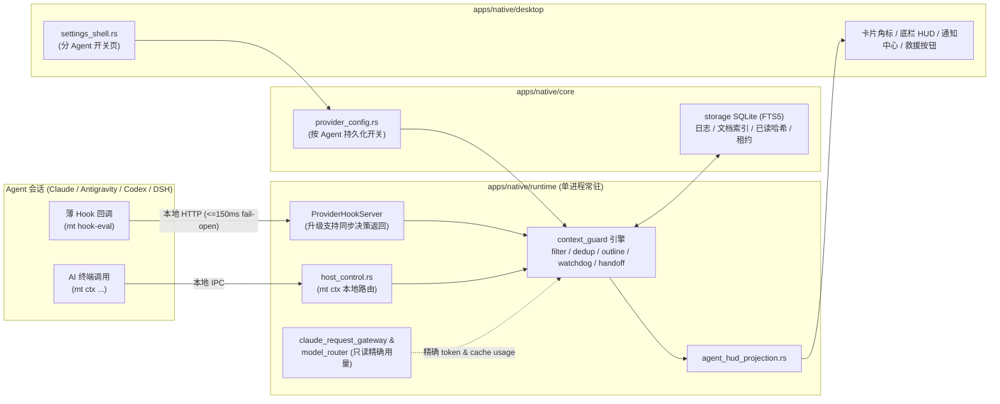

# Matou 原生版「上下文与缓存优化引擎」PRD 与技术设计

> **适用分支**：`codex/native-parity`（Rust 原生版，[matou-native-parity](file:///Users/icesword/Documents/AIProjects/matou-native-parity)）  
> **架构路线**：方案 A —— Matou 内置统一引擎 + 极薄 Hook + `mt ctx` 本地 CLI（**彻底零 MCP、零额外常驻进程**）

---

## 1. 产品目标与核心原则

### 1.1 要解决的用户痛点
在 Matou 里同时推进多个编码智能体时，用户最常遇到四类损耗：
1. **日志和大文件撑爆上下文**：跑一次测试或构建吐出几千行噪音，或者 AI 反复重读同一个未修改的大文件，几轮就把上下文额度打满。
2. **KV-Cache 莫名失效、等待变长**：后台切出去看别的窗口几分钟，缓存过期后回来触发几十万 Token 的冷重算，又慢又费额度。
3. **后台会话卡死不自知，崩了还得从头讲**：多卡片并行时，某张后台卡片转圈卡死或上下文爆仓，用户切回去才发现白等半小时，开新会话又得手动重新交代背景。
4. **外挂插件太重、各 Agent 不统一**：每个 Agent 单独装第三方插件/MCP，既多起一堆后台进程、吃掉起步 Token，又把用户本机配置改得一团乱。

### 1.2 四条设计铁律
1. **彻底零 MCP**：不注册任何 MCP Server，不向对话塞额外工具定义，不占用起步 Token，不修改用户的全局 Agent 配置。
2. **零额外常驻进程**：所有核心逻辑、SQLite 存储、看门狗全部收口在 Matou 原生 `apps/native/runtime` 单一服务里；Hook 与 CLI 直接复用原生编译出的 Rust `mt` 二进制，响应控制在毫秒级。
3. **全 Agent 平等可开关**：Claude Code、Antigravity、Codex、DSH 以及后续新接入的 Agent，在设置页拥有**同一套统一开关**，由用户自由决定对哪个 Agent 开启或关闭；关闭即彻底零注入、零残留。
4. **零缓存前缀污染**：所有水位告警、死循环提醒、缓存倒计时只通过 Matou 原生 UI（HUD、卡片角标、通知中心）呈现，**绝不往发给大模型的提示词里插动态文本**。

---

## 2. 四类 Agent 能力矩阵与接入边界

基于 `codex/native-parity` 现有底座（[provider_hook.rs](file:///Users/icesword/Documents/AIProjects/matou-native-parity/apps/native/runtime/src/provider_hook.rs)、[agent_hud_projection.rs](file:///Users/icesword/Documents/AIProjects/matou-native-parity/apps/native/runtime/src/agent_hud_projection.rs)、[mt_cli.rs](file:///Users/icesword/Documents/AIProjects/matou-native-parity/apps/native/runtime/src/mt_cli.rs)），四类 Agent 的平等开关与真实能力边界如下：

| 优化模块 | Claude Code | Antigravity | Codex | DSH | 备注 / 降级说明 |
| :--- | :---: | :---: | :---: | :---: | :--- |
| **上下文水位 & KV-Cache 倒计时** | 支持 | 支持 | 支持 | 支持 | 走 `claude_request_gateway` / `model_router` 的优先取网关真实 usage，其余回退读各 Agent 会话日志 |
| **卡死检测 & 一键交接续聊** | 支持 | 支持 | 支持 | 支持 | 统一基于 `ProviderHookServer` 事件流 + 会话文件活跃度 + 系统休眠保护 |
| **终端噪音剪裁 & 敏感脱敏** | 支持 | 支持 | 支持 | 仅观测* | 前三者均已接入 `PreToolUse` / `PostToolUse` 命令 Hook；DSH 当前为观测桥接（`observation.yml`），若底层不支持同步阻断则自动标灰提示 |
| **防重复读 & 大文件分级保护** | 支持 | 支持 | 支持 | 仅观测* | 同上；拦截后**二次重试自动放行**，避免误卡死用户正常排障 |
| **内置提速工具 (`mt ctx`)** | 支持 | 支持 | 支持 | 支持 | 全部 4 类 Agent 均已支持会话级托管指令注入（`compose_managed_instructions`）及终端执行 |
| **可选 KV-Cache 临过期保活** | 支持（默认关） | 支持（默认关） | 支持（默认关） | 视会话续发能力 | 严格默认关闭；每轮上限由用户配置（默认 1 次），收到用户新消息重置 |

> [!NOTE]
> 对于暂不支持“同步 Hook 阻断/改写”的 Agent（如当前观测模式下的 DSH），设置页仍保留同一套开关位置，但对应子项置灰并显示明确提示：“该 Agent 当前仅支持观测，暂不支持自动拦截”，绝不静默失效。

---

## 3. 产品功能与交互规格

### 3.1 设置页：按 Agent 独立配置
在 [settings_shell.rs](file:///Users/icesword/Documents/AIProjects/matou-native-parity/apps/native/desktop/src/settings_shell.rs) 中新增 **「上下文与缓存优化」** 面板（与现有 [compaction_settings.rs](file:///Users/icesword/Documents/AIProjects/matou-native-parity/apps/native/desktop/src/compaction_settings.rs)、[provider_settings.rs](file:///Users/icesword/Documents/AIProjects/matou-native-parity/apps/native/desktop/src/provider_settings.rs) 风格一致）：

- **顶部 Agent 切换条**：`Claude Code` · `Antigravity` · `Codex` · `DSH`（未来接入新 Agent 自动出现）。
- **总开关**：「为该 Agent 启用上下文与缓存优化」（新安装默认关闭，或仅默认开启纯观测项，待产品拍板）。
- **5 个独立子开关（总开关开启后生效）**：
  1. **终端噪音剪裁与密钥脱敏**
     - 超过阈值（默认 16 KB）的构建/测试/安装输出自动压缩为“错误行 + 摘要”，完整日志存本地并给出检索 ID。
     - 自动遮蔽常见 API Key / Bearer Token；可选勾选“拦截直接读取 `.env` 等敏感文件”。
  2. **防重复读与大文件分级保护**
     - 对同一会话内**未发生变更且大于 4 KB** 的文件重复读取进行提示拦截；若文件仅有小幅修改，优先返回 diff。
     - 按文件类型设分级上限：普通代码 45 KB / 800 行，高噪音日志/锁文件 16 KB，`.patch`/`.diff` 128 KB。
     - **防误伤规则**：同一路径 120 秒内第二次尝试读取自动放行。
  3. **KV-Cache 监控与可选保活**
     - 在卡片与 HUD 显示缓存剩余有效时间；可选“过期前 1 分钟桌面提醒”（默认关闭）。
     - **自动保活开关（默认关闭）**：仅针对主会话（绝不给子 Agent 或已结束会话发保活），默认每轮最多保活 1 次，用户发送新消息后重置计数。
  4. **卡死检测与一键救援**
     - 监控后台运行中会话的静默时长（区分正常长构建、慢模型思考与真正零输出卡死，且带电脑合盖休眠漂移保护）。
     - 触发告警时，自动在本地预生成脱敏后的「交接摘要」。
  5. **内置提速工具 (`mt ctx`)**
     - 开启后，仅在当前会话的托管提示词里追加 4~5 行极短路由说明，引导 AI 使用 `mt ctx` 命令看大文件大纲、查被截断日志、批量搜索和压缩后恢复进度。

### 3.2 工作台反馈（原生融合，不做额外 Sidecar 面板）
- **会话卡片 & 底栏 HUD**（扩展 [agent_hud_projection.rs](file:///Users/icesword/Documents/AIProjects/matou-native-parity/apps/native/runtime/src/agent_hud_projection.rs)）：
  - 展示：**上下文占用（如 `72k / 200k`）**、**缓存倒计时（如 `缓存剩余 3m 40s` / `已冷`）**、**本会话累计拦截噪音（如 `已省 148 KB`）**。
  - 悬停或展开详情浮层可查看：命中率估算、被拦截的完整日志列表（支持一键复制检索 ID 或直接打开原文）、当前看门狗阶段。
- **分级通知中心**：
  - 上下文达到预警线（如 75% / 85%）→ 温和提醒，每次 `/compact` 后重置。
  - 会话判定为卡死（红色）→ 强提醒，标明工作空间与卡片标题；点击通知直接定位并聚焦到该会话卡片。
- **一键救援与交接续聊**：
  - 卡死卡片或高水位卡片右上角/提示条出现 **「带摘要开新会话」** 和 **「复制交接摘要」**。
  - 点击「带摘要开新会话」直接联动 Matou 现有的会话创建/Fork 流程，在新卡片里自动注入交接上下文（修改文件清单、最近命令及通过/失败结果、当前卡住的步骤、相关本地日志 ID），无需手动整理。

---

## 4. 技术架构设计（基于 `codex/native-parity`）

### 4.1 整体链路

### 4.2 关键架构改造点

#### ① `ProviderHookServer` 从“纯观测”升级为“观测 + 同步决策”
- 现状：[provider_hook.rs](file:///Users/icesword/Documents/AIProjects/matou-native-parity/apps/native/runtime/src/provider_hook.rs) 目前接收各 Agent Hook 上报后只更新内部状态与 HUD，直接返回空成功。
- 改造：
  - 当该会话对应 Agent 的拦截子开关开启时，`PreToolUse` / `PostToolUse` 回调进入 `context_guard::evaluate_hook(...)`，按各 Agent 的原生 Hook 协议返回放行、改写或阻断提示（例如把超长 `Bash`/`run_command` 包装为流式过滤器，或对重复读大文件返回精准提醒）。
  - **严格 Fail-Open 红线**：单次 Hook 决策设置 **150ms 硬超时**；任何超时、解析失败、数据库锁竞争或开关关闭时，立刻返回放行 `{}`，绝不阻塞或弄崩 Agent。

#### ② `apps/native/runtime/src/context_guard/` 核心模块拆分
1. **`config.rs` & `core/src/provider_config.rs`**：
   - 新增 `ContextOptimizerConfig`，以 `HudProvider`（`claude-code` / `antigravity` / `codex` / `dsh`）为 key 持久化每个 Agent 的总开关、5 个子开关及参数（阈值、敏感路径白名单、保活上限）。
2. **`filter.rs`（噪音剪裁与脱敏）**：
   - 针对高频命令（`cargo test`、`pnpm test`、`git diff`、`npm/pnpm install`、`docker`、`kubectl`、`playwright` 等）内置确定性剪裁规则，保留失败栈、汇总行和上下文行。
   - 超大 JSON 输出自动提取结构骨架、错误条目和样本行。
   - 统一脱敏管线（API Key、JWT、私钥片段），写库前与返回前均做脱敏。
3. **`dedup.rs`（防重复读与分级限流）**：
   - 按 `(session_id, canonical_path, line_range)` 记录已读文件 SHA-256 与精简快照（上限 256 KB）。
   - 文件未改且 >4 KB → 首次拦截提示复用；文件小改（diff 占比 <40% 且 <6.5 KB）→ 直接返回 diff；`/compact` 后自动清空该会话的去重表，确保压缩后可立即重读。
4. **`store.rs`（本地 SQLite + FTS5）**：
   - 复用 `apps/native/core/src/storage/` 数据目录，新建独立库 `context_guard.sqlite`（避免锁竞争影响主状态库）。
   - 存储：被截断的完整命令输出（按 session TTL 自动清理，默认保留 7 天）、本地索引的长文档/日志切片（FTS5 全文检索）、看门狗租约与交接快照。
5. **`outline.rs`（零外部依赖大文件大纲）**：
   - 原生 Rust 实现轻量签名扫描，支持 Rust / TypeScript / JavaScript / Python / Go / Markdown / `.patch` 等主流格式，提取行号 + 顶层结构/函数签名，响应强制压在 **8.8 KB** 以内。
6. **`watchdog.rs` & `handoff.rs`（缓存监控、看门狗与交接摘要）**：
   - **双源融合**：优先读取 `claude_request_gateway` / `model_router` 的实时 usage，无网关流量时回退读取各 Agent 的本地会话日志，实测校准当前模型的 KV-Cache TTL。
   - **休眠防误报**：检测系统单调时钟与墙钟跳变（合盖休眠），唤醒后自动宽限静默计时，杜绝假红色告警。
   - **交接摘要**：自动汇总本会话 `file.changed` 列表、最近一次构建/测试退出码与关键报错、当前停滞的工具步骤及本地日志 ID，供“一键续聊”和 `/compact` 后恢复使用。

#### ③ 扩展现有 `mt` CLI：`mt ctx` 子命令规格（彻底零 MCP）
直接挂在 [mt_cli.rs](file:///Users/icesword/Documents/AIProjects/matou-native-parity/apps/native/runtime/src/mt_cli.rs) 下，通过现有 [host_control.rs](file:///Users/icesword/Documents/AIProjects/matou-native-parity/apps/native/runtime/src/host_control.rs) 本地通道与 `context_guard` 通信，**所有命令输出硬顶 8.8 KB**：

| 命令 | 用途 | 典型调用 |
| :--- | :--- | :--- |
| `mt ctx outline <path>` | 输出大文件结构大纲与行号范围 | `mt ctx outline apps/native/runtime/src/host.rs` |
| `mt ctx search <query> [--source <id>]` | 在本地 SQLite FTS5 检索被剪裁的完整日志或已索引文档 | `mt ctx search "assertion failed" --source log_04` |
| `mt ctx batch-search <q1> <q2> ...` | 单次并行检索多个符号/关键词，合并去重返回 | `mt ctx batch-search "ProviderHookServer" "HudProvider"` |
| `mt ctx index <path>` | 将超大文档/日志切片入本地库，仅返回目录与 source ID | `mt ctx index /tmp/build.log` |
| `mt ctx resume` | `/compact` 后一键拉取当前会话已改文件、最近校验状态与进度线索 | `mt ctx resume` |

---

## 5. 安全、性能与稳定性红线

1. **绝不卡死主流程**：Hook 同步评估硬超时 150ms，失败即放行；SQLite 写入异步化或使用 WAL 模式独立建库，不影响终端渲染与 PTY 吞吐。
2. **绝不污染用户环境**：Hook 和 `mt ctx` 指令全部通过 Matou 现有的会话级临时目录/启动参数注入（复用 `provider_hook.rs` 的 `TempDir` 生命周期），关闭开关或退出会话即自动失效，不修改 `~/.claude/settings.json` 等用户全局文件。
3. **不乱烧用户额度**：KV-Cache 自动保活严格默认关闭；开启后仅作用于用户活跃主会话、带单轮次数上限（默认 1 次），绝不对子 Agent、已取消或后台闲置太久的会话发请求。
4. **品牌与命名卫生**：全仓库源码、配置键、文档和日志统一使用 Matou 自有命名（`context_guard`、`mt ctx`），提交前必须通过 `pnpm check:identifiers` 门禁。

---

## 6. 三期落地路线图与验收标准

### 第一期：统一开关框架 + 缓存/水位监控 + 卡死看门狗与一键救援
- **范围**：
  - `provider_config.rs` + `settings_shell.rs` 按 4 类 Agent 的开关配置与持久化。
  - `context_guard::watchdog` & `handoff` + `agent_hud_projection.rs` 扩展。
  - 卡片/HUD 显示上下文水位与 KV-Cache 倒计时；通知中心接入高水位与卡死告警；卡片增加「带摘要开新会话 / 复制交接摘要」。
- **验收标准**：
  - 切换任意 Agent 总开关/子开关后持久化正确，重启 Matou 保持一致；关闭后对应会话零 HUD 噪音项、零告警。
  - 模拟会话静默卡死能准确出通知并点通知跳回卡片；模拟电脑休眠唤醒不误报。
  - 点击「带摘要开新会话」能拉起新卡片并完整带入已改文件与最后一步状态。

### 第二期：薄 Hook 拦截 + 终端噪音剪裁 + 防重复读与安全脱敏
- **范围**：
  - `ProviderHookServer` 升级支持同步决策返回（150ms fail-open）。
  - Claude Code / Antigravity / Codex 接入噪音剪裁、密钥脱敏、`.env` 保护、已读文件去重与 diff 返回；DSH 在 UI 上清晰标注观测边界。
  - `context_guard.sqlite`（FTS5）落库完整日志并支持在 HUD 浮层查看原文。
- **验收标准**：
  - 运行输出 >50 KB 的测试命令时，回传给 Agent 的体积被压缩至 ≤8.8 KB 且保留全部报错行；完整原文可在本地库查回。
  - 重复读取 >4 KB 未修改文件首次被拦截提示，120 秒内二次重试自动放行；`/compact` 后立即重读不拦截。
  - Hook 进程异常或超时 150ms 时自动放行，Agent 正常执行不中断；关闭该 Agent 开关后完全不拦截。

### 第三期：`mt ctx` 提速工具组 + 可选 KV-Cache 保活
- **范围**：
  - `mt_cli.rs` 实现 `mt ctx outline / search / batch-search / index / resume` 及托管提示词按需注入。
  - 接入可选的 KV-Cache 临过期提醒与单轮限次保活开关。
- **验收标准**：
  - 4 类 Agent 在开启「内置提速工具」后均能通过终端直接调用 `mt ctx` 并获得 ≤8.8 KB 的结构化返回；关闭后会话提示词里不注入任何 `mt ctx` 说明。
  - 保活默认关闭；手动开启后仅在主会话临过期前触发 1 次，用户发新消息后重置，绝不对子 Agent 或已结束会话触发。

---

## 7. 进入实现前，需要你拍板的 3 个小决定

1. **新用户的默认开关状态**：新版本升级后，建议默认“只开纯观测（HUD 水位/缓存倒计时 + 卡死救援），拦截类和 `mt ctx` 默认关闭由用户自选”，还是“全部默认关闭，由用户按 Agent 手动打开”？
2. **文档落盘位置**：这份 PRD 确认后，是否需要同步存进原生分支仓库的 `docs/prd/` 目录（比如 `docs/prd/PRD-Matou-上下文与缓存优化引擎.md`）？
3. **开工顺序**：确认后是直接按 **第一期** 在 `codex/native-parity`（或从它切一个新功能 worktree）开干，还是想先把某一块的细节再调一下？
